# 矿场自动化游戏 —— 需求与工程约束（工作稿）

> **本文档不预设游戏内容。** 资源、结构、需求的具体形式、配方、建筑、剧情、数值全部由设计者
> 提供，本文档只记录：① 已明确的需求；② 由这些需求推导出的工程约束；③ 需要设计者补充的内容清单。
> 模块与可执行文件用 `mine` 作临时名（来自"矿场"），最终命名随游戏定名一起改。

---

## 1. 已确认的需求（设计者原话，权威）

1. 游戏类型：**沙盒 / 工业自动化**。
2. 视角：**平面 2D**，不是横版。
3. 游戏内部存在一个**矿场**。
4. 矿场**有多层**。
5. **每层会生成不同的资源和结构**。
6. **每层会有一个或多个需求**。
7. 需求需要**通过特定方式提交原料或产物**。
8. 需求完成后**进入下一层**。
9. 存在两种模式：
   * **故事模式**：预先设定好的流程。
   * **无尽模式**：程序生成内容。
10. **贴图采用多边形风格**。
11. **没有玩家角色，所有玩家使用上帝视角操作游戏**。

12. **地块**：地图中**占据格子的固定物体**，包括地板、矿物、机器等。为保证之后的玩法，需要支持
    **2×2、3×3、2×3** 之类的大型结构地块。
13. **为了性能，地块分为两类**：
    * **场景地块**（场景、矿物、地板等）：**仅在需要时更新**；
    * **实体地块**（功能地块，例如机器）：**每 tick 或每 xx 秒更新**。

14. **实体地块继承场景地块**；**地块基类带一个布尔属性 `random_reverse`**，为真时在**地图初始化**时
    随机设定自身渲染：有 **50%** 的概率将自己**左右翻转渲染**。

15. **`random_reverse` 由内容作者定义**（写进内容数据），**`mirrored` 无需进入存档**；
    引擎会读的字段因此有两个：`image` 与 `random_reverse`。
16. **新增 `Floor` 类继承 `SceneTile`**，只多一个**地板标记**（告诉其他东西"我是地板"），
    并要有**对应的 `.ecfg` 定义器**（`floor::` 表）。
17. **第一份本体内容：泥地**（`floor:: dirt::`），贴图 `floor_dirt.png`。

18. **美术资源**：泥地的 `random_reverse` 为 **true**；**每个内容一个图片，不使用大图集**；
    命名不限，**官方内容包使用蛇形命名**；尺寸按需要**每 1 格 128 或 256 像素**，可以为其它值。
    （这就是 §7.13 的答案。）

19. **单矿物与散点生成器**（原话）："添加一个 single_ore（单矿物）类继承场景地块，层创建器添加
    散点生成器，以散点形式在指定 tile 层放置指定物体，包含最小生成数量，最大生成数量，平均密度，
    地板限制等属性。"

20. **左上角显示当前层数**（原话）："正式游戏中需要在左上角显示当前层数，格式为层1/层2"。

21. **故事模式第一层的内容**（原话）："设置故事模式第一层地图100*100,生成矿物石头，20-35个，贴图为给出图片"。
    本体内容因此有了**第一层**（`content/layers.ecfg`：100×100、地板是本体自己的泥地、散点撒石头 20–35 块）
    与**第一块矿物**（`content/ores.ecfg`：`ore:: stone::`，贴图 `content/art/ore_stone.png`）。这是设计者
    第一次给本体内容写数据，用的就是夹具与文档一直在演示的那套格式（§4、`docs/MODS.md` §0）。

22. **物品类与物品 ecfg 注册器**（原话）："添加物品类和物品ecfg注册器"。物品是**不在图上**的内容——机器
    产出、配方进出、需求点名、玩家携带的都是它——所以它有自己的一类（`mine::types::Item`）与自己的定义器
    （`item::` 表，`types/item_definition.h`）；引擎为它读的字段只有 `image`（§4、`docs/TYPES.md` §6）。

23. **第一件物品：石头**（原话）："创建物品石头 id=stone"。本体内容因此有了第一件物品
    （`content/items.ecfg`：`item:: stone::`，贴图 `content/art/item_stone.png`，64×64）。它与第一块矿物
    **同名而不冲突**：名字按**种类**发号，矿物是地图上占着格子的一格、物品是能被搬走的东西（§7.2 的第一项）。

24. **实体类与四叉树**（原话）："添加实体类，位置不与瓦片地图对齐，可以移动，交互，默认每tick更新除非
    特别声明更新间隔或不自动更新。为了保证性能，一个层运行时所有实体编入一个四叉树表便于快速检索一个位置
    一定范围内的实体"。（这一条先写成"位置不固定与瓦片地图对齐"，随即更正为"位置**不**与瓦片地图对齐"——
    按更正后的为准：位置是自由的，瓦片地图只是它旁边的参照，不是它脚下的格子。）

25. **掉落物类与定义器**（原话）："添加掉落物类和定义器，不自动更新，可以被鼠标拖动移动"。掉落物是
    **躺在地上、自己不变化、能被指针拖着走**的东西：它是实体的一种（§1.24），所以位置是自由的、进四叉树、
    能被查到；它有自己的 `drop::` 表，引擎为它读的字段是 `image`。

26. **钻头**（原话）："添加一个钻头类，类型为实体地块，可以被放置在矿物上，按照定义器设定的挖掘能力/矿物硬度
    计算时间，每段时间向外丢出一个矿物对应的掉落"。所以：钻头是**实体地块**（会跑的功能地块，§1.13），
    它站在矿**上面**（矿在它下面的瓦片层——一个格子每层只放一个地块，§1.12）；出一个掉落要多久 =
    矿的**硬度** ÷ 钻头的**挖掘能力**；时间到了就往外丢一个**那条矿对应的掉落物**（§1.25）。

27. **仓库**（原话）："添加仓库，类型为场景地块，通过定义器设定容量等参数，鼠标拖动掉落物到仓库上方即可把
    掉落物加入到仓库中，点击在地块右下角显示包含内部物品信息的ui，仓库对象中包含子对象container用于存储物品
    信息和处理存储功能并便于和其他代码交互，包含draginto子对象用于接收掉落物，包含click子对象接收点击信息"。
    拆开就是：**场景地块**（不跑、不自动更新）、定义器给**容量**、拖过来的掉落物进**容器**、点一下就在**地块
    右下角**看里面有什么；而 `container` / `draginto` / `click` 三个子对象各管一件事，并且都能被别的代码直接用。

28. **石头仓库与物品信息的显示**（原话）："我已经放置了贴图，添加一个石头仓库方块，容量100.以及我希望显示物品
    信息时包含物品的贴图，即[物品贴图][物品的本地化名称][数量]"。本体内容因此多了一个仓库
    （`content/warehouses.ecfg`：`warehouse:: stone::`，贴图 `content/art/capacity_stone_warehouse.png`——
    设计者自己放进本体包的那张，容量 **100**）；而仓库面板的每一行从此是
    **[贴图][本地化名称][数量]**：贴图是这条内容自己的那张，名称来自界面字符串表
    （`content.name.<种类>.<名字>`，其次 `content.name.<名字>`，都没有就显示注册表里的 id，`docs/TEXT.md`）。

29. **本地化名称功能**（原话）："添加本地化名称功能"。内容的名字是设计者写的 **id**（`stone`、`chunk`、
    `entrance`）——id 是存档与数据引用的东西，不是给人读的标签；界面上凡是显示一条内容的地方，现在都显示
    **本地化名称**：字符串表里有就用它，没有就用注册表里的名字（内容没了就是 `#<id>`）。查找只有一条链
    （`content.name.<种类>.<名字>` → `content.name.<名字>` → 注册表名字），实现在 `mine/content_name.h`
    的 `content_label()`，游戏里唯一的入口是 `MineApp::content_name(种类, id)`；**种类自己的词**
    （`ore`、`warehouse`…）是引擎的英文词汇，**不跟语言走**（设计者 M2.16 确认：不需要）。

30. **限制摄像头缩放为 40px-100px**（原话）："限制摄像头缩放为40px-100px"。游戏世界视图的相机因此只能把
    一格画成 **40–100 像素**：`mine/view_limits.h` 的 `kMinViewZoom = 40` / `kMaxViewZoom = 100`，
    在 `MineApp` 构造时交给相机（`set_zoom_limits`），所以**每一条**改缩放的路都受同一对数字约束——
    启动参数 `--view`、进层的自动取景、`+`/`-` 键、滚轮。40 是**还能看清并点中一格**的下限（再小一格
    只是一个点，指针挑不出来），100 是**一格占满屏幕**的上限；沙盒的相机是调试工具，仍保留自己的
    0.05–512（`docs/SANDBOX.md` §7）。这两个数是**常量**，不是内容数据：设计者 M2.16 确认不需要每层
    不同的范围。

31. **双击选中，上方居中显示物品信息**（原话）："使得包含container子对象的地块可以被鼠标双击选中，选中后会
    在游戏界面最上方居中显示物品信息"。拆开就是两条：**能被选中的是任何带 `container` 子对象的地块**——
    不是"仓库"一种，所以 `SceneTile` 多了一个问法 `container()`（默认 nullptr，仓库覆盖它，将来的机器输入侧也
    一样）；**双击**是选中的动作，落在有容器的地块上就选中它，落在别处（地板、矿、空地）就清掉选中。选中的
    地块把容器内容显示在**游戏界面最上方居中**：标题是它自己的本地化名字与"已用 / 容量"，下面每行
    **[贴图][名字][数量]**——与右下角面板同一份内容、同一个排版函数，只有位置不同。**一个指针一次只显示
    一处**：双击的第一次按下仍然是单击（右下角面板，§1.27），第二次按下选中、并把右下角的面板关掉；之后
    任何一次单击都把显示让回给右下角面板。双击的窗口是 0.4 秒（`mine/double_click.h` 的常量，不是内容）。
    设计者 M2.17 的三条补充：**"沙盒除了试玩部分需要该功能其他不需要"**——所以沙盒的**试玩**（按 `P` 进入的
    那个视图）也能双击选中，编辑状态不选；**"只需要装了什么就可以"**——面板只说容器里有什么，不说它是从
    哪来的（§7.10 的数据）；**"添加方框高亮提示"**——被选中的地块在**地图上**也标出来：占地大小的方框 +
    里面一层浅色（一格就是一格）。试玩里能被选中的是**能放在格子上的**内容，仓库现在是其中之一。
32. **`.ecfg` 的 `__include`**（原话）："为ecfg添加__include: #file 功能，加载时可以加载其他ecfg文件的内容
    放入include所在的位置解析"。所以：**一行 `__include: #<路径>` 被那个文件的内容替换掉，然后才解析**——
    不是"读进来当字符串"，也不是"另开一个文档"，而是**这一行的位置上就是那些行**。路径相对**写它的那个
    文件**（与内容文件引用美术资源同一条规则，`docs/MODS.md` §0）。被包含的文件顶格写，落进来时缩进到
    `__include` 那一行的缩进——所以一份片段能放进任何位置：顶层、`item::` 表里、表的表里。`<< ... >>`
    文本块的内容**原样**搬过去（那是值，缩进它会改掉值）。读不到、成环（a 引 b、b 引 a）、嵌套超过 16 层、
    `#` 后面没写路径，四种都是错误，而且错误信息里带着是**哪个文件的哪一行**要的它。片段要**带 `_` 前缀**
    （`_parts.ecfg`、`_ores/`）：内容包扫描时，名字以 `_` 开头的文件或目录**不是内容文件**——片段被自己读
    一遍、又被 include 一遍，同一份内容就会注册两次。片段还可以**自己声明**：`__not_main` 取三个值之一——
    `"skip"`（直接加载时**跳过**，不报错，重载也照样跳过）、`"true"`（直接加载时**报错**，只允许被 include）、
    `"false"`（与不写一样），两个布尔字面量 `true`/`false` 等价；别的值一律是错误，不会被猜成 `false`。引擎自带
    的三条加载路径（内容包扫描、模组宿主、沙盒重载）都按它跳过或拒绝，`EcfgDocument::main()` 让别的调用方也
    能问出文件自己说了什么。这个字段**属于文件**：被 include 时它不跟着内容走，所以包住它的主文件照常能加载
    （设计者 M2.18 的第三条："防止错误加载或重加载"）。
33. **层定义器的 `place_block`**（原话）："在层定义器中添加place_block字段，可以在指定位置放置具有指定属性的方块，格式为
    place_block:: / placement1:: / x:111... subobject:: / container:: / items:["aaa",100,"bbb",100]"（原文有换行与缩进）。
    于是：**一层可以在它自己说的位置上放一块指定的东西，并且一开始就装着指定的物品**。一条放置说四件事——**是什么**
    （`kind:"warehouse"` + `content:"stone"`，与 `scatter` 同一对字段）、**在哪个瓦片层**（`layer`，默认 0）、**在哪一格**
    （`x` 与 `y`，两个都要写：一格有两个坐标）、**装着什么**（`subobject:: container:: items:[名字,数量, …]`，名字是**物品**的
    名字、数量是正整数，写几个槽就是几个）。它在**地板之后、散点之前**落下——固定位置正是它的意义，而占住那一格之后
    散点就不会落在上面（与"一个格子一个瓦片层只放一个东西"同一条规则）。**"指定属性"今天只有容器一种子对象**
    （`subobject::` 是引擎的词，将来的机器输入侧、需求提交箱是同一层里的别的子对象）：别的名字直接报错，不会被忽略；
    读不到、装了注册表里没有的物品、容器装不下、格子在地图外，都会在**构建报告**里说清楚是哪一块、在哪一格。
34. **`building` 子对象与建造接口**（原话）："创建building子对象，包含对应地块的所需材料，建造时间，建筑分类（存储，
    加工，开采等，后续需要），提供建造相关的接口，包含can_place等方法在放置前判断对应的位置是否符合放着的条件，
    例如钻头必须放置在矿物上等"。于是：内容条目下可以写 `building:: materials:["stone",10,"chunk",2] time:5
    category:"extraction"`（材料是"名字, 数量"成对数组，与 `items` 同一套写法；时间是秒；分类今天有 storage /
    processing / extraction 三个，别的名字**报错**，将来要加新的就加名字）。地块通过 `SceneTile::building()`
    回答自己是不是建筑、要什么、多久、干什么用。**放置前的判断是 `MineLayer::can_place(placed, &why)`**：位置在
    不在图上、瓦片层有没有、那一格是不是空的、以及内容自己的条件——**钻头必须站在矿上**（同一格更低瓦片层里有
    矿），层构建时对钻头强制这一条，不合就进构建报告。
35. **定义属性与存档属性（享元）**（原话）："我们需要让地块和子对象的属性分为定义属性(例如1个仓库容量是100这一类
    固定属性)和存档属性（例如一个仓库里面有什么）并让他们区分起来，其中定义属性不可以在层设置中覆盖，地图上的所有
    同种地块读取同一份定义属性，参考享元设计"。于是：**一份内容条目 = 一份定义**（`TileDefinition`：容量、掉头、
    图片、挖掘力、硬度、掉落、`building`），它由 `ContentDefinitions` 持有、**活过所有从它建出来的层**；**一个地块
    实例 = 只存自己的状态**（容器里有什么、钻头挖到哪、脏不脏、朝向是哪次骰子给的）。地块通过 `SceneTile::definition()`
    拿到那一份共享记录，固定属性**都从它读**——所以一万块地板是一万个小对象加**一份**定义，不是一万份拷贝。
    **层设置只能写存档属性**：`place_block` 的 `subobject:: container::` 只认 `items`，写 `capacity:` 直接报错，
    定义属性改不动。

以上三十五条是当前唯一的内容性输入。除此之外的一切内容均由设计者后续提供（见 §7）。

---

## 2. 由已确认需求推导出的工程约束

这些是**技术结论**，不涉及具体内容：

* **"层"是一等概念**：层要有独立的地图实例、独立的资源/结构/需求集合，以及"层间推进"的
  状态机（当前层 → 需求全部完成 → 解锁下一层）。
* **"需求"是一等概念**：需求 = 目标（原料或产物）+ 数量 + 提交方式；完成判定必须在服务端权威
  执行，并且状态可被客户端观测（HUD / 终端面板）。
* **内容必须数据驱动**：既然内容由设计者定义，代码里**不能**出现资源枚举、结构枚举、配方表或
  建筑清单。层、资源、结构、需求、配方、建筑都以数据描述，代码只提供加载与执行。
* **内容（定义与逻辑）要能从外部加载**：本体只做核心逻辑，内容以**模组包**形式提供——一个目录、一份
  清单、若干内容文件，外加可选的 **C++ 模块**（共享库 + 版本化的 C ABI）。一个模组坏了只影响它自己：
  报告、跳过、游戏继续跑。见 `docs/MODS.md`。
* **内容必须可观察**：内容由设计者写、且会反复修改，"改一个文件立刻看到结果"必须是工具的一部分，
  而不是每次重启游戏。为此提供**单层沙盒**调试模式（`docs/SANDBOX.md`）：只渲染一层、没有需求与
  推进，面板列出数据注册出的内容与 id，改完文件按 F5 重载，已放置的格子按**名字**重新定位。
* **程序生成**：无尽模式的层内容必须由 `(seed, 层号)` 唯一决定，同种子完全可复现
  （可复现是联机与问题复现的前提）。
* **多边形是美术风格，资源仍是图片**（§1.10）：贴图是"多边形风格"的**图片**（低多边形、平色块、
  硬边），引擎**照常使用图片资源**——位图文件随内容包提供，引擎加载成纹理后按格子绘制。
  引擎**不做矢量多边形渲染**：多边形感来自美术，不来自几何；现有的 `SpriteBatch`（带贴图的四边形）
  就是画它的方式。
  由此定下的工程约束：内容包要能带**图片文件**，内容条目用相对路径引用（`image:"art/wall.png"`），
  引擎负责解析路径、校验文件存在、加载纹理（Ore 已有 PNG 解码：`ore::Image::load_png`）。
  `[已实现]` 加载时解析并校验 `image` 字段（存在性 + PNG），沙盒已经用**真实贴图**画格子与面板色块
  （截图见 `docs/MODS.md`）。**一份内容一张纹理、不进图集**（§1.18）：每份带图的内容单独一张纹理，
  按原样上传，绘制时按内容分组（一个批次绑定一张纹理）。世界渲染在 M2 里走同一条路。
* **没有玩家角色**（§1.11）：不存在"角色"这个实体——没有角色贴图、没有角色碰撞体、没有角色移动。
  输入是**相机与指针**：平移/缩放视角、指向格子、选择并下达动作。多人时每个玩家各有一份视角，
  作用在**同一张图**上（是否协作/竞争仍未定，见下条）。这也意味着"出生点"这类字段不属于握手与地图数据，
  而"玩家位置"不需要进快照——**要同步的是世界状态与各自的视角**。
* **地图是“上百格见方”的量级，相机与指针是唯一输入**（§1.11）：玩法要在几百×几百格的图上跑，
  所以存储、查询与绘制都**不能随地图面积线性变慢**：
  * 存储：框架的 `TileMap` 分块（32×32）惰性分配；游戏自己的地图格 `mine::ContentGrid` **每格 4 字节**
    （内容 id + kind + “内容已消失”标志打包进 32 位），**按层惰性分配**，已放置计数是计数器而不是遍历——
    512×512 一层 1 MiB，1024×1024×8 层全写满 32 MiB。`[已实现]`
  * 查询/绘制：`t2d::Camera2D::visible_cells()` 给出视口覆盖的格子范围，渲染只走这一段；
    缩放很小时按“每 N 格一个四边形”采样绘制（见 `docs/SANDBOX.md` §7）。`[已实现]`
  * 相机：平移、以指针为锚点缩放、复位、边界限制（`clamp_to`：视图停在图边，图小于视口时居中）。`[已实现]`
  * 指针坐标：**平台层就把指针换算成帧缓冲像素**（`ore::PixelScale`：帧缓冲尺寸 / 窗口内容尺寸，
    逐轴），命中测试、绘制与相机锚点因此是同一套坐标；缩放显示器（1.6667 倍的 GNOME/Wayland 会话）
    上不做这一步，指针会整体偏向左上、永远到不了界面右下角。`[已实现]`
  * 每帧动态数据（顶点）从 upload ring 的一段里分配，**段满则整批丢弃**，所以一屏四边形多的界面
    必须把 `AppConfig::upload_segment_size` 调大（mine 用 4 MiB）。`[已实现]`
* **世界是地块的集合，格子是它的索引**（§1.12、§1.13）：一层矿场 = 一张地图格 + 一堆地块 + 一副骰子，
  三者都由 `mine/world.h` 的 `MineLayer` 持有，`MineWorld` 持有"哪一层正在被玩"。**地块与地图格都要有，
  因为它们回答的问题不同**：地图格（`ContentGrid`，每格 4 字节）回答"这一格是哪条内容"——存档、路由查询、
  剔除都走它；地块回答"这是什么东西"——占地（3×3 是一个地块而不是九个格）、节奏、朝向。**只有被进入的那一层在
  内存里**（层数可以很多），而生成器只看得到 `(seed, 层号)`，所以再进来一次拿回的是同一个矿场。
  * **查询与绘制不随地图面积变慢**：地块按 32×32 的块建索引（与框架 `TileMap` 同一套分块），
    一个 3×3 会登记进它碰到的每个块，**一次查询里每个地块只被访问一次**（戳记去重）；绘制、放置检查、
    指针命中的成本因此是"屏幕上有什么"。
  * **代价写在明处**：地块是 C++ 对象（约 56 字节），地图格是 4 字节。**一层里每一格都是一个地块的图，
    存储是打包格子的十倍以上**——设计者的层规则（§7.3、§7.4）决定一层有多少地块，这条数字是给那时候用的。
  * **两条推进路径**（§1.13）：`refresh()` 走过全部地块、只为脏的付钱；`tick(dt)` 只走"会跑的"那些
    （层在创建地块时就分好了列表，不在运行时判类型）。两条路径每帧各一次，做了什么由世界视图的 HUD 报出来。
  * **世界还有第二半：实体**（§1.24）：地块是"占着格子的固定物"，**实体**是"不在格子上、会动的东西"。
    它有一个**位置**（浮点，**不与瓦片地图对齐**——3.5、2.25 就是一个位置，没有任何东西会把它对齐到格子上），
    能**移动**、能**交互**，并且**默认每 tick 被更新**：声明一个更新间隔就按间隔跑，声明"不自动更新"就一次
    也不跑（那就由别的东西驱动它）。两者回答的问题不同，所以**实体不继承地块**：地块回答"哪一格是什么"
    （格子 + 占地 + 朝向），实体回答"什么东西在哪一点"（位置 + 移动）。一层里**所有实体编入一张四叉树**
    （`mine/quadtree.h`），所以"这个位置一定范围内有哪些实体"是**答案的代价**，不是"这一层有多少东西"的
    代价——实测（release，10000 个实体铺在 1000×1000 的层里）一次半径 20 的查询走 21 个节点、只测
    **31 个条目**，而线性遍历要测 10000 个。
  * **生成器接口固定为 `(seed, 层号) -> LayerSpec`**：`LayerSpec` = 地图形状 + 要放的内容（kind、名字、
    瓦片层、锚点、占地）。故事模式回设计者的数据，无尽模式由种子推出来，**两者产出同一种结构**，
    下游（渲染、需求、推进）不需要区分模式。**故事模式的层规则已经是数据**（`layer::` 的
  `size::` 与 `floor::`，见 §4 与 `docs/MODS.md` §0），所以故事模式放的正是设计者写的东西；
  **还没有规则的地方**（无尽模式、以及故事里"每层有哪些资源/结构"）生成器什么都不放：
  空层也是层——能进、能走、能查、能画。`[已实现]`
* **内容逻辑有它自己的命名空间**（§1.12、§1.13）：定义是数据（`.ecfg` 表 + 注册表），**逻辑是 C++**，
  住在 `mine::types`（`docs/TYPES.md`）。这个命名空间是两半之间的契约：数据说"有什么"，类型说
  "它怎么运转"。**里面不出现任何内容名字**——没有资源、结构、机器、配方被写进代码。
  由此定下的工程约束：
  * **地块（`types/tile.h`）是"占据格子的固定物体"的基类**：地板、矿物、机器都是它。它带
    **kind + id**（与地图格、存档同一套身份：名字永远来自注册表，地块不存名字），
    **占地矩形**（左上角为锚点；`covers`/`cell_count`/`within`/`overlaps`），以及"内容是否还在"
    （内容消失时保留 id 与位置，回来时按名字修好）。**2×2、3×3、2×3 不是特例，而是同一个矩形**，
    所以"一个结构跨格怎么办"在类型层不是分支。
  * **地块分两类，而且是一棵继承树**（§1.14）：`Tile` → `SceneTile` → `EntityTile`。场景地块
    **没有每帧路径**（脏标记 + `refresh()`，调用方只为"改过的东西"付钱）；**实体地块是场景地块**
    （世界变化时同样按需刷新）**再加自己的节奏**（`period_seconds()`：0 = 每 tick；`advance(dt)` 到点才运行）。
    因为实体地块**是**场景地块，"要不要 tick"不能靠运行时判类型：**层在创建时就把要 tick 的地块放进
    自己的列表**，刷新那一遍走过全部地块、只为脏的付钱，tick 那一遍只走机器。这就是省下来的东西。
  * **渲染朝向是地块的属性**（§1.14）：基类带 `random_reverse`（内容数据说"这块内容可以掉头"）与
    `mirrored()`（结果）。**只在地图初始化时掷一次**，用**层自己的 `t2d::Rng`**（种子来自世界 seed）
    决定 50% 左右翻转，之后渲染每帧只读结果；**开关为假的地块不消耗随机数**（改一块内容不会把后面
    地块的骰子整体挪位）；**它只关于渲染**——地块做什么从不被镜像。手工指定用 `set_mirrored()`。
  * **节奏按时间而不是按 tick 计数**：`advance()` 拿到的是这一帧的秒数，余数留下（一秒的周期不漂移）；
    **一帧长于一个周期时只运行一次**，并把**整段时间**交给 `on_update(elapsed)`——地块不能补跑错过的
    tick，否则"矿场产出多少"会取决于帧是怎么掉的；这段时间怎么记账是内容的事。
* **地板是一类内容，也是一个标记**（§1.16）：`ContentKind::Floor`（**追加在类别表末尾**——类别值
  被打进每个地图格与每份存档，插在中间等于给后面的内容重新编号）与 `mine::types::Floor`
  （`SceneTile` 的子类，只多一个 `is_floor()` 标记）。**"是不是地板"是东西的种类，不是数据里的开关**：
  机器放下之前问脚下的格子、寻路迈步之前问前面的格子，都不需要知道任何一块地板的名字。
  沙盒把 `floor` 与 `ore` 也算作"占格子"的类别，所以设计者能直接把泥地与石头铺出来看。
* **矿物是一类内容，也是一个标记**（§1.19）：`ContentKind::Ore`（同样**追加在类别表末尾**）与
  `mine::types::SingleOre`（`SceneTile` 的子类，只多一个 `is_ore()` 标记：一格一块、可以挖出来的
  东西——`ore::` 表声明）。**散点生成器**是层创建器的一种（`layer::` 的 `scatter::`）：在指定瓦片层上
  按**平均密度**撒指定的内容，**最小/最大生成数量**夹住结果，**地板限制**决定哪些格子可用；
  **数量由规则定、位置由这一层的骰子定**（同一个种子同一张图，不同种子同一个矿场的不同布局）。
* **美术资源一块内容一张图**（§1.18）：引擎**不为内容建图集**——每份带图的内容单独一张纹理，按原样上传
  （尺寸随意，一格通常 128/256 像素；不缩放也不拒绝）。代价写在明处：**一次绘制绑定一张纹理**，所以
  屏幕上出现几种图就是几个批次（沙盒一屏是个位数；M2 的世界渲染按内容分组绘制，瓶颈出现时再谈纹理数组）。
  命名不限，**官方内容用蛇形命名**。
* **引擎会读的字段是两个**（§1.15）：`image`（贴图，路径相对**声明它的那个文件**）与
  `random_reverse`（是否允许地图初始化时左右翻转渲染）。**读不懂就报告**：`random_reverse:1` 是数据错误，
  不是"悄悄当成假"。其余字段全部是设计者的，引擎不看。本体内容（`games/mine/content/`）与内容包、
  模组的内容文件走同一套规则。
* **一张地图要有多个瓦片层**：地面、矿脉、结构、物流这些东西要能**分开描述、分开查询、分开渲染**——
  一层放一样，绘制自下而上叠起来；碰撞查询按"层掩码"（`LayerMask`）走，**哪一层挡路由游戏数据决定**，
  引擎不预设"第 0 层是地面"这种含义。层数上限 32，每层各自分块存储，没写过的层只占块头。
* **俯视语义**：游戏要的是平面俯视、格子对齐、**无重力**，与横版平台跳跃无关；框架里曾经用于验证的
  横版演示（平台跳跃世界、它的快照/预测与美术）已按设计者的判断**删除**——它不是本项目内容，
  留着还会把尚未确定的联机与模拟设计往那个形状上带。游戏自己的俯视模拟层在 M2 里建，
  复用框架的 tilemap、渲染、传输层（`ILink`/共享内存/KCP）与协议框架。
* **联机形态未定**：框架已具备半分离通路（单机=共享内存、联机=KCP、专用服务器无图形），
  游戏层预留接入点，但**是否支持联机、几人、协作还是竞争，由设计者决定**。已确定的部分：既然没有
  玩家角色、所有人都是上帝视角（§1.11），那么"玩家"在数据上是一份**视角 + 选择**，不是地图上的实体。

---

## 3. 视角与操作（工程约束）

* `[M2]` 平面 2D 俯视、格子对齐、正交投影、**无重力**。
* `[M2]` **没有玩家角色**（§1.11）：输入不驱动任何化身，而是驱动**相机与指针**——
  * 相机：平移（方向键 / 拖拽）、缩放（滚轮）、复位；视角是每个玩家自己的一份；
  * 指针：指向格子（悬停即选中）、框选、对选中目标下达动作；
  * 动作表（挖掘、放置、取放、使用设施…）属于内容，由设计者给出清单后实现（§7.14），
    实现上必须支持键位重绑定与动作表可配置。
* `[M2]` 因此**不存在"角色与格子碰撞"这一层**：碰撞只服务于结构、物流与需求判定
  （哪一层挡路由层掩码决定）。`[已实现]` 相机的边界限制：`t2d::Camera2D::clamp_to()`（视图停在图边，
  图小于视口时居中），以及 `fit()` 一帧把整张图框进视口。`[已实现]` **缩放的上下限是设计者给的**
  （§1.30）：世界视图只能把一格画成 **40–100 像素**（`mine/view_limits.h`），于是 `fit()` 也只能到
  范围允许的地方——100×100 的层在 1280×720 的窗口里"整图入框"要约 12 像素/格，取景因此停在 40。
* 键位分工（工程建议，非内容）：相机一组键；指针/选择一组键；界面一组键；快捷键栏。
* `[已实现]` **世界视图**（会话界面按 Enter，或 `--world-view 1`）：进入矿场的一层，按游戏的方式画它
  （所有瓦片层自下而上、每个地块画满自己的占地、按 `mirrored` 左右翻转、没有网格线与标签），
  输入只有相机与指针，底部两行 HUD 说出这一层是什么、指针指着哪个地块、以及两条推进路径这一帧做了什么。
  指针现在能做两件事：**按住左键拖动掉落物**（§1.25），以及**双击选中带容器的地块**——它的内容显示在
  界面最上方居中（§1.31）。
  `[ ]` 走进上一层/下一层（只有被进入的那层在内存里，同一 `(seed, 层号)` 再进来是同一个矿场），
  `C` 复位视角，`F5` 重载内容并重建这一层，`F6` 内容列表，`Esc` 回会话界面。
  `--layer-fill bands|scatter` 是**调试填充**：它不点名任何内容，只把注册表里的东西铺出来——
  是"注册表长什么样"的视图，不是矿场的规则（与沙盒的 `--fill` 同一条约定）。
  `--layer-drops 1` 是**掉落物的调试填充**：把注册表里 `drop::` 的每一条铺一个在层里（同样不点名内容），
  好在"按数据放掉落物"的规则出现之前先看见它们、拖动它们。
  指针能"做"什么仍然等动作表（§7.14）——**第一个动作已经给了**（§1.25）：**按住左键拖动掉落物**；
  其余动作（选择、框选、放置、取放、下达、取消……）仍在等。
  `[已实现]` **左上角的层数**（§1.20）：`层1/2`——**从 1 开始数**（玩家数的第一层就是第 1 层），
  斜杠后面是故事描述的层数；故事没有描述这一层（走到故事之外）或是无尽模式时只写当前层
  （没有总数可说，不编一个）。**模式说了算**（`layer_depth_for(模式, 规则, 层号)`，
  `mine/layer_rules.h`）：只有故事有总数可数，所以无尽模式不会因为本体内容描述了第 1 层就把自己说成
  "1/1 层矿场"。它画在**图层之上**（与底部状态栏同一条规则：地图不能把玩家自己的状态画掉）。
  底部那行仍然是**引擎的**编号（从 0 开始，与 `--mine-layer` 一致）——两个读者，两套编号。
* 沙盒（`docs/SANDBOX.md`）现在就是这套操作的样子：光标 + 相机 + 指针动作，没有角色；
  它的**试玩**（按 `P`，§9 of `docs/SANDBOX.md`）把这套操作单独拿出来跑一遍——同一层、按游戏的画法画、
  输入只有相机与指针，是 M2 世界视图的第一个使用者。

---

## 4. 分层世界（工程约束）

* `[M2]` 层由**数据描述**，字段至少包含：层号、层名、该层资源集合、该层结构集合、该层需求集合。
  具体字段与含义待设计者确认（§7）。
* `[M2]` 每层一张独立地图实例；进入某层时才生成/加载（层数可以很多）。
* `[M1]` 层里的东西是**地块**（§1.12）：占据格子的固定物体，可以只占一格，也可以占 2×2、3×3、2×3。
  地块属于**某一层**（`Tile::layer()`），重叠判断因此只在同层之间成立——地板与站在它上面的机器
  是两层上的两个地块，不是冲突。类型见 `mine/types/tile.h`，说明见 `docs/TYPES.md`。
* `[M2]` 层间通道：由数据描述（通道类型与解锁条件），当前唯一确认的解锁条件是"本层需求全部完成"。
* `[已实现]` 生成器接口固定为 `generate_layer(seed, index) -> LayerSpec`（`mine/world.h` 的 `LayerGenerator`）：
  * 故事模式：返回设计者提供的数据（预设流程）。
  * 无尽模式：由 `(seed, index)` 确定性生成。
  两者产出同一种数据结构，因此下游代码（渲染、需求、推进）不需要区分模式。
* `[已实现]` **故事模式的层规则就是数据**（`mine/layer_rules.h`）：`layer::` 下每个条目是一层，
  **写的顺序就是矿场的顺序**——第一个是第 0 层，第二个是第 1 层……与注册表发号同序，所以第 n 层的内容
  id 是 n+1，存档按名字永远对得上。一层的**创建器按固定顺序跑**（地板先铺、散点后撒），引擎读三张表
  （`docs/MODS.md` §0）：
  * `size::`：`width` / `height`（1..4096 格）、`tile_layers`（1..32）；不写的字段用会话/命令行的尺寸。
  * `floor::`：**地板创建器**——`layer` 选瓦片层（默认 0），规则 `full_flash:"<地板名>"` 把这一层的
    **每个格子**都设成那个地板（一格一个地块：每格因此都能单独换，`random_reverse` 也才有意义——
    一张覆盖全图的地块只有一个翻转决定）。
  * `scatter::`：**散点生成器**，一个条目一个——在指定瓦片层上撒指定的东西（`kind` + `content`），
    四个属性是**最小/最大生成数量、平均密度、地板限制**（外加它撒在哪一层）。可用格子 = 在图内 +
    这一层还没有东西 + 满足地板限制；数量在 `density × 可用格子数` 附近波动再被 min/max 夹住，
    **可用格子不够时地图赢**（限制是规则、最小值是愿望），差多少会**说出来**（`LayerSpec::problems`
    → 建层报告 → 画面）。落点来自这一层的骰子（`layer_seed(种子, 层号)`）：数量由规则定、位置由骰子定。
  条目下**其它字段是设计者的**（`name`、`resources`、以后的 `structures` / `demands`），引擎不解释；
  `size::` / `floor::` / `scatter::` 里的字段**是引擎的**，写错名字**指名报告**而不是忽略。名字注册表里
  没有时，层照建、每个格子被拒一次，但**只报一条原因**，画面中央写明原因。
  实测（解析 → 规则 → 生成器 → 建层）：48×32 的 `full_flash` = 1536 个地块 / 769 个翻转 / 0.7 ms；
  200×200 = 40000 个地块 / 23.6 ms；512×512 = 262144 个地块 / 154.6 ms。
* `[待设计者]` 层规则里**还没有的**：§7.3 的"每层生成哪些资源/结构"、§7.8 的故事流程（层数、每层目标、
  剧情文本）、§7.10 的数值。（§1.21 给了第一份：1 层、100×100、石头 20–35；其余仍在等。）无尽模式仍由 `(seed, 层号)` 推（§7.9 未定），所以它进的是空层；两个
  **调试生成器**（`debug_band_generator` / `debug_scatter_generator`：把注册表里的内容铺出来，
  不点名任何内容）仍在，用于"内容还没进层规则时先看看它长什么样"。
* `[已实现]` **物品类与 `item::` 定义器**（§1.22）：`mine::types::Item`（`types/item.h`）是"不在图上的
  内容"——机器产出、配方进出、需求点名、玩家携带的都是它；身份与地块同一套（**类别 + 注册表发出去的
  id**，名字永远在注册表里），引擎为它读的字段只有 `image`（`random_reverse` 是**地块**的字段）。
  数据侧 `item::` 表 → `read_item_definition()` / `item_definitions()` / `make_item()`
  （`types/item_definition.h`），加载时读一遍并**留下来**（`ContentDefinitions::find_item()`）。
  **本体内容里的第一件物品就是石头**（§1.23）：`content/items.ecfg` 的 `item:: stone::` 与贴图
  `content/art/item_stone.png`——它与矿物 `stone` 同名而不冲突（名字按种类发号），加载时被注册、定义被
  留下、贴图被解码成它自己的一张纹理；**其余物品仍然是设计者的**（§7.2），代码与数据都不编。
* `[已实现]` **实体类与它的四叉树**（§1.24）：`mine::types::Entity`（`types/entity.h`）是**不在格子上**
  的东西——它有一个**位置**（浮点，不与瓦片地图对齐）、能移动、能被要求交互，并且**默认每 tick 被更新**：
  声明更新间隔就按间隔跑，声明"不自动更新"就一次也不跑（由别的东西驱动它）。节奏与地块**共用一条规则**
  （`types/update_cadence.h`）：一帧比一个周期长时**只跑一次**，把整段时间交给它，不重放错过的 tick——
  否则一次卡顿就会改变矿场产出什么。实体**不继承地块**（地块是格子，实体是一个点），两者共享的是身份
  （类别 + id + 注册表给的名字）。一层里的实体由 `MineLayer` 持有并**编入一张四叉树**（`mine/quadtree.h`），
  `entities_within(点, 半径)` 回答"这附近有什么"，结果按**出生顺序**给出（同一个问题两次得到同一个答案）；
  移动与销毁都经过层，所以索引不会因为谁忘了说而失效（移动是实体自己告诉层的：它知道自己属于哪一层）。
  **还没有内容生成实体**（§7.7 等设计者）：现在能造出实体的只有 C++——本体或代码表模组。
* `[已实现]` **掉落物**（§1.25）：`mine::types::Drop`（`types/drop.h`）是**实体的一种**，它把两件事定下来——
  **层不更新它**（躺在那儿不会自己变化），并且**指针可以拖它**（`draggable()` 为真，`PointerDrag` 负责拖）。
  数据侧 `drop::` 表 → `read_drop_definition()` / `drop_definitions()` / `make_drop()`
  （`types/drop_definition.h`），引擎为它读的字段只有 `image`（它躺在地上长什么样）。
  它和地块一样有身份（类别 + 注册表发出去的 id + 名字），和实体一样有自由位置与四叉树——世界里它画成
  **一格大、以位置为中心**的图，所以躺在四格之间时就是压在四格上（这正是"位置不是格子"的样子）。
  `--layer-drops 1` 是它的调试填充（一层里每个 `drop::` 条目铺一个）；**还没有数据说"哪里该有掉落物"**，
  所以游戏本体内容里一个掉落物都没有——等的正是 §7.2/§7.7。
* `[已实现]` **钻头**（§1.26）：`mine::types::Drill`（`types/drill.h`）是**实体地块**（`EntityTile`），
  它站在矿**上面**——矿在它下面的瓦片层，因为一个格子每层只放一个地块（§1.12）。数据侧：
  `drill::` 表给 `dig_power`（挖掘能力），`ore::` 表给 `hardness`（硬度）与 `drop`（挖出来是哪条掉落物）。
  **周期 = hardness / dig_power**；到点就往四个方向轮流丢一个掉落物实体，一格远（§1.25 的掉落物，所以能拖）。
  这两件事都在**建层时**定下来：层手里同时有注册表（名字 → id）与定义（设计者的数字），于是"脚下没矿"
  "矿没说自己多硬""矿没说自己掉什么""钻头没说自己多能挖"都是**建层时就说出来的拒绝**，而不是一台永远
  默默不动的机器。一帧比一个周期长时，它按这一帧覆盖的时间**丢出相应个数**（§1.13 的节奏规则：
  一次卡顿不改变矿场产出什么）。
  实测（夹具层 24×16、3 个瓦片层、一条 hardness 2.0 的矿脉、一台 dig_power 1.0 的钻头）：
  `world: the drill 'rig' at 18,3 mines ore 'vein' (hardness 2.00 / power 1.00 = 2.00s per drop of 'chunk')`，
  跑起来之后钻头四周躺着它丢出来的掉落物（截图见交付状态（十））。
  **矿物不会被挖完**：一条矿脉有多少、挖完之后怎么办是设计者的（§7.3/§7.10）——引擎现在只按时间出料。
  `--layer-drills 1` 是它的调试填充：把 `drill::` 的每一条放在一个**有矿**的格子上。
* `[已实现]` **仓库**（§1.27）：`mine::types::Warehouse`（`types/warehouse.h`）是**场景地块**（`SceneTile`：
  不跑、不自动更新——它不是"会跑的功能地块"，而是**有人对它做什么的时候才发生什么**）。它由三个**子对象**组成，
  每个都是一件能单独用的东西：
  * `container`（`types/container.h`）：容量、里面有什么、按到达顺序列出；`add` / `take` **返回实际收下/给出
    多少**（满了就是 0，快满了就给能放下的那些），所以别的代码——机器、需求、存档、模组——可以直接跟它打交道；
  * `draginto`（`types/drag_into.h`）：接收拖过来的掉落物，**要么整件收下、要么什么都不变**（半件进一个满箱子
    是在撒谎）；
  * `click`（`types/click.h`）：接收点击——**点在它身上**就展开/收起面板，**点在别处**就收起（只有一个指针，
    所以只有一件东西是选中的）。
  数据侧 `warehouse::` 表读一个字段：`capacity`（本体自己的那一个是 §1.28 的 `warehouse:: stone::`，
  容量 100）。拖动松手时，掉落物**落在哪一格**就找那一格上的仓库
  （从最高瓦片层往下找，与画面上看到的一致）：进得去就进容器、地上那个随即消失（`PointerDrag::end()` 返回
  `Stored` / `Refused` / `Left`，HUD 把结果说出来——满了要在**错误色**里说）；点击则在地块**右下角**画出
  里面的东西，每一行是 **[贴图][本地化名称][数量]**（§1.28），标题是仓库自己的本地化名称
  （`STONE WAREHOUSE   1 / 100`、`石头仓库   1 / 100`），没写名字的内容就显示它的 id。实测（夹具层 20×12）：
  把掉落物从 (642,372) 拖到仓库 (375,482) → HUD `STORED drop #1 chunk`、地上那件的像素**全部消失**、容器里 1 件；
  再点一下仓库 → 面板出现在它的右下角（截图见交付状态（十一））。
* `[已实现]` **只有被进入的那一层在内存里**：`MineWorld::enter(层号)` 现建现用，换层就把上一层放掉；
  生成器只看得到 `(seed, 层号)`，所以**再进来一次拿回的是同一个矿场**（单测里两次生成的文本逐字节相同）。
  层与层之间的通道、解锁条件仍然等设计者（§7）。

---

## 5. 需求与提交（工程约束）

* `[M1]` 需求的数据结构：目标（物品/产物 id）+ 数量 + 提交方式 + 可选修饰（字段待定）。
  id 一律是**数据里的字符串/整数标识**，代码不解释其含义。
* `[M1]` **提交方式由设计者定义**。实现提供"可配置提交渠道"抽象：每种渠道声明
  * 接受哪些物品（过滤器）、
  * 如何接收（手动放入 / 由物流送入 / 由设施产出直接计入）、
  * 计数与扣除规则（累计、是否允许混入其它物品、是否要求连续供给）。
  具体有哪几种渠道、各自的规则，等设计者给出后再落地。
* `[M3]` 完成判定：渠道缓冲区内目标物品数量达到需求数量 → 扣除 → 需求标记完成；
  同一层的需求全部完成 → 解锁下一层。
* `[M3]` 需求状态（未开始 / 进行中 / 已完成 / 失败）必须出现在 HUD 与终端面板上。

---

## 6. 内容注册与存档 id 策略（工程约束）

内容由设计者以数据形式提供，且会随版本变化（增删、换序）。因此：

* **内容按名字注册**，运行时使用**数字 id**：每种 `ContentKind`（item / structure / machine /
  recipe / layer / channel / floor / ore）独立编号，从 1 开始，按注册顺序分配，保持紧凑（可存 varint）。
  kind 列表是工程定义而非内容；设计者引入新类别时**追加**它（§1.16 的地板、§1.19 的矿物都是这样来的），
  旧的存档表里没有这一类，读出来就是"这一类一条内容都没有"，不是读不懂。
* **存档只存数字 id**，并且**每份存档自带一张 name→id 表**（`ContentTable`，含 magic 与版本号）。
  只存数字是错的：版本一变，旧档里的 id 7 会被静默解释成另一个东西。
* **读档时按名字翻译**：`ContentRemap::build(存档表, 当前注册表)` 生成"存档 id → 当前 id"的
  双向映射。当前版本已不存在的内容进入 `missing()` 被**报告**，对应的 id 翻译成 0，
  由调用方决定这份存档还能不能继续（而不是悄悄复用数字）。
* **编码确定性**：同样的注册顺序 ⇒ 逐字节相同的表；不同顺序 ⇒ 不同的表（这正是表必须随存档走
  的原因）。同一份内容数据在客户端与服务端注册出的 id 完全一致，联机才可能对得上。
* **表编码**：magic + version + 逐 kind 的条目（id varint + name 字符串）。解码拒绝错误 magic、
  版本不符、截断、重复 id、重复名字、零 id、空名字、超长名字、尾随字节——读不懂就拒绝，
  绝不猜测。
* `[已实现]` `mine_core/registry.h`：`ContentRegistry`、`ContentTable`、`ContentRemap`；
  单测 `test_registry`（10 用例 / 128 断言，纯 CPU）。
* `[已实现]` **内容数据用 `.ecfg` 文件**（格式见仓库根的 `example.ecfg`，读取器 `t2d/core/ecfg.h`）。
  文件里以 kind 名（item / structure / …）开表，表内每个键就是一个内容名，键下面的字段由设计者
  定义、引擎不解释：
  ```
  item::
      <名称>::
          <设计者的字段>
  ```
  `mine_core/content_loader.h` 负责把名字灌进注册表；非 kind 的表会被**报告**而不是忽略（防拼写
  错误）。单测 `test_content_loader` 走通"配置文件 → 注册表 → 存档表 → 用变化后的注册表重新加载"。

### 内容的交付方式：纯 ecfg 内容包与模组包

内容不必编译进本体，有两种外部形式（`docs/MODS.md`），加载顺序固定为**本体内容 → 内容包 → 模组包**，
三者进同一个注册表，id 按注册顺序分配：

* **纯 ecfg 内容包**：**一个包就是一个目录**——若干 `.ecfg` 内容文件 + 它们的资源，可选一个
  `pack.ecfg`（顶层键 id / name / version / requires，与模组的 `mod.ecfg` 同一套）。没有清单、没有
  文件列表、没有代码。`--packs <dir>` 给一个目录：它本身是包就用它，否则它里面的每个包目录都是包；
  包内部按路径排序，包之间按目录名再按 `requires` 调整。**散落的 `.ecfg` 文件会被报告**（包是目录）。
* **不写参数时游戏自己找**（§1 之外的一条已确认需求）：`packs/` 目录**在可执行文件旁边**，
  把内容包与模组包丢进去就能跑，与启动时的工作目录无关；工作目录下的 `packs/` 是第二顺位（开发工作区）。
  同一个目录里 `*.ecfg` 是内容包、带 `mod.ecfg` 的子目录是模组包，**模组包目录不会被当成内容包扫描**
  （否则同一个名字会被注册两次）。两条都是缺省：目录不存在不报错，显式写出来的路径不存在会报错。
  细节见 `docs/MODS.md` §0。
* **模组包**：目录 + 清单 + 可选共享库，用于需要"跑点什么"的内容。

* 包 = 目录 + `mod.ecfg` 清单 + 若干内容文件 + 可选的共享库。清单里出现未知的键、缺 id、依赖缺失或
  成环、内容文件语法错、原生库缺失/ABI 不符/`on_load` 拒绝——一律**报告并跳过该包**。
* 三者进入**同一个注册表**，**本体内容先注册**：本体的 id 因此保持稳定，内容包与模组只能往后追加。
  同名内容**报冲突而不合并**（谁先注册谁保留，冲突记进报告）；内容包重定义本体内容时，本体赢。
* 原生模组编译时只需要 `mine/mod_api.h`（及其引用的类型头），**不链接本体的任何库**；跨过 ABI 的只有
  纯数据与函数指针，接口按"只追加 + `struct_size` + 版本号"的方式演进。
* `[已实现]` 单测 `test_module`（5 用例 / 33 断言）、`test_mod_package`（9 用例 / 104 断言）与
  `test_content_pack`（13 用例 / 198 断言，覆盖包头错误、重复 id、依赖缺失与成环、语法错、重定义本体内容、
  三来源顺序与重载一致性、本体内容自带贴图、引擎字段写错被报告），示例在 `games/mine/tests/{packs,mods}/`。

## 7. 需要设计者提供的内容清单（本清单就是"内容接口"）

按建议顺序给出，我按收到一项落地一项：

| # | 内容 | 我需要什么 | 影响的模块 |
|---|---|---|---|
| 1 | **游戏标题与命名** | 标题、模块/可执行文件最终名 | 全局、开始界面 |
| 2 | **资源与物品表** | 有哪些资源/产物、id 与**显示名**（界面上的名字写在字符串表里：`content.name.<种类>.<名字>` / `content.name.<名字>`，见 `docs/TEXT.md` 与 §1.28）、哪些属于"原料"哪些属于"产物"。**格式已落地**：`item::` 表 + 物品类（`mine::types::Item`）与它的定义器，引擎读 `image`（§1.22）。**第一件已经给了**（§1.23）：`item:: stone::`，贴图 `art/item_stone.png`。**掉落物的机制也落地了**（§1.25）：`drop::` 表 + 能被指针拖动的掉落物类——等的只是其余物品、哪些是原料哪些是产物、以及**什么东西会掉出什么** | 数据层、背包、需求 |
| 3 | **分层规则** | 每层生成哪些资源（按深度？按层号表？随机？）、储量规则；以及**一张图分几个瓦片层、每层放什么**（引擎支持 1..32 个瓦片层，含义完全由数据决定：哪层是地面、哪层放结构、哪层挡路）。**格式已落地**：`layer::` 的 `size::`（多大、几个瓦片层）、`floor::`（地板创建器）与 `scatter::`（散点生成器：最小/最大数量、平均密度、地板限制）——等的只是规则本身。**第一层已经给了**（§1.21）：100×100、2 个瓦片层、地板泥地、石头 20–35；等的只是其余层 | 生成器、地图 |
| 4 | **结构表** | 有哪些结构、每层生成什么、是否阻挡/危险。**矿物已经是自己的一类**（`ore::`，一格一块，散点生成器撒的就是它）——等的只是有哪些矿、在哪几层、多密。**第一块已经给了**（§1.21）：`ore:: stone::`，贴图 `art/ore_stone.png`。**矿也能说自己多硬、挖出来掉什么**（§1.26 的 `hardness` / `drop`）——等的只是这些数字 | 生成器、碰撞、渲染 |
| 5 | **需求的具体形式** | 提交方式有哪几种及各自规则；是否有数量曲线/修饰（限时、纯度…） | 需求系统 |
| 6 | **加工/配方链** | 配方（输入→输出）、耗时、是否需要设施 | 物流与加工 |
| 7 | **自动化要素清单** | 有哪些建筑/设备、物流形式（传送带？管道？机械臂？）、是否需要能源。**会动的东西的机制已落地**（§1.24）：实体类、四叉树、节奏都在——等的只是有哪些东西在动、动起来做什么。**第一台机器也落地了**（§1.26）：钻头会按"矿的硬度 ÷ 自己的能力"出料，丢出那条矿对应的掉落物。**第一个"存放"的东西也落地了**（§1.27）：仓库是场景地块，容器 + 拖入 + 点击看内容三件都在——等的只是还有哪些设备、物流怎么走 | 物流系统 |
| 8 | **故事模式流程** | 层数、每层的目标与顺序、是否有剧情文本。**层的存在与顺序已落地**：`layer::` 的书写顺序就是矿场顺序——等的只是层数与每层的目标。**第 1 层已经给了**（§1.21），所以故事现在有 1 层 | 数据（故事表） |
| 9 | **无尽模式生成规则** | 难度曲线、每层需求数量与数量级、随深度变化的东西 | 生成器 |
| 10 | **数值范围** | 层地图尺寸、数量级、期望的完成时长。**尺寸字段已落地**（`size:: width/height/tile_layers`，1..4096 / 1..32）——等的只是具体数字。**第一组已经给了**（§1.21）：100×100、石头 20–35 | 全局调参 |
| 11 | **联机形态** | 是否支持、人数、协作/竞争、断线处理 | 会话层 |
| 12 | **界面语言** | 是否需要中文界面（当前内置位图字体只有 ASCII 大写，中文需要换字体/字形表） | 界面 |
| 13 | ~~**多边形风格的图片规则**~~ **已确认**（§1.18）：一块内容一张图、不进大图集、尺寸随意（一格 128/256 像素）、官方内容蛇形命名 | **仍待补**：配色表、是否描边/渐变/半透明、动画帧、一个结构跨格怎么办、每个瓦片层用哪些图片 | 渲染、数据 |
| 14 | **指针动作清单** | 没有角色之后，玩家用指针能做哪些动作（选择、框选、放置、取放、下达、取消…），各自的鼠标键/键位，是否需要快捷键栏与"当前工具"概念。**前两个动作已经给了**：按住拖动物体（§1.25）、双击选中带容器的地块（§1.31） | 交互、输入 |

在收到 2/3/4/5 之前，任何层/资源/结构/需求的具体内容都不会被写进代码或数据文件——**设计者给一项，落地一项**
（§1.21 就是给的第一项：故事的第一层与石头）。

---

## 8. 里程碑（工程交付，与内容解耦）

| 里程碑 | 工程内容 | 验收（可执行） |
|---|---|---|
| **M1（本次）** | 本文档 + **开始界面** + 会话壳 | 菜单可键控操作并进入会话界面；菜单逻辑单测全绿；两个界面各有离屏截图 |
| **M2 前置（本次）** | **单层沙盒**（内容调试工具）+ 布局往返 | 空注册表时网格为空且明说；id 整体位移后旧布局仍按名字对上；内容消失被报告而非重映射；纯 CPU 单测 |
| M2 | 俯视模拟层（移动/碰撞）+ 层数据加载 + 单层渲染（内容未定时能加载"空层"跑通） | 俯视移动与碰撞单测；同一 `(seed, 层号)` 两次生成结果一致；能进入某层并渲染出来 |
| M3 | 需求系统 + 提交渠道抽象 + 层推进 + 物流骨架（按设计者给出的清单实现具体要素） | 需求完成判定单测；"提交→完成→解锁下一层"端到端；确定性物流哈希测试 |
| M4 | 接入设计者内容数据（故事表 + 无尽规则）+ 存档 + 联机回归 | 故事流程可通关脚本；存档往返测试；双客户端 KCP 同层同需求状态 |

### M1 交付状态（已落地）

* 本文档：`tile2d/docs/GAME_DESIGN.md`。
* 开始界面：`mine_game`（`tile2d/games/mine`），世界类型 / 种子 / 单机·主持·加入 / 退出，
  键控 + 会话界面回退。
* 纯逻辑：`mine_core`（会话配置 + 菜单模型 + 内容注册表 / 每存档 id 表），无 Ore 依赖。
* 测试：`test_mine_menu`（11 用例 / 168 断言）、`test_registry`（10 用例 / 129 断言），
  毫秒级，已进入 Tile2D 的 ctest 套件。
* 截图（真机 GPU，Intel Arc Pro 130T/140T；离屏渲染，尺寸取窗口标称的 2133×1200）：

  

  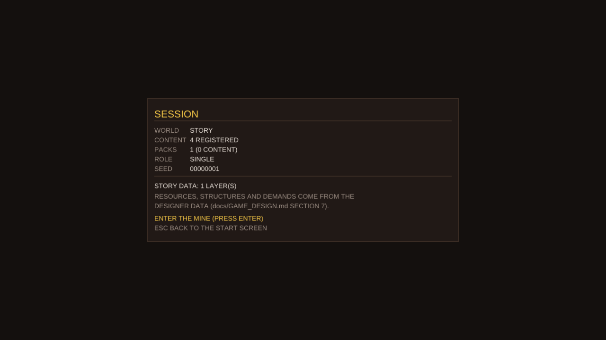

* 代码中**没有**任何预设内容：无资源枚举、无结构枚举、无配方、无建筑清单。

### M2 前置交付状态（已落地）：单层沙盒

内容还没到位，但"看不见数据的效果"会拖慢设计者。所以先做**单层沙盒**：只渲染一层、没有需求与推进，
面板列出数据注册出的内容与 id，改完文件按 F5 重载，已放置的格子按名字重新定位。**它不是第三种玩法
模式**，是开发工具（完整说明见 `docs/SANDBOX.md`）。

* 纯逻辑：`mine_core/sandbox.h`（网格 / 内容面板 / 光标 / 相机 / 按名字重载 / 布局序列化 / 文字导出），
  无 Ore 依赖；单测 `test_sandbox`（28 用例 / 716 断言，毫秒级）。
* 界面：`mine_app` 的第三个界面（网格 + 内容面板 + 状态栏），键鼠操作，`--world sandbox`。
* 命令行：`--content`（可重复）、`--grid WxH`、`--fill none|bands|scatter`、`--layout`、
  `--save-layout`、`--dump-layer`。
* 真机验证（同一份布局，数据文件换版本；命令见下，数字都是当前构建跑出来的）：

  | 运行 | 数据文件 | 结果 |
  |---|---|---|
  | A | v1（6 项） | `--fill scatter --seed 1`：散布 **241 格**并存盘 |
  | B | v2（在 structure 表最前面插一项，id 全部 +1） | 读入 A 的布局：**241 格 / 0 缺失**，坐标、kind、名字与 A 完全一致（**105 个格子的 id 变了**） |
  | C | v3（删掉 `placeholder_ore`） | 读入同一布局：**207 格 / 34 缺失**，缺失格子保留名字、id 为 0，没有一格拿到新数字 |
  | D | 三个瓦片层，v1 散布 **687 格** | 读入 v2 的布局：**687 格 / 0 缺失**（**285 个格子的 id 变了**）；读入 v3 的布局：**592 格 / 95 缺失** |

  改文件再按 F5 的那条路（`SandboxReloadReport`）同样量过：v1 画完之后把文件换成 v2，一层时
  **105 格 id 移动**、三层时 **285 格**，`0 丢失`——"按名字重定位"不是说法，是数字。

  复现（在 `tile2d/` 下）：
  ```
  # A：散布并存盘
  mine_game --world sandbox --start --content games/mine/tests/data/placeholder_content \
      --fill scatter --seed 1 --save-layout /tmp/a.bin
  # B / C：用变化后的内容包读回同一份布局
  mine_game --world sandbox --start --content games/mine/tests/data/placeholder_content_v2 --layout /tmp/a.bin
  mine_game --world sandbox --start --content games/mine/tests/data/placeholder_content_v3 --layout /tmp/a.bin
  # D：三个瓦片层
  mine_game --world sandbox --start --content games/mine/tests/data/placeholder_content \
      --tile-layers 3 --layer 1 --fill-layer all --fill scatter --seed 1 --save-layout /tmp/layers.bin
  ```

* 顺带修掉一个框架 bug：`SpriteBatch::draw_rect` 用一个 0.001 宽的 uv 区间采样**单个**白色像素，
  线性过滤下四角会采到它的透明邻居，于是每个矩形都是渐变（面板、高亮行、沙盒格子全都受影响；内置位图
  字体图集有整格白色，所以一直没暴露）。现在采样退化为一个点，并新增离屏回归测试。

* 截图（真机）：

  空网格（本体内容照样加载，面板里是游戏自己带的泥地与石头；不填充就什么都不画）：

  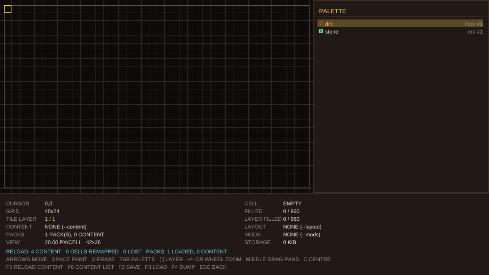

  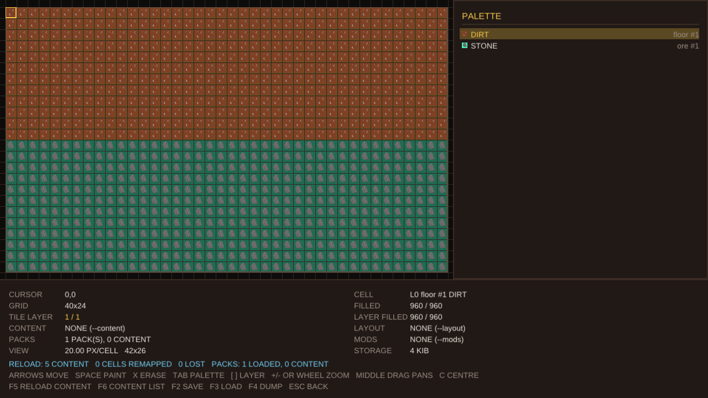

  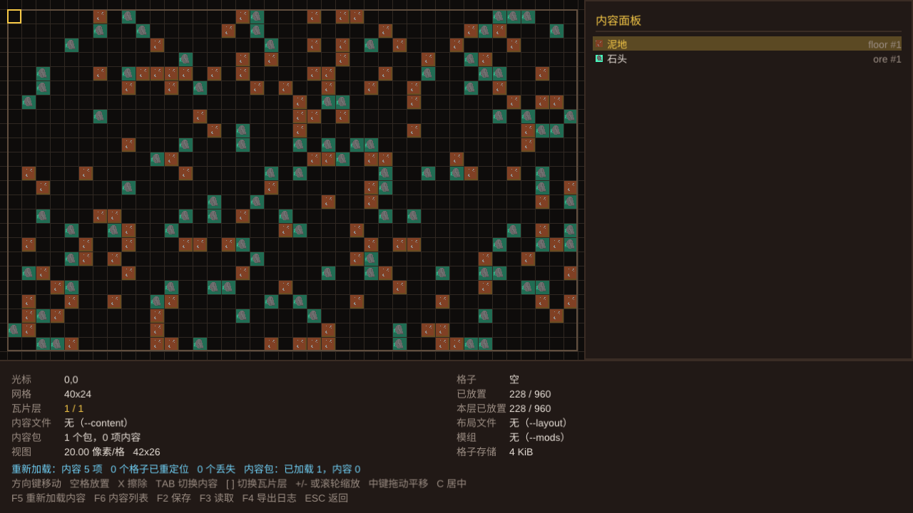

  

  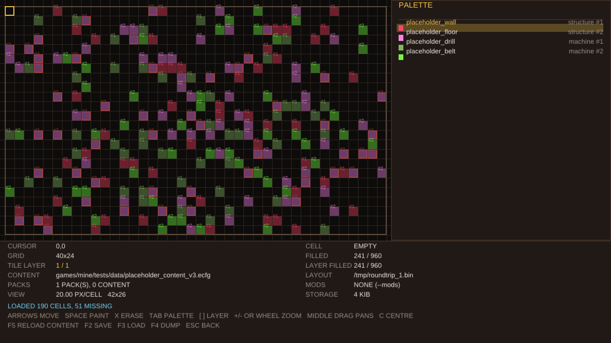

### M2 前置交付状态（二）：大图与相机（已落地）

玩法要在几百格见方的图上跑，而沙盒当时每格存一个名字（一个 `std::string` 加一次堆分配），一屏还要把可见格子
全部按格子画一遍。这一轮把两件事都换成能撑住大图的做法，并且都用真机数字验证：

* **相机进框架**：`t2d/core/camera2d.h`——视口、世界中心、缩放（像素/世界单位，格子游戏即像素/格）、
  `screen_of`/`world_of`（互为精确逆）、`zoom_at`（指针下的世界点不动）、`fit`（带边距框住一张图）、
  `clamp_to`（有界视角）、`visible_cells`（视口覆盖的半开格子范围，即剔除范围）。纯数学，无 GPU、无窗口。
  沙盒的相机整体换成它，行为不变（原有相机测试一条不改地通过），单测 `test_camera2d`（7 用例 / 1986 断言）。
* **地图格打包**：`mine::ContentGrid`——每格 32 位（20 位 id + 4 位 kind + 1 位“内容已消失”），
  按层惰性分配（没写过的层零占用），已放置计数 O(1)。格子不再存名字：名字来自注册表与每份存档自带的
  name→id 表（§6），所以重载仍然是“按名字重定位”，而且**消失的内容保留它的 id 并标记为缺失**，
  内容回来时能被名字修好。单测 `test_content_grid`（5 用例 / 105 断言）。
* **绘制与预算**：沙盒只走 `visible_cells()`；当可见格子数 × 层数超过四边形预算时，按“每 N 格一个四边形”
  采样绘制（`draw_step_for()`，N 由预算开方得出），低缩放下网格线与标签自动关闭。
* **框架修的两处**：退出顺序改为“先 `wait_idle()` 再 `on_shutdown()`”（此前无 `--screenshot` 的无头运行
  100% 触发 `VK_ERROR_DEVICE_LOST`）；`AppConfig::upload_segment_size` 让应用能给每帧动态数据留够空间
  （ring 段给不出空间时 sprite batch 会整批丢弃，屏幕全空）。

真机数字（Intel Arc Pro 130T/140T，debug 构建，离屏 1280×720，`--fill scatter --fill-layer all`）：

| 地图 | 格子数 | 存储 | 每帧 | 峰值 RSS |
|---|---|---|---|---|
| 40×24 × 1 层 | 960 | 3 KiB | ~10 ms | 108.9 MB |
| 512×512 × 4 层 | 1.05M | 4096 KiB | ~11 ms | 108.9 MB |
| 1024×1024 × 8 层 | 8.4M | 32768 KiB | ~12 ms | 125.0 MB |

同一组运行在改造前是：512×512×4 用 134.5 MB / 2.25 s（20 帧），1024×1024×8 用 414.6 MB / 5.30 s——
存储从每格一个名字降到每格 4 字节，帧成本从“随地图面积”变成“随屏幕”。

截图（512×512 × 4 层，同一份散布数据）：整图入框（0.99 像素/格，按块采样）与放大到 20 像素/格：

  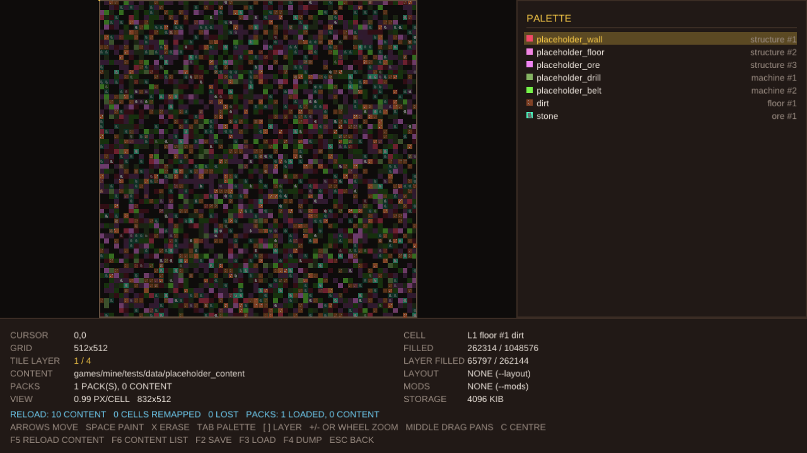

  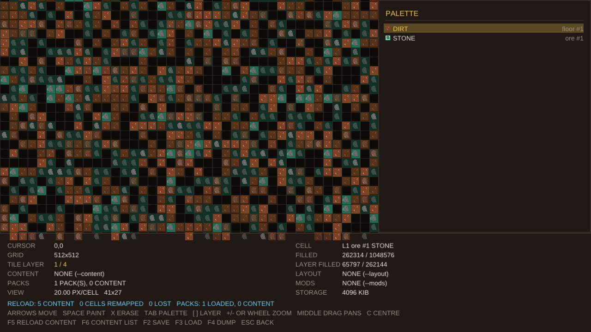

### M2 交付状态（一）：世界（已落地）

里程碑 M2 要的是"进入某层并渲染出来"。这一轮交付的是**世界**：层、地块、两条推进路径、查询，
以及游戏自己的世界视图。**内容仍然由设计者给**——层里放什么（§7.3、§7.4）当时还没有，
所以生成器什么都不放，而"空层"是可用的：能进、能走、能查、能画。
（故事模式读设计者数据的层规则在**下面（二）**落地：`layer::` 的 `size::` 与 `floor::`。）

* **纯逻辑**：`mine/world.h`（`MineLayer` / `MineWorld` / `LayerSpec` / `LayerGenerator` /
  两个调试生成器），无 Ore 依赖，专用服务器将来直接用同一份。单测 `test_world`（**12 用例 / 130 断言**，
  毫秒级）：占地的每一格、同层重叠被拒、注册表里没有的内容被拒并说明、内容没有定义时仍然是一个地块、
  **同一 `(seed, 层号)` 两次生成逐字节相同**（`dump_text` 对比）、另一层是另一张图、
  只有"会跑的"进 tick 列表、刷新只为脏的付钱、块索引里跨块的 3×3 只被访问一次、
  掩码碰撞（含图外算挡路）、空层照常工作。
* **引擎会读的字段仍然只有两个**（§1.15）：`image` 与 `random_reverse`。管线本来就会读一遍好把
  写错的字段当场报出来，现在**把读到的定义留下来**（`ContentDefinitions`），建层时直接用——
  于是"这块内容能不能掉头"是从数据来的，不是代码里的开关。
* **界面**：世界视图（会话界面按 **Enter**，或 `--world-view 1`）——进入矿场的一层，按游戏的方式画：
  所有瓦片层自下而上、**每个地块画满自己的占地**（3×3 是一个图元）、`mirrored` 左右翻转、
  没有网格线与标签；输入只有相机与指针；底部两行 HUD 说出这一层、指针指着哪个地块（含占地与是否翻转）、
  以及两条推进路径这一帧做了什么。`[ ]` 换层、`C` 复位、`F5` 重载内容并重建这一层、
  `F6` 内容列表、`Esc` 回会话界面。
* **调试填充**：`--layer-fill bands|scatter` 不点名任何内容，只把注册表里的东西铺出来——
  与沙盒的 `--fill` 同一条约定（"注册表长什么样"的视图，不是矿场的规则）。
  没有它时进的是**空层**，而空层在屏幕上明说自己是空的。

真机数字（Intel Arc Pro 130T/140T，debug 构建，离屏 1280×720）：

| 运行 | 层 | 结果 |
|---|---|---|
| `--world endless --world-view 1 --grid 40x24` | 空层 | 0 地块，0 格，屏幕中央写明"这一层没有放置任何内容"（无尽模式还没有规则，§7.9） |
| `--layer-fill scatter --grid 64x40 --packs games/mine/tests/packs` | 一层 | **661 地块 / 131 运行中 / 69 翻转**，7 个绘制批次 |
| 同上，只有本体内容（泥地与石头），`--view 20,12,48` | 一层 | **661 地块 / 178 翻转**（27%），放大后能直接看出左右翻转的成对地板块与单格的石头 |

截图（真机）：

  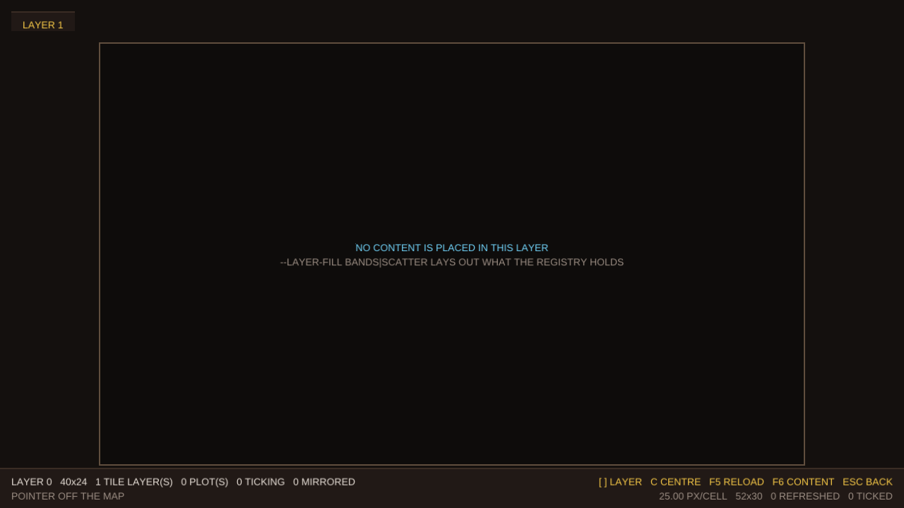

  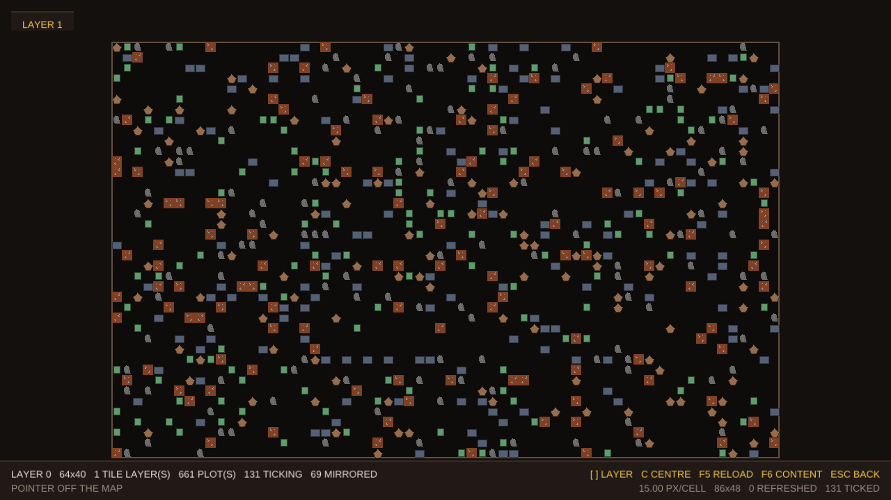

  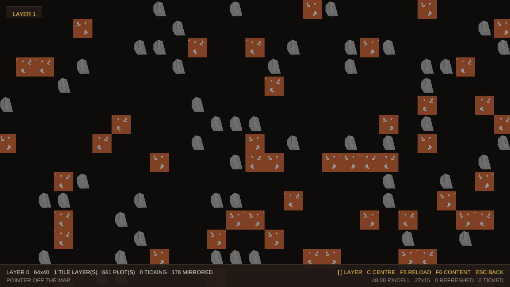

  ![走上一层（[ ]），同一个种子、不同的图](../games/mine/docs/images/world_layer1_en.png)

  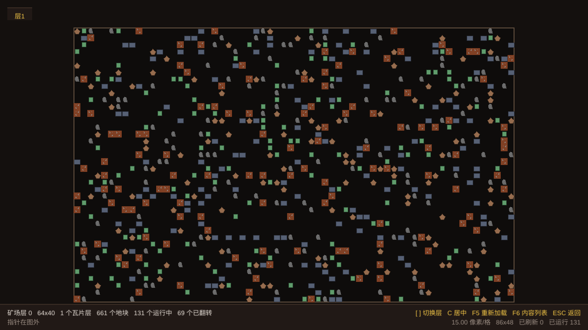

* 顺带修掉一个**真机才能发现的 bug**：F5 重载内容时，`load_content_images()` 会销毁上一批贴图纹理，
  而上一帧可能还在 GPU 上读它——**在用的纹理被销毁 = 设备丢失**。复现（两版都会崩）：
  跑起沙盒 → 换掉磁盘上的内容文件 → 按 F5 → 退出，得到
  `sync.cpp:72: result failed: VK_ERROR_DEVICE_LOST`（退出码 134）。修法是重载前先把 GPU 停下来
  （`renderer().wait_idle()`，只在真的有纹理要换时调用）：同一串命令现在是
  `RELOAD: 10 CONTENT   105 CELLS REMAPPED   0 LOST`，干净退出。重载是少见而刻意的动作（F5），
  一帧的延迟换设备不被打坏，值。

### M2 交付状态（二）：故事模式的层规则（已落地）

设计者的要求（原话）："添加一个故事模式层 ecfg 创建器，初次进入某个层时按照 ecfg 内的生成规则生成层，
首先需要添加大小设定和地板创建器，先添加一个 full_flash 字段，意为将所有地板设置为给定的地板类型。"

* **数据**：`layer::` 下一个条目一层，**书写顺序 = 矿场顺序**（与注册表发号同序：第 n 层的内容 id 是
  n+1）。`size::`（`width` / `height` 1..4096、`tile_layers` 1..32）与 `floor::`（`layer` +
  `full_flash:"<地板名>"`）是引擎读的两张表；条目下其余字段是设计者的（`name`、`resources`、
  以后的 `structures` / `demands`），引擎不解释——和别的内容条目同一条界线。见 `docs/MODS.md` §0。
* **引擎**：`mine/layer_rules.h`——`read_layer_rule()` / `layer_rules()` / `LayerRules`
  （同名先声明者保留，与注册表同一条规则）与 `story_layer_generator(rules, 世界形状)`。
  层规则由内容管线从**本体、内容包、模组包**三处一起读（与 `image` / `random_reverse` 同一条路），
  所以模组加一层和本体加一层没有区别。故事模式的生成器**不看种子**（预设就是每个世界都一样），
  进层时现建现用（§4）。
* **拒绝而不是猜**：`size:[40,24]`（数组）、`widht:40`（拼错）、`width:0`、`tile_layers:33`、
  `full_flash:3`（不是字符串）、`full_flash:""`、`floor:: layer:1` 而这一层只有 1 个瓦片层——
  全部**带文件名报告**，该层不进故事，同一个包的其它内容照常加载（列表上显示 PARTIAL）。
  地板名注册表里没有时**层照建**：每个格子被拒一次，但报告**只留一条原因**并计数
  （实测 16×12：`192 placement(s) refused in all, 1 reason(s) listed above`），画面中央写明原因。
* **画面**：一层是空的时，中间说明**为什么**——先是构建拒绝的原因（数据点了不存在的内容），
  再是"故事数据没有描述第 N 层"，最后才是调试填充的提示。
* **验证**：`test_layer_rules` **14 用例 / 330 断言**（读取器的每一条拒绝、故事顺序、尺寸覆盖世界形状、
  铺满每个格子、指定瓦片层、地板名缺失、后一条规则覆盖前一条、以及包 → 管线 → 世界端到端）。
  Tile2D 套件 25 → **26 个测试**（debug / release / asan / tsan 26/26、no-renderer 11/11、
  server-only 26/26）。真机（无头，1280×720）实测：
  `content: ... 2 story layer(s), 0 error(s)`、
  `world: layer 0 is 48x32 with 2 tile layer(s): 1536 plot(s), 0 ticking, 769 mirrored, 1536 cell(s)`。
  `--world story` 在没有层数据时仍然是空层 + 一句说明，所以**这次没有往本体内容里加任何东西**：
  层是设计者的数据（§7.3、§7.8、§7.10 还在等）。（**后来设计者给了内容**：第一层 100×100、石头 20–35，
  见 §1.21 与「M2 交付状态（五）」。）

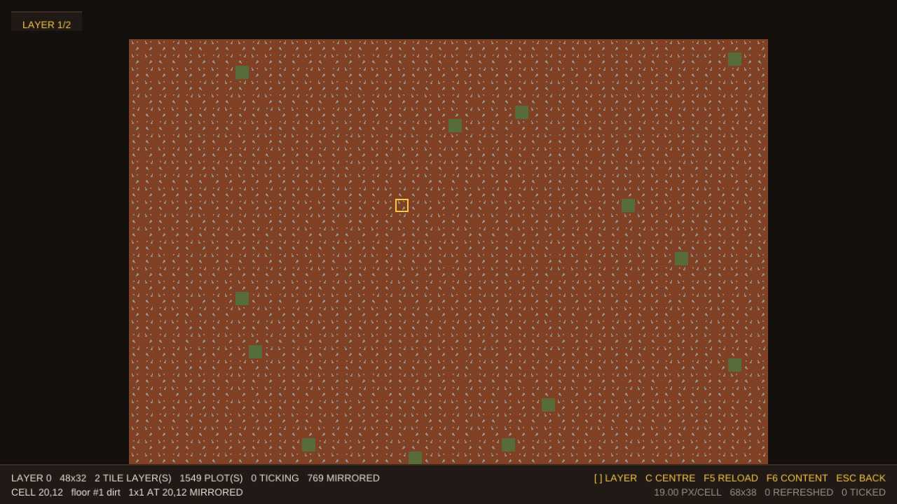
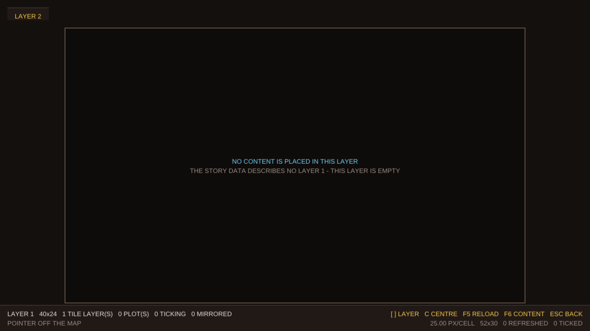
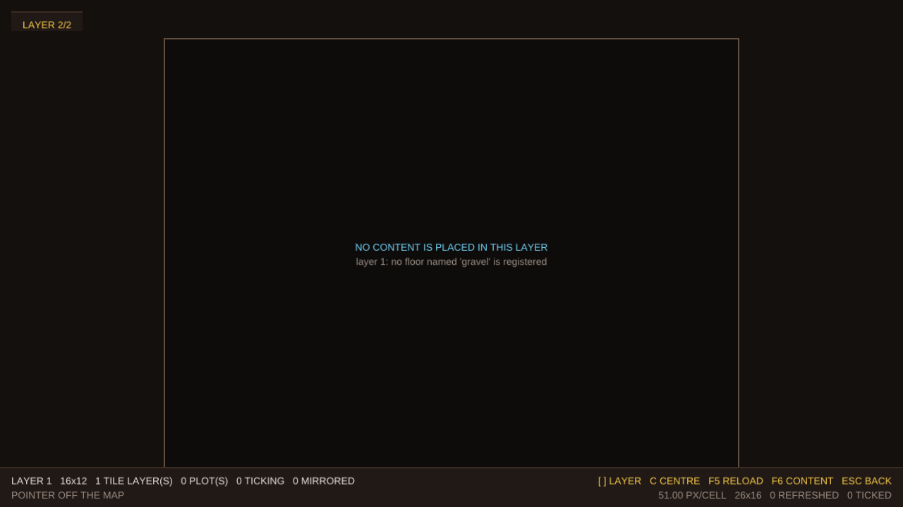

### M2 交付状态（三）：矿物与散点生成器（已落地）

设计者的要求（§1.19 的原话）："添加一个 single_ore（单矿物）类继承场景地块，层创建器添加散点生成器，
以散点形式在指定 tile 层放置指定物体，包含最小生成数量，最大生成数量，平均密度，地板限制等属性。"

* **`SingleOre`**（`mine/types/single_ore.h`）：继承 `SceneTile`，只多一个 `is_ore()` 标记——和地板
  同一个形状的问题（"这里有没有东西可以挖"），所以调用方不用知道任何一块矿物的名字。**一格一块**：
  散点一格放一个，于是"哪一格有矿"和"哪块地块是那个矿"是同一个问题。它的类别是**新追加的
  `ContentKind::Ore`**（`ore::` 表）：追加不动旧值，而旧的存档表里没有这一段——
  `ContentTable::deserialize` 现在接受**更少的类别段**（那几类读出来就是空），多于本版本知道的类别仍然拒绝。
* **散点生成器**（`layer::` 的 `scatter::`，`mine/layer_rules.h`）：一个条目一个生成器，属性就是你要的
  那四个——`min` / `max`（最小/最大生成数量）、`density`（平均密度）、`floor`（地板限制），
  外加 `kind` / `content`（撒什么）与 `layer`（撒在哪个瓦片层）。
  * **可用格子** = 在图内 + 这一层还没有东西 + 满足地板限制；创建器**地板先铺、散点后撒**，所以
    "这一层已经有东西"包括地板，两个散点撒在同一层也不会互相压（后撒的避开先撒的）。
  * **数量**：每个可用格子以 `density` 为概率被选中（期望 `density × 可用格子数`），再夹到
    `[min, max]`，最后夹到可用格子数——**可用格子不够时地图赢**（限制是规则、最小值是愿望），
    差多少**说出来**：`LayerSpec::problems` 是这一轮新加的一条报告通道，生成器说得出它做不到什么，
    建层报告带着它，画面与日志都看得见。
  * **位置**：来自这一层的骰子（`layer_seed(种子, 层号)`）——数量由规则定、位置由骰子定。
  * 读不懂的字段**在读文件时就拒绝**：`kind` 不是类别、`kind:"item"`（不占格子）、没有 `density`、
    `density:5`、`min` > `max`、`floor` 写在没有地板创建器的层上、`layer` 超出这一层的瓦片层数。
* **顺手修掉一个只有真机截图才看得见的 bug**：世界视图原来把"没有贴图的内容"画在所有贴图**之前**，
  于是上一层没有图的矿被下一层地板的贴图盖住——撒了 13 块矿，画面上一块也看不见。现在**一层一层画**：
  每一层先画没有图的地块（名字派生的调试颜色）、再画这一层的贴图。同一趟还修掉另一件：HUD 与指针原来
  画在图层**之前**，放大到 48 像素/格时贴图会盖住状态栏（旧截图里就有）。现在是"底 → 层 → 界面"三趟
  （`draw_world_screen` / `draw_world_layer` / `draw_world_overlay`）。
* **验证**：`test_mine_types` 13 → **14 用例 / 187 断言**（`SingleOre` 是场景地块、两个标记互不冒充、
  `make_tile` 按类别造类、`item:: ore::` 是物品不是矿物）；`test_layer_rules` 14 → **22 用例 /
  712 断言**（散点的每一条拒绝、数量公式的三种情形、地板限制、两层不互相压、同种子同布局、超出瓦片层数
  说出来）。Tile2D 套件仍是 **26 个测试**（debug / release / asan / tsan / server-only 26/26、
  no-renderer 11/11）。真机（无头 1280×720，故事测试替身）：
  `world: layer 0 is 48x32 with 2 tile layer(s): 1549 plot(s)` = 1536 个地板 + **13 块矿**
  （`density:0.01`，min 6 / max 40）；放大到 48 像素/格时地板与矿各画各的、状态栏在最上面。
* **没有往本体内容里加任何东西**：仓库里唯一的矿物与散点数据仍是测试替身
  `games/mine/tests/data/story_content/`（本体 0 条层规则、0 条矿物，`test_content_pack` 钉住）。
  （**后来变了**：本体现在有 1 条层规则与 1 块矿物，`test_content_pack` 钉的正是它们，见（五）。）

### M2 交付状态（四）：左上角的层数（已落地）

设计者的要求（§1.20 的原话）："正式游戏中需要在左上角显示当前层数，格式为层1/层2"。

* **显示的就是这个格式**：`world.depth:"层{}/{}"`（英文 `LAYER {}/{}`、繁体 `層{}/{}`），
  **从 1 开始数**——玩家数的第一层是第 1 层，而引擎与 `--mine-layer` 数的是第 0 层，两套编号各自服务
  一个读者：左上角给玩家，底部那行给看日志的人。
* **斜杠后面是什么**：故事描述的层数（`LayerRules::size()`）。**没有总数的时候不编一个**：
  走到故事之外，或者无尽模式（层规则未定，§7.9），只写当前层（`world.depth.endless:"层{}"`）——
  一条"HUD 说 6/3"的规则比不显示总数更难解释。这条判断是纯逻辑，`layer_depth(规则, 层号)` 一个函数
  （`mine/layer_rules.h`），所以它测得到。
* **画在图层之上**：与底部状态栏同一条规则（M2.6 修的那条）——地图不能把玩家自己的状态画掉；
  它有自己的小面板，压在贴图上也能读。
* **验证**：`test_layer_rules` 22 → **23 用例 / 725 断言**（从 1 开始、故事内给总数、故事外不给、
  无尽不给、负数层号读成第一层）；`test_text` 9 用例 / 339 → **343 断言**（三语言字符串表，新增的两条
  在两种中文里都在）。真机无头 1280×720：第一层是 `层1/2` / `LAYER 1/2`，按 `]` 走到第二层是
  `层2/2` / `LAYER 2/2`。世界视图的截图全部重出（左上角现在有这一行）。

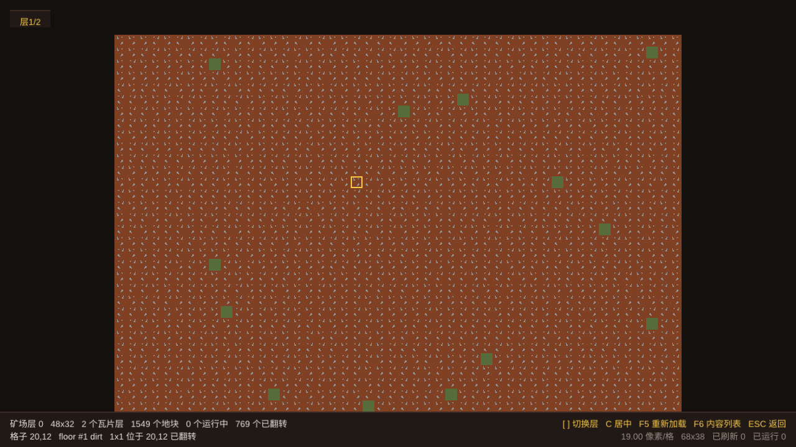

### M2 交付状态（五）：故事模式的第一层与石头（已落地）

设计者的要求（§1.21 的原话）："设置故事模式第一层地图100*100,生成矿物石头，20-35个，贴图为给出图片"。

* **内容第一次进了本体包**：`content/layers.ecfg` 描述第一层，`content/ores.ecfg` 声明矿物，
  `content/art/ore_stone.png` 是设计者给的图（128×128；一格一张图、不进图集，§1.18）。层名 `entrance`，
  而 `layer::` 的**书写顺序就是挖下去的顺序**，所以它正是玩家看到的第 1 层。
* **写下来的数字**：`size::` 100×100 / 2 个瓦片层；`floor::` 用 `full_flash:"dirt"` 把每个格子铺成
  **本体自己的**泥地（layer 0）；`scatter:: stone::` 是散点生成器（`kind:"ore"`、`content:"stone"`、
  `layer:1`、`density:0.003`、`min:20`、`max:35`、`floor:"dirt"`）。
* **实测**（无头 1280×720）：`content: ... 3 registered, 2 plot definition(s), 0 item definition(s), 1 story layer(s), 0 error(s)`、
  `images: 2 loaded`、`world: layer 0 is 100x100 with 2 tile layer(s): 10020 plot(s), 0 ticking,
  4993 mirrored, 10020 cell(s)` = 10000 个地板 + **20 块石头**。密度 0.003 的期望是 30 块，这个种子
  （`layer_seed(1, 0)`）掷出 19，**min 把它抬到 20**——数量由规则定、位置由骰子定，20..35 是规则保证的。
  20 块的坐标实测：`71,20 25,36 72,71 59,33 2,17 32,75 73,12 60,7 69,79 11,4 61,61 54,35 22,67 83,1
  69,64 52,43 6,5 42,73 59,1 84,16`。
* **石头用的是设计者给的图，不是名字派生的调试色**：24 像素/格放大后，指针那一格的 HUD 写着
  `CELL 52,43   ore #1 stone   1x1 AT 52,43`（M2.16 起这一行显示本地化名称 `STONE`），格子里就是那张图；
  把 `image:` 注释掉再跑一次，同一格
  变成名字派生的绿色（实测两次渲染在那 20 格上像素不同）——贴图真的在画。
* **会话界面不再说"层内容尚未提供"**：故事描述了层就写 `STORY DATA: 1 LAYER(S)`（三语言），
  只有一层都没有时才保留那句话——一块屏幕不能对刚加载的数据说谎。下面两行（资源、结构、需求来自
  设计者的数据）两种情况都成立，留着。
* **测试替身让位**：仓库里那份故事夹具的层名改成 `fixture_shallow` / `fixture_deep`。本体现在有自己的
  第一层，而一个包加的是**层**，不是内容——夹具跟在它后面，成为第 2、3 层（`--packs
  games/mine/tests/data/story_content` 仍然是"一个包往故事里加层"的活例子）。
* **石头也是沙盒能画的内容**：`is_placeable_kind` 现在把 `ore` 也算作“占格子”的类别（此前只有
  structure / machine / floor）——`SingleOre` 就是占一格的场景地块，所以布局里存得下它、面板里选得中它、
  散点撒出来的石头也能直接铺出来看。这一条改动了**所有把它量进去的数字**：M2 前置那节的 A/B/C 表在
  本构建上重跑（207 格 / 34 缺失，一层 105、三层 285 个格子的 id 移动），世界视图的调试填充
  661 地块 / 131 运行中 / 69 翻转（原 661/160/88，绘制批次 5 → 7），沙盒、世界与会话界面的截图全部重出。
* **验证**：`test_layer_rules` 23 用例 / 725 → **797 断言**（本体第一层 100×100、石头在 20..35 之间、
  每一块都落在泥地上、id 是注册表里的 `stone`；夹具那两层照旧）；`test_content_pack` 13 用例 /
  198 → **215 断言**（本体包两张图、1 个地板、1 个矿物、1 层，字段逐个钉住）；`test_text` 9 用例 /
  343 → **345 断言**（新增 `session.story` 三语言）。套件仍是 **26 个测试**（release / debug / asan /
  tsan / server-only 26/26、no-renderer 11/11、Ore 13/13）。
* **截图重出**（真机无头 1280×720）：`world_story_en.png`（整层 100×100，石头就是那些灰点）、
  `world_story_zoom_en.png`（滚轮放大到 **60.83 像素/格**，石头贴图就在指针那一格，HUD 写着
  `CELL 52,43   ore #1 STONE   1x1 AT 52,43`——M2.16 起这个名字来自字符串表）、`world_story_zh_hans.png`（`层1/1`）、
  `world_story_none_en.png`（走到第 2 层：故事没描述它，左上角因此只写 `LAYER 2`，不给总数）。
### M2 交付状态（六）：物品类与 `item::` 定义器（已落地）

设计者的要求（§1.22 的原话）："添加物品类和物品ecfg注册器"。

* **物品类**（`mine::types::Item`，`types/item.h`）：**不在图上**的内容——机器产出、配方进出、需求点名、
  玩家携带的都是它。它没有地块、没有占地、没有层（"这个物品在哪一格"是**容器**的问题，而容器是设计者的
  数据，§7.10），所以它**不继承 `Tile`**：共用一个基类等于说两者是同一种东西，而地块有层与占地、物品两样
  都没有，一格能放地块、永远放不下物品。身份与地块同一套：**类别 + 注册表发出去的 id**，名字永远在注册表
  里（`Item::name(registry)`，内容没了就是 `#<id>`，与地块同一段文字）；`Item::valid(registry)` 答"它背后
  的内容还在不在"——重载把内容拿走后，物品保留自己的 id 并**说出来**，而不是悄悄变成占了这个数字的另一条
  内容。默认构造的是**空槽**：没有内容、没有贴图。
* **`item::` 定义器**（`types/item_definition.h`）：`read_item_definition()` 读一条、`item_definitions()`
  走一份 `.ecfg`、`make_item()` 把定义变成物品——与地块定义器（`types/tile_definition.h`）同一形状。
  引擎为物品读的字段只有一个：**`image`**（背包槽、配方、需求画的就是这张图）；`random_reverse` 是**地块**
  的字段（"这份内容画在地图上能不能掉头"），物品不在图上，所以写在那里的只是设计者字段，引擎不读也不报
  ——`docs/MODS.md` §0 的字段表据此改准了适用范围。表里写错 `image`（不是带引号的路径）**拒绝并说明**，
  与地块同一条规则；拿别的表（比如 `ore::`）的条目来读物品同样拒绝：条目写在哪个表里就是什么。
* **加载时读一遍并留下来**：`ContentDefinitions::find_item()` / `item_count()`，包与模组两条路都读
  （`content_pack.cpp` / `mod_package.cpp`），所以字段写错在**文件那里**就报，而不是等到有人要画它；
  启动那行现在报 `N plot definition(s), M item definition(s), ...`。查找刻意分成 `find_tile()` /
  `find_item()`：物品不是地块，按地块查它必须查不到，哪怕两者同名。
* **本体内容里一个物品都没有**：设计者还没说有哪些物品（§7.2），代码与数据都不编。这一条交付的是**机制**：
  `item::` 表从此有人读，读到的东西留得住、拿得到（`Item` 就是拿它的那一半）。
* **验证**：`test_mine_types` 14 用例 / 187 → **15 / 211 断言**（同一份文档里叫 `stone` 的地板与叫 `stone`
  的物品互不干扰；`image:7` 被拒；拿矿物的表读物品被拒；定义 → `Item` 的 id、名字、贴图、空槽、内容消失；
  物品不是地块）。`test_content_pack` 13 用例 / 198 → **14 / 231 断言**（一个包里的物品被注册、定义被留下、
  按地块查不到；坏 `image` 被报出来而名字照常注册）。套件仍是 **26 个测试**（release / debug / asan / tsan /
  server-only 26/26、no-renderer 11/11、Ore 13/13）。
* **表与公开面**：本体表 686 → **702 节 / 2190 → 2236 符号 / 8678 → 8735 重定位**（release，1.07 → 1.09 MiB；
  debug 5320 / 18154 / 23754 / 3.35 MiB），指纹不变（`bdcb9b070ab30e78`，头文件只增不改），启动仍然只有那一条
  `__EXCEPTIONS` 警告；`codetab build --api engine.api` 构建期查过，**越界 0 个**（向宿主索取的符号 161 → 160）。

### M2 交付状态（七）：第一件物品——石头（已落地）

设计者的要求（§1.23 的原话）："创建物品石头 id=stone"。

* **本体内容里第一次有了物品**：`content/items.ecfg` 声明 `item:: stone::`，`content/art/item_stone.png`
  是设计者给的图（64×64，**逐字节**拷进本体包，与 `ore_stone.png` 同一个做法）。本体包的文件按路径排序
  加载（floors → items → layers → ores），所以它注册成 **`item #1 stone`**。
* **同名不是冲突**：矿物 `stone` 与物品 `stone` 同时存在——注册表**按种类发号**（`find(kind, name)`），
  所以地图上那一格（`ore #1 stone`）与能被搬走的那个（`item #1 stone`）是两条互不干扰的内容。这正是
  `ContentDefinitions` 把查找拆成 `find_tile()` / `find_item()` 的原因：按地块查物品必须查不到。
* **实测**（真机无头 1280×720）：`content: 1 base pack(s) with 4 and 3 image(s), 0 pack(s) with 0 and 0
  image(s), 0 mod(s) with 0 -> 4 registered, 2 plot definition(s), 1 item definition(s), 1 story layer(s),
  0 error(s)`、`images: 3 loaded, one texture per content entry (largest 256 px)`——**物品的贴图与地块走同一
  条路**（`load_content_images()` 遍历每一个解析成功的图片，没有按类别分支），所以它有自己的那张纹理。
* **列表与会话界面跟着说了实话**：展开本体包那一行是 `floor #1 dirt` / `item #1 stone` /
  `layer #1 entrance` / `ore #1 stone`（标题行 `7 SOURCES  21 CONTENT  0 FAILED`）；会话界面
  `CONTENT 9 REGISTERED`、`PACKS 3 (5 CONTENT)`。**M2.16 重出这一屏**（名字改走本地化查找，加载的
  内容也只剩本体那一个来源）：标题行 `2 SOURCES  5 CONTENT  0 FAILED`，五行是 `floor #1 DIRT`、
  `item #1 STONE`、`layer #1 ENTRANCE`、`ore #1 STONE`、`warehouse #1 STONE WAREHOUSE`——
  注册表里的名字仍是小写的 id，界面上显示的是设计者写在字符串表里的名字（§1.29）。
* **物品进不了地图，但画得出来**：沙盒面板只列**占格子**的内容（`is_placeable_kind`），物品不占格子、
  没有格子可以铺，所以它不在面板里——"能不能画"与"能不能放"是两件事：前者已经成立（纹理在），
  后者永远不成立（一格放得下地块、放不下物品）。
* **还没有的东西**：现在没有任何界面**画**物品——背包、配方、需求都还没写（§7.2 的其余项、§7.5、§7.6）。
  这一件物品现在的状态是"注册好了、定义留住了、贴图备好了、等着被用"。
* **验证**：`test_content_pack` 14 用例 / 231 → **239 断言**（本体包三张图、1 个地板、1 个物品、1 个矿物、
  1 层；物品的定义逐字段钉住：`image == "art/item_stone.png"`、按地块查它查不到、它不计进地块定义数）。
  套件仍全绿（release / debug / asan / tsan / server-only 26/26、no-renderer 11/11、Ore 13/13）。
* **顺带修掉三处对不上的地方**（把整个截图集重测一遍时发现的，都不是这一条要求的）：
  ① **§1.22 的条目补上了**：上一轮的交付说明引用了它，§1 清单里却漏了它——§1 因此从 21 条变成 23 条。
  ② **无尽模式的左上角不再编总数**：本体有了自己的第 1 层之后，无尽模式进第 0 层读成 `LAYER 1/1`——
  故事的总数漏进了没有尽头的模式（§1.20 说的是"无尽模式只写当前层"）。现在**模式说了算**
  （`layer_depth_for(模式, 规则, 层号)`，`mine/layer_rules.h`：只有故事有总数可数，沙盒与无尽一律只写当前层），
  `test_layer_rules` 23 用例 / 797 → **807 断言**。
  ③ **两张世界截图过期了**：`world_empty_en.png` 与 `world_story_bad_floor_en.png` 拍的是本体有第 1 层之前
  的状态（"故事没有描述第 0 层"、16×12 的坏地板层当第 1 层），现在拍不出来了——前者重拍成**无尽模式的空层**
  （还没有规则，所以是空层，画面照样说明自己是空的），后者重拍成**一个包加的第 2 层地板名没注册**
  （`LAYER 2/2`，原因照写在画面上）。
* **截图重出**（真机无头 1280×720）：内容列表四张（`content_list_en` / `content_list_fold_en` /
  `content_list_zh_hans` / `content_list_broken_en`）、会话界面两张（`session_screen` / `session_packs_en`）、
  状态栏写着内容总数的沙盒那十二张（`RELOAD: 3 → 4 CONTENT`；其中四张因为数字从一位变两位，整行都在动）、
  以及无尽模式世界视图的三张（`world_scatter_en` / `world_mirror_en` / `world_zh_hans`，只有角上的徽标变）。
  **逐字节不变**：所有故事模式世界截图、`world_layer1_en`、沙盒试玩两张，以及任何不数内容的地方——
  重渲染后 md5 与提交里那份相同。
* **表与公开面**：本体表 702 → **706 节 / 2236 → 2247 符号 / 8735 → 8756 重定位**（release，1 144 445 →
  1 146 806 B = 1.09 MiB；debug 5323 / 18160 / 23772 / 3.35 MiB），指纹不变（`bdcb9b070ab30e78`，
  77 个头文件），align 分布 `{1:120, 2:55, 4:6, 8:73, 16:392, 32:32, 64:28}`，
  向宿主索取的符号仍是 **160** 个（t2d 57 / ore 25 / 平台 78）。
* **物品本身没有改一行代码**：`item::` 表与物品类上一轮就在（§1.22），这一轮只是设计者给了第一件东西；
  引擎里动的只有上面那处无尽模式的层数。

### M2 交付状态（八）：实体与它的四叉树（已落地）

设计者的要求（§1.24 的原话）："添加实体类，位置不与瓦片地图对齐，可以移动，交互，默认每tick更新除非特别
声明更新间隔或不自动更新。为了保证性能，一个层运行时所有实体编入一个四叉树表便于快速检索一个位置一定范围
内的实体"。（这一条先写成"位置不固定与瓦片地图对齐"，随即更正为"位置**不**与瓦片地图对齐"——按更正后的
为准。）

* **实体不是地块**（`mine::types::Entity`，`types/entity.h`）：地块是**格子**（占着格、固定、有朝向），
  实体是**一个点**（不在格子上、会动），所以它**不继承 `Tile`**——继承等于说两者是同一种东西。
  两者共享的是身份：类别 + 注册表发出去的 id + 名字（内容没了就是 `#<id>`，与地块同一段文字）。
  位置是浮点的，**不与瓦片地图对齐**：3.5、2.25 就是一个位置，没有任何东西会把它对齐到格子上。
* **移动**：`set_position()` / `move()`。移动会**告诉它所在的那一层**（实体知道自己属于哪一层），
  层因此跟着更新索引——"一层里所有实体都在索引里"是**不变量**，不是一条要靠调用者记住的规矩。
* **交互**：`on_interact(Entity&)`（默认什么都不做，并且说出来），层提供 `interact(a, b)`——**两边都问**，
  有一边有反应就是"发生了一次交互"，而且两边都不必知道对方是什么类型。**交互具体是什么**仍然是设计者的
  （§7.14 指针动作）。
* **更新节奏**：默认**每 tick**；`set_period_seconds(s)` 声明间隔；`set_auto_update(false)` 声明
  "不要自动更新我"（它照旧在那里、照旧能移动与交互，只是由别的东西驱动）。节奏规则与地块**共用一份**
  （`types/update_cadence.h`，`EntityTile` 改成用它）：**一帧比一个周期长时只跑一次**，把整段时间交给它，
  不重放错过的 tick——一次卡顿不能改变矿场产出什么。
* **四叉树**（`mine/quadtree.h`）：一层里的实体编入一张四叉树，根是这一层的矩形，一个节点超过 **16** 个
  条目就分裂（最多 8 层）。`entities_within(点, 半径)` 返回**按出生顺序**排好的结果（同一个问题两次得到
  同一个答案），另有一个 visitor 版本不建列表。落在地图外的实体**留在根节点**：查询覆盖到它在哪里就找得到
  它，地图要不要拦住它是设计者的规则（§2），不是索引的事。索引只知道"位置 + 一个 payload"：它不认识实体，
  也不认识内容。
* **实测**（release，`test_entities` 自己打出来的数字；10000 个实体铺在 1000×1000 的层里）：
  一次**半径 20 的查询**走 **21 个节点**、只测 **31 个条目**——线性遍历要测 10000 个；
  **10000 个实体生成 0.79 ms**（边造边进索引）、**一次 tick 走过全部 10000 个 0.058 ms**、
  **1000 次半径 10 的查询 0.388 ms**（每次 **0.4 µs**，每次测 25.2 个条目、走 8 个节点，找到 3.1 个）。
* **层怎么改的**：`MineLayer` 持有实体（`adopt` / `spawn` / `destroy`）、它们的索引，以及
  `entities_within` / `for_each_entity_within` / `interact`。`tick()` 现在同时走**地块的节奏列表**与
  **实体**：地块多，所以继续用"创建时就分好的列表"；实体少，所以由层走过、每个自己决定——节奏是它自己的，
  而一张要跟着它改主意的列表是自找的麻烦。销毁是**立即出索引、帧末出存储**：正在遍历实体的回调手里的
  指针仍然有效。`MineWorld` 改成用 `unique_ptr` 持有那一层——**层里的东西指回层**，层一旦被搬走，
  那些指针就会指向一个不在那儿的层。
* **验证**：新增 `test_entities` **8 用例 / 129 断言**（自由位置不被对齐、默认每 tick / 间隔 / 不自动更新、
  余数不漂移、长帧只跑一次、两边都被问的交互、四叉树的插入 / 删除 / 移动 / 边界 / 同一位置的重复条目 /
  地图外的条目、半径查询的代价、层的索引跟着移动走、销毁立即出索引而帧末出存储、实体在自己的回合里能
  够到层（造一个、毁一个、问附近有什么并交互）、tick 顺序 = 出生顺序）。套件 **27 个测试**全绿
  （release / debug / asan / tsan / server-only 27/27、no-renderer 11/11、Ore 13/13）。
* **屏幕上一个像素都没动**：没有内容生成实体，也没有任何界面画实体——三张有代表性的文档截图
  （`world_story_en` / `sandbox_en` / `session_screen`）重渲染后**逐字节相同**（`compare -metric AE` = 0）。
* **顺带修掉一处会让人读到错数字的构建缺陷**：代码表的依赖里只有 `.cpp`——**改头文件不会重建表**，
  而表才是真正在跑的那个东西。这一次它当场咬人：`quadtree.h` 改了一个函数体之后表还是旧的
  （734 节 / 2329 符号 / 8981 重定位），强制重建才是 734 / 2330 / 8974。现在表的依赖里加上本体与引擎的
  头文件、生成的 `config.h`，以及它据以校验的 `engine.api`（`CONFIGURE_DEPENDS`，新加的头文件也会被带上）。
* **表与公开面**：本体表 706 → **734 节 / 2247 → 2330 符号 / 8756 → 8974 重定位**（release，
  1 146 806 → 1 178 601 B = 1.13 MiB；debug 5592 / 19023 / 24758 / 3.50 MiB），指纹不变
  （`bdcb9b070ab30e78`，头文件 77 → 80），align 分布
  `{1:121, 2:59, 4:6, 8:75, 16:406, 32:37, 64:30}`，向宿主索取的符号仍是 **160** 个（t2d 57 / ore 25 / 平台 78）。
* **还没有的东西**：① **没有 `entity::` 定义器**——设计者要的是"实体类"，不是"实体 ecfg 注册器"
  （§1.22 那次两样都要）；现在能造出实体的只有 C++：本体，或代码表模组。② **没有任何界面画实体**：
  世界里不画它，所以"实体长什么样"还没有答案。③ **交互是什么**仍然等 §7.14——机制在位，内容是设计者的。

### M2 交付状态（九）：掉落物与指针拖动（已落地）

设计者的要求（§1.25 的原话）："添加掉落物类和定义器，不自动更新，可以被鼠标拖动移动"。

* **掉落物是实体的一种**（`mine::types::Drop`，`types/drop.h`）：位置自由（不与瓦片地图对齐）、进四叉树、
  能被查到——实体那一半照旧（§1.24）——它把两件事定下来：**层不更新它**（`auto_update()` 天生为假：
  这是"它是什么"，不是条目里的字段），并且**指针可以拖它**（`draggable()` 为真；普通实体为假，
  与"我是不是地板"同一种问法）。
* **定义器**（`types/drop_definition.h`）：`drop::` 表 → `read_drop_definition()` / `drop_definitions()` /
  `make_drop()`，引擎为掉落物读的字段只有 `image`。为此**追加了 `ContentKind::Drop`**（追加在类别表末尾，
  旧存档表照旧读得出来：类别少一段就是"这一类一条内容都没有"），`content_kind_name` 给它 `"drop"`。
* **指针拖动**（`mine/pointer_drag.h`）：按下左键 → 取**最近的一个可拖的东西**（`kGrabRadius` = 0.75 格；
  并列时取小的 serial，所以同一次按下两次都拖同一个）→ 记住**抓取偏移**（拖起来不会跳到指针中心）→
  移动时跟着指针走、**夹在层的矩形内**（指针可以出图，被拖的东西不会）→ 松手放下。
  它只认世界坐标，不认像素与按键，所以整件事能在毫秒级的单测里跑完。
* **屏幕这一侧**：世界里掉落物画成**一格大、以位置为中心**的图（躺在四格之间时就是压在四格上——这正是
  "位置不是格子"的样子），画在所有地块之后；按住左键拖，HUD 第二行从格子描述变成
  `CELL 33,50   DRAGGING drop #1 scrap`（三语言）。`--layer-drops 1` 是调试填充：把 `drop::` 的每一条
  在层里铺一个（与 `--layer-fill` 同一条约定，不点名任何内容）。
* **实测（端到端：真机无头 1280×720，脚本隔着调试输入服务器移动鼠标与按键）**：把 32 像素/格的一屏里那颗
  掉落物从屏幕 `(635, 352)` 按住、移动 `+288, +96` 像素、松手——它自己的像素重心从 `(635.1, 352.1)` 走到
  `(923.2, 448.8)`，即**移动了 288.1 / 96.7 像素 = 9.00 / 3.02 格**（抓取偏移被完整保留：指针走多少，
  它就走多少）。按住时 HUD 是 `CELL 33,50   DRAGGING drop #1 scrap`，松手后是
  `CELL 42,53   floor #1 dirt   1x1 AT 42,53`，而它停在放下它的地方（单测钉住了"新位置找得到、旧位置找不到"）。
  **M2.16 重出这一屏**：32 像素/格已经在新范围之外（§1.30），所以改成 `--view 33,50,48`——同一段拖动之后
  HUD 是 `CELL 39,52   floor #1 DIRT   1x1 AT 39,52 MIRRORED`、`48.00 PX/CELL   27x15`，
  掉落物停在放下它的地方（名字来自字符串表，M2.16 起）。
* **验证**：新增 `test_drops` **4 用例 / 72 断言**（掉落物不是地块、天生不自动更新、普通实体不可拖；
  定义器只读 `drop::`、`image` 写错被拒且不牵连别的条目、拿别的表读它被拒；拖动取最近的、保留抓取偏移、
  夹在地图内、松手不动、并列取小 serial、被销毁时松手；调试填充每个 `drop::` 条目铺一个、没注册就不铺）。
  `test_text` 345 → **347 断言**（三语言的 `world.dragging`）。套件 **28 个测试**全绿
  （release / debug / asan / tsan / server-only 28/28、no-renderer 11/11、Ore 13/13）。
* **截图**：`world_drops_en.png`（两颗掉落物躺在矿场里）、`world_drop_drag_en.png`（按住左键：HUD 写着
  `DRAGGING drop #1 scrap`，指针那一格有高亮）、`world_drop_dropped_en.png`（松手之后：它停在放下它的地方）。
  图里的内容仍然是**测试替身**（`games/mine/tests/data/drop_content`：两条 `drop::` + 两张 16×16 夹具贴图）——
  **本体内容里一个掉落物都没有**：哪些东西会掉、掉出来是什么，是设计者的（§7.2/§7.7）。
* **表与公开面**：本体表 734 → **760 节 / 2330 → 2413 符号 / 8974 → 9203 重定位**（release，
  1 178 601 → 1 217 687 B = 1.16 MiB；debug 5731 / 19517 / 25552 / 3.60 MiB），指纹不变
  （`bdcb9b070ab30e78`，头文件 80 → 83），align 分布
  `{1:125, 2:60, 4:6, 8:78, 16:422, 32:38, 64:31}`，向宿主索取的符号 160 → **161** 个
  （多出来的那个是 `ore::InputState::mouse_pressed`：世界视图第一次问"左键是不是刚按下"——它当时在公开面之外，
  M2.16 按设计者的决定进了 `engine.api`）。
* **还没有的东西**：① **没有数据说"哪里该有掉落物"**——`drop::` 只说得清"有这么一种掉落物"，
  说不清"在这一层放一个"；现在能放下它的只有调试填充，或 C++（本体 / 代码表模组）。
  ② **掉落物不说它是谁的**："这是哪条物品掉出来的、有几个"是设计者的数据模型（§7.2/§7.6/§7.10），
  引擎现在只读它的 `image`。③ **除了拖动没有别的交互**：没有拾取、没有背包、没有需求点名——都等设计者。

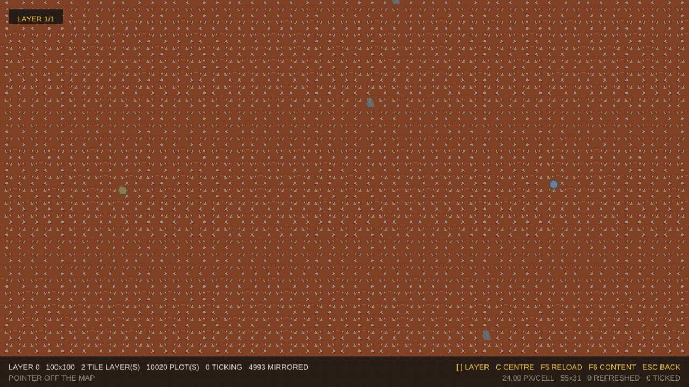

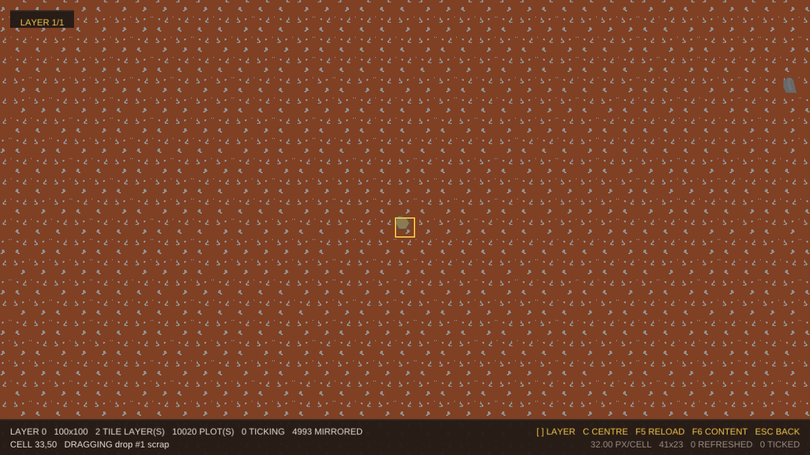

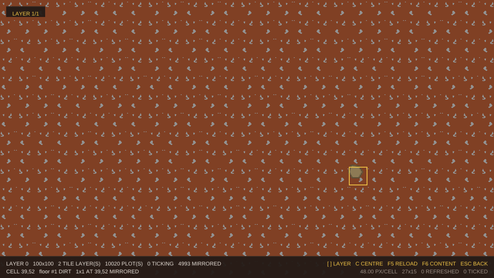

### M2 交付状态（十）：钻头——实体地块，按"硬度 ÷ 能力"出料（已落地）

设计者的要求（§1.26 的原话）："添加一个钻头类，类型为实体地块，可以被放置在矿物上，按照定义器设定的挖掘能力/
矿物硬度计算时间，每段时间向外丢出一个矿物对应的掉落"。

* **钻头是实体地块**（`mine::types::Drill`，`types/drill.h`）：它继承 `EntityTile`（§1.13 的"会跑的功能地块"），
  占着一格、按节奏跑；跑起来做的事是**挖它脚下的矿**。矿在它**下面的瓦片层**——一个格子每层只放一个地块
  （§1.12），所以"钻头放在矿上"就是"钻头站在矿上面那一层"，落位检查本来就不拦这种叠法。
* **周期 = 矿物硬度 ÷ 挖掘能力**，两个数都是设计者的：`drill::` 表给 `dig_power`，`ore::` 表给 `hardness`
  与 `drop`（挖出来是哪条掉落物，§1.25 的 `drop::`）。为此**追加了 `ContentKind::Drill`**（追加在类别表末尾，
  旧存档表照旧读得出来），并给地块定义器加了三个按类别读的字段。
* **两件事都在建层时定下来**（`MineLayer::configure_drill`）：那是注册表（名字 → id）与定义（设计者的数字）
  同时在手的唯一时刻，所以"脚下没矿""矿没说自己多硬""矿没说自己掉什么""钻头没说自己多能挖"都是
  **建层报告里的拒绝**，而不是一台永远默默不动的机器——四种都在单测里钉住了。
* **到点往外丢一个**：四个方向轮流、一格远（所以钻头不会把自己埋在一个点上；出图时贴边），丢出来的是
  **掉落物实体**——上一轮那个能被指针拖走的东西。为此**地块第一次够得到世界**：`Tile::owner()` 是它所在的层，
  钻头用 `owner()->adopt(...)` 把掉落物放进层里。
* **一帧比一个周期长时按时间出料**：`on_update` 拿到的是这一帧覆盖的整段时间（§1.13 的节奏规则），
  所以一次卡顿丢掉三个周期就是三个掉落物——"一次卡顿不改变矿场产出什么"。
* **实测（真机无头 1280×720，夹具层：24×16、3 个瓦片层、一条 hardness 2.0 的矿脉、一台 dig_power 1.0 的钻头）**：
  `world: layer 1 is 24x16 with 3 tile layer(s): 394 plot(s), **0 ticking** ...` 之后放下钻头 →
  `world: the drill 'rig' at 18,3 mines ore 'vein' (hardness 2.00 / power 1.00 = **2.00s per drop of 'chunk'**)`，
  层里变成 `395 plot(s), **1 ticking**`。让它真跑起来（调试输入服务器按真实时间截图）：钻头四周依次出现
  四个掉落物（右、下、左、上各一个）——两张截图就是"刚放下"与"跑了几秒之后"。
* **验证**：新增 `test_drills` **4 用例 / 58 断言**（它是实体地块、层把它算进 tick 列表、owner 是它所在的层；
  周期 = hardness/power；一次回合丢出一个、落在钻头旁边一格、四叉树在新位置找得到；方向轮流；一帧六秒
  丢三个；四种数据缺失各自被拒且机器保持 idle；定义器读三个字段并拒绝非数字/非正数/空名字；调试填充只放在
  有矿的格子上、一层只有一个瓦片层时放不下）。套件 **29 个测试**全绿
  （release / debug / asan / tsan / server-only 29/29、no-renderer 11/11、Ore 13/13）。
* **顺带把掉落物的定义器接进加载**：上一轮 `drop::` 的读取器只有测试在用，加载路径并没有读它——现在包与模组
  两条路都会读、会留下（`ContentDefinitions::find_drop()` / `drop_count()`），调试填充也改走 `make_drop()`，
  与地块走 `make_tile()` 是同一条路。
* **表与公开面**：本体表 760 → **789 节 / 2413 → 2499 符号 / 9203 → 9620 重定位**（release，
  1 217 687 → 1 288 432 B = 1.23 MiB；debug 5857 / 19966 / 26360 / 3.70 MiB），指纹不变
  （`bdcb9b070ab30e78`，头文件 83 → 84），align 分布
  `{1:130, 2:64, 4:7, 8:82, 16:436, 32:39, 64:31}`，向宿主索取的符号仍是 **161** 个。
  文档里的三张旧截图（世界、沙盒、会话）重渲染后**逐字节相同**——钻头没有动到别人的画面。
* **还没有的东西**：① **没有数据说"哪里该有钻头"**——`drill::` 说得清"有这么一台机器"，说不清"在这一层放一台"；
  现在能放下它的只有 `--layer-drills 1`（调试填充：每个 `drill::` 放在一个有矿的格子上）或 C++。
  ② **矿不会被挖完**：一条矿脉有多少、挖完怎么办是设计者的（§7.3/§7.10），引擎只按时间出料。
  ③ **掉落物还没有人捡**：没有拾取、没有背包、没有需求点名（§7.2/§7.6/§7.10）；"这条掉落物是哪条物品"
  同样还没建模。

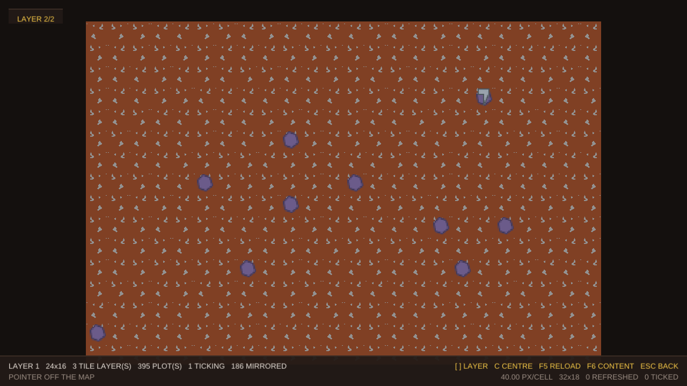

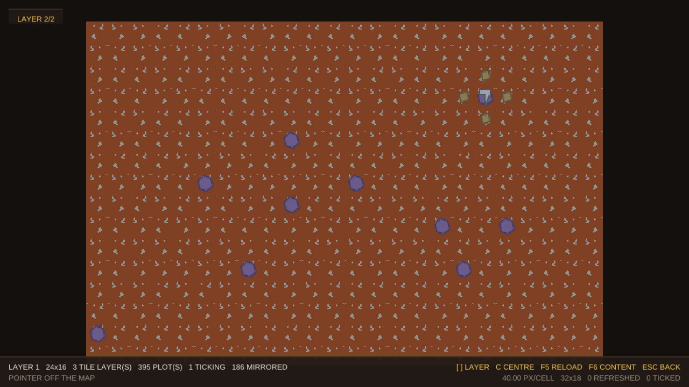

### M2 交付状态（十一）：仓库——容器、拖入、点击（已落地）

设计者的要求（§1.27 的原话）："添加仓库，类型为场景地块，通过定义器设定容量等参数，鼠标拖动掉落物到仓库上方即可
把掉落物加入到仓库中，点击在地块右下角显示包含内部物品信息的ui，仓库对象中包含子对象container用于存储物品信息
和处理存储功能并便于和其他代码交互，包含draginto子对象用于接收掉落物，包含click子对象接收点击信息"。

* **仓库是场景地块**（`mine::types::Warehouse`，`types/warehouse.h`）：`SceneTile` 的子类，**不跑、
  不自动更新**——它不是"会跑的功能地块"（那是 §1.13 的 `EntityTile`，钻头那种），而是**有人对它做什么的时候
  才发生什么**：一件被拖过来，或者被点一下。层的 tick 列表里因此没有它（单测钉住了 `ticking_count() == 0`、
  跑一百秒也返回 0）。
* **三个子对象，各管一件事，而且都能单独用**：
  * **`container`**（`types/container.h`）：容量、里面有什么、按**到达顺序**列出；`add` / `take`
    **返回实际收下/给出多少**——满了就是 0，快满了就给能放下的那些。它不认识仓库、也不认识掉落物：装的是
    "类别 + id + 数量"，与存档写的是同一对东西，所以机器、需求、存档、模组都能直接跟它打交道。
  * **`draginto`**（`types/drag_into.h`）：接收拖过来的掉落物。**要么整件收下、要么什么都不变**——
    半件进一个满箱子是在撒谎。这条规则当场抓出一个 bug：第一版先 `add` 再比较数量，于是"拒绝"的时候
    箱子已经被塞进了能塞的部分；现在先看空间再动手，单测钉住了"拒绝之后总数不变"。
  * **`click`**（`types/click.h`）：接收点击。**点在它身上**就展开/收起面板，**点在别处**就收起——
    只有一个指针，所以只有一件东西是选中的；它只记"开着没有"和"被点了几下"，面板画什么不归它管。
* **定义器给容量**：`warehouse::` 表读一个字段 `capacity`（必须是大于零的整数，`capacity:2.5`、`capacity:0`
  都被**拒绝**并说明；别的类别写这个字段不读也不报错）。没写就是**装不下任何东西**的仓库，而不是一个被塞了
  一个谁也没写的尺寸的仓库。
* **拖动入库**：松手时看掉落物**落在哪一格**（位置是点，格子由它取整得到），从**最高瓦片层往下**找那一格上的
  仓库——与画面上看到的一致。进得去就进容器、地上那件**随即从索引里消失**（帧末从存储里消失，正在遍历的回调
  手里的指针仍然有效）；进不去（满了）就留在放开的地方，并且**在错误色里说出来**；落在空地上就是普通放下。
  `PointerDrag::end()` 因此返回 `Stored` / `Refused` / `Left` / `Nothing`，并留下最后一件的类别与 id
  （它已经从层里消失，消息只能靠这里记住的身份）。
* **点击看内容**：点击**不落在可拖的东西上**时就是一次点击——所有仓库都被问一遍（落在它身上的那个打开或收起，
  其余的把面板收起来），面板画在**地块的右下角**：标题行 `WAREHOUSE   1 / 4`，然后一件一行
  `drop #1 chunk   x1`（空的就是 `EMPTY`）。三语言都有。
* **实测（真机无头 1280×720，夹具层 20×12、2 个瓦片层、3 个仓库、1 个掉落物）**：把掉落物从屏幕
  `(642,372)` 拖到仓库 `(375,482)` 松手 → HUD 变成 `STORED drop #1 chunk`，按颜色数**地上的掉落物像素
  从 198 个变成 0 个**（它进了容器），容器里 1 件；再点一下那个仓库 → 面板出现在它右下角，写着
  `WAREHOUSE   1 / 4` 与 `drop #1 chunk   x1`。两张截图就是这两步。
* **验证**：新增 `test_warehouses` **6 用例 / 106 断言**（容器：容量/剩余/满、只收下放得下的、按到达顺序列出、
  取走返回实际数量且空槽消失、没有内容的 id 与 0 件都不收、容量调小不丢东西；draginto：整件收下或什么都不变、
  收一个掉落物实体；click：点它开、再点关、点别处关、只数落在它身上的；仓库：是场景地块不是实体地块、
  不 tick、容量来自条目、2×2 覆盖四格、点击按格判定；拖动：拖到仓库上入库且地上消失、满了拒绝且留在原地、
  落在空地上就是放下；定义器：读容量、拒绝非整数/零/负数、别的类别写了不读）；`test_text` 347 → **357 断言**
  （三语言的五条新文案）。套件 **30 个测试**全绿（release / debug / asan / tsan / server-only 30/30、
  no-renderer 11/11、Ore 13/13）。
* **表与公开面**：本体表 789 → **806 节 / 2499 → 2553 符号 / 9620 → 9773 重定位**（release，
  1 288 432 → 1 306 545 B = 1.25 MiB；debug 5982 / 20384 / 26831 / 3.77 MiB），指纹不变
  （`bdcb9b070ab30e78`，头文件 84 → 88），
  align 分布 `{1:132, 2:64, 4:7, 8:83, 16:446, 32:42, 64:32}`，向宿主索取的符号仍是 **161** 个。
* **还没有的东西**：① **没有数据说"哪里该有仓库"**——`warehouse::` 说得清"有这么一种仓库"，说不清"在这一层
  放一个"；夹具里是用散点生成器放的，本体内容里一个仓库都没有（§7.7）。② **容器里装的是掉落物**，不是物品：
  掉落物仍然不说自己是哪条物品（§1.25 的遗留，等 §7.2/§7.6/§7.10）。③ **只有放进去，没有取出来**：`take`
  这一半在容器上，但还没有任何界面或规则调用它（物流、机器取料都还没有）。

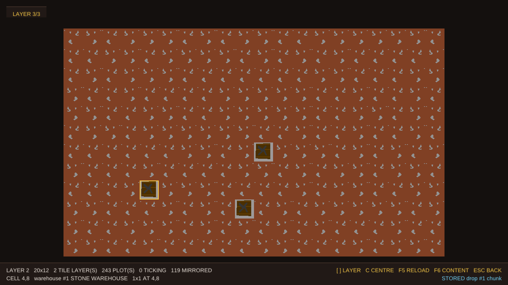

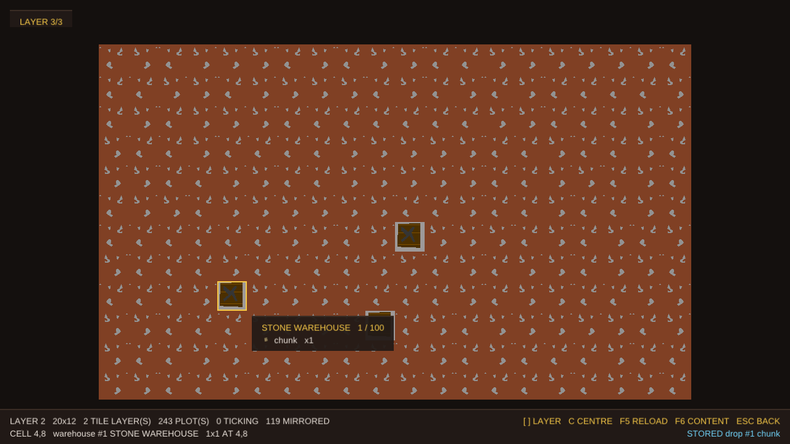

### M2 交付状态（十二）：石头仓库，与"[贴图][名称][数量]"（已落地）

设计者的要求（§1.28 的原话）："我已经放置了贴图，添加一个石头仓库方块，容量100.以及我希望显示物品信息时包含物品
的贴图，即[物品贴图][物品的本地化名称][数量]"。

* **本体内容多了一个仓库**：`content/warehouses.ecfg` 里 `warehouse:: stone::`——贴图就是设计者自己放进
  本体包的那张 `content/art/capacity_stone_warehouse.png`（128×128 的木箱），**容量 100**。这是本体内容的
  第四个文件（地板、物品、矿物、层、仓库）。设计者的 `.kra` 源文件也在那个目录里：引擎只读 `.ecfg` 与它
  点名的图，别的文件是设计者的（`docs/MODS.md` §0 允许），所以它既不影响加载也不影响打包。
* **面板每一行变成 [贴图][本地化名称][数量]**（§1.28）：贴图是这条内容自己那张（`image_key` → 自己的纹理），
  名称走新的查找 `mine/content_name.h` 的 `content_label()`——**`content.name.<种类>.<名字>`**，其次
  **`content.name.<名字>`**，都没有就用注册表里的 id（内容没了就是 `#<id>`）。字符串表"没有就回它被问的
  那个 id"这条规则（`t2d::Locale::text`）正好让"没写名字"和"名字是空字符串"分得开。
  面板的**标题**也是仓库自己的本地化名称（`STONE WAREHOUSE   1 / 100`、`石头仓库   1 / 100`），
  没写名字时才退回种类自己的词（`WAREHOUSE` / `仓库` / `倉庫`）。
* **两趟画同一个面板**：字在 overlay 里（和 HUD 一起，用字形图集），图在自己的图片趟里（一张内容一张纹理），
  两趟都问同一个 `warehouse_panel_layout()`——否则图和字会各画各的（沙盒的 `PaletteLayout` 是同一个道理）。
* **实测（真机无头 1280×720，夹具层 20×12）**：夹具层现在放的是**本体自己的**那个仓库（`warehouse:: stone::`），
  把夹具的掉落物拖进它：英文 `STONE WAREHOUSE   1 / 100` + 一行 `[chunk 的贴图] chunk   x1`；
  换成 `--lang zh-Hans` 同一屏是 `石头仓库   1 / 100` + 同一行（夹具的 `chunk` 没有写名字，所以显示它的 id——
  这正是"没写就显示 id"那条回退规则）。HUD 同时写着 `STORED drop #1 chunk`。
* **验证**：`test_warehouses` 6 → **7 用例 / 106 → 114 断言**（新增一条：名称查找的三种情况——种类专属的名字
  赢过通用名字、通用名字赢过 id、表里没有就回 id，以及"表里到底有没有"这个回答；同一个 id 在两种类别下可以有
  两个名字）；`test_content_pack` 239 → **245 断言**（本体包现在四张图、三个地块定义，仓库的 `capacity` 是 100）；
  `test_text` 357 → **363 断言**（三语言的两条新文案 + 标题改成带名字的形状）。套件 **30 个测试**全绿
  （release / debug / asan / tsan / server-only 30/30、no-renderer 11/11、Ore 13/13）。
* **表与公开面**：本体表 806 → **818 节 / 2553 → 2585 符号 / 9773 → 9891 重定位**（release，
  1 306 545 → 1 323 495 B = 1.26 MiB；debug 6011 / 20457 / 27140 / 3.80 MiB），指纹不变
  （`bdcb9b070ab30e78`，头文件 88 → 89），align 分布 `{1:135, 2:65, 4:7, 8:85, 16:450, 32:44, 64:32}`，
  向宿主索取的符号 161 → **162** 个（`content_label` 里的 `std::function` 带进来一个平台符号）。
* **没有改的地方**：底部 HUD 的格子那一行、内容列表里仍然是引擎的 `种类 #id 名字`（它们没有贴图，而且文档里的
  截图一直引着这个格式）。想让它们也走本地化名字是一行的事——设计者说一声就改。
* **还没有的东西**：① **没有数据说"哪里该有仓库"**：夹具层是用散点生成器放的（放的是本体自己的那个仓库），
  本体内容里还没有"这一层放一个仓库"的规则（§7.7）。② **容器里装的是掉落物**，不是物品：掉落物仍然不说自己
  是哪条物品（§1.25 的遗留，等 §7.2/§7.6/§7.10）。③ **只有放进去，没有取出来**：`take` 还没有人调用。


![点一下仓库（英文）：标题是 STONE WAREHOUSE   1 / 100，每一行是 [贴图][名称][数量]](../games/mine/docs/images/world_warehouse_panel_en.png)

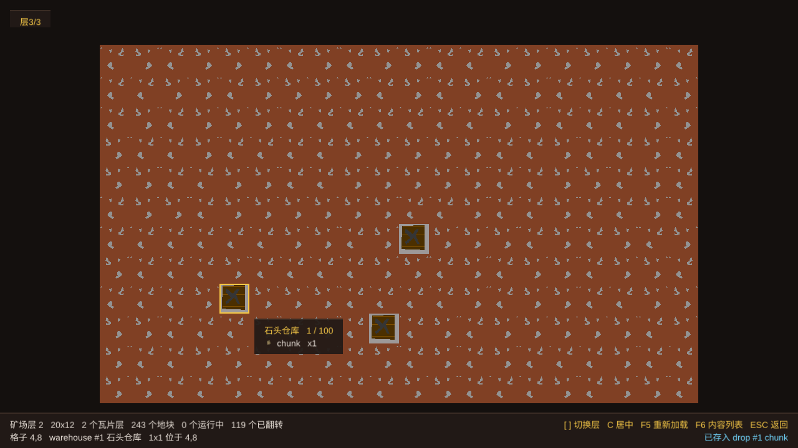

### M2 交付状态（十三）：本地化名称，与 40–100 像素/格的相机（已落地）

设计者的要求（§1.29、§1.30 的原话）："添加本地化名称功能，以及限制摄像头缩放为40px-100px"。

* **一个查找，界面各处**：`content_label()`（`mine/content_name.h`，M2.15 引入）现在被界面上**每一处**显示
  内容名字的地方点名使用——游戏里唯一的入口是 `MineApp::content_name(种类, id)`（`games/mine/include/mine/app.h`）：
  ① 世界视图 HUD 的格子那一行（被指的地块与拖动中都算），② 仓库面板的标题与每一行（M2.15 已经是），
  ③ 内容列表的每一行，④ 沙盒调色板的每一行（名字在左，`种类 #id` 在右，id 仍在——存档与日志用它），
  ⑤ 入库那条 HUD 消息（`已入库 drop #1 chunk`），⑥ 沙盒自己的格子读数与格子标签（状态栏 `L0 floor #1 DIRT`，
  以及格子上放得下时画的那个标签——放不下时仍然退回 `#id`，那是存档与日志用的数字）。
  **"界面上显示内容名字"因此只有一条实现**，改一次这些地方一起改；找不到的那一处（沙盒状态栏与格子标签）
  正是**重出截图时看出来的**：图先拍，字随后对不上，就把代码改了。
* **没写名字的内容显示它的 id**：这条回退规则没有变（`t2d::Locale::text` 对没有的字符串回它被问的 id），
  所以夹具的 `chunk`、`scrap` 仍然显示它们自己的 id——**用夹具的那些截图因此没变**（本体内容都有名字，
  夹具没有），只有本体内容出现的地方变了。
* **种类自己的词不跟语言走**（`content_kind_name`：`ore`、`warehouse`…）：它们是引擎的词汇，写在文档、
  日志与 `engine.api` 里，界面上的 `warehouse #1 石头仓库` 正是"引擎的词 + 设计者的名字"。**设计者说不需要
  它们跟语言走**（M2.16 的答复），所以种类词永远是引擎的英文词汇，界面上一眼分得清哪一半是谁的。
* **相机的缩放范围**：`mine/view_limits.h`（`kMinViewZoom = 40.0f` / `kMaxViewZoom = 100.0f`）在
  `MineApp` 构造时交给世界相机（`set_zoom_limits`），所以**每一条**改缩放的路都落在同一对数字里——
  启动参数 `--view`、进层的自动取景、`+`/`-`、滚轮；相机自己仍然是"缩放没有变化就不移动视野"
  （`Camera2D::zoom_at` 在范围顶端照样成立）。40 是还能看清并点中一格的下限，100 是一格占满屏幕的上限。
  **这两个数是常量，不是内容数据**：设计者说不需要每层的范围（M2.16 的答复），`view_limits.h` 因此是
  唯一一处写着它们的代码。
* **实测（真机无头 1280×720，夹具层 20×12，64 像素/格起步）**：连按 12 次 `-`（不设限会是
  64 × 0.8¹² = 4.4 像素/格）→ HUD 写着 **`40.00 PX/CELL   32x18`**（1280 ÷ 40 = 32 格），木箱上那个灰叉
  实测 **31 → 19 像素**（19 ÷ 0.484 = 40）；连按 12 次 `+`（不设限会是 64 × 1.25¹² = 931 像素/格）→
  **`100.00 PX/CELL   14x8`**，同一个灰叉 **48 像素**（48 ÷ 0.48 = 100）——两头都停住，48 ÷ 19 = 2.5
  正是 100 ÷ 40。`--view 10,6,5`（要 5）开机就是 `40.00 PX/CELL`。
* **装不下的图：限制赢**：故事的 100×100 层按 40 像素/格是 4000×4000 像素，1280×720 的窗口要"看到整张图"
  得约 12 像素/格——进层取景只能到 **40**，实测 `LAYER 0 100x100 … 40.00 PX/CELL   32x18`。这是设计者给的
  范围的直接结果（§1.30），不是缺陷：范围是设计者定的，取景只能到它允许的地方。
* **名字的证据**：英文 HUD `CELL 1,9   floor #1 DIRT   1x1 AT 1,9 MIRRORED`——**DIRT 是大写的**，而注册表里
  的名字是数据里写的小写 `dirt`，所以这一行证明它来自字符串表而不是回退；简体同一处是
  `格子 4,8   warehouse #1 石头仓库   1x1 位于 4,8`。内容列表（简体，展开本体包）五行：
  `floor #1 泥地`、`item #1 石头`、`layer #1 入口`、`ore #1 石头`、`warehouse #1 石头仓库`；
  沙盒调色板英文 `DIRT` / `STONE`、简体 `泥地` / `石头`（右边仍是 `floor #1` / `ore #1`）。
* **沙盒的相机不动**：它是调试工具，仍是 0.05–512 像素/格——同一屏上它写着自己的 `VIEW 20.00 PX/CELL`
  （20 比游戏的 40 还小，正是"没被夹"的证据；`docs/SANDBOX.md` §7）。
* **验证**：`test_world` 12 → **13 用例 / 130 → 146 断言**（新增一条：两个常量的值、`clamp_view_zoom` 在
  0/12/40/64/100/1000 上的回答、相机的 `set_zoom` 在两头被夹住、以及"缩放没变就不移动视野"在范围顶端
  仍然成立、范围内锚点不动）；`test_text` 363 → **367 断言**（三语言多了 `content.name.dirt` 与
  `content.name.entrance`）。套件 **30 个测试**全绿（release / debug / asan / tsan / server-only 30/30、
  no-renderer 11/11、Ore 13/13）。
* **表与公开面**：本体表 818 → **822 节 / 2585 → 2602 符号 / 9891 → 9928 重定位**（release，
  1 323 495 → 1 326 770 B = 1.27 MiB），指纹不变（`bdcb9b070ab30e78`，头文件 89 → **90**——新的
  `mine/view_limits.h`），align 分布 `{1:135, 2:65, 4:7, 8:86, 16:452, 32:45, 64:32}`，
  向宿主索取的符号仍是 **162** 个（这一轮没有新的平台符号）；其中 `ore::InputState::mouse_pressed` 按设计者
  的决定进了公开面（M2.16）——引擎那 83 个符号从此**全部**在 `engine.api` 里，启动器报告 0 个越界。
* **还没有的东西**：① 夹具与模组里的名字（`chunk`、`scrap`、`wall`…）没有本地化名称——它们是测试替身，
  设计者没给名字，所以它们照旧显示 id；② 种类词不跟语言走、③ 40/100 是代码里的常量——**这两条是设计者的
  决定**（M2.16），不是还没做的事。


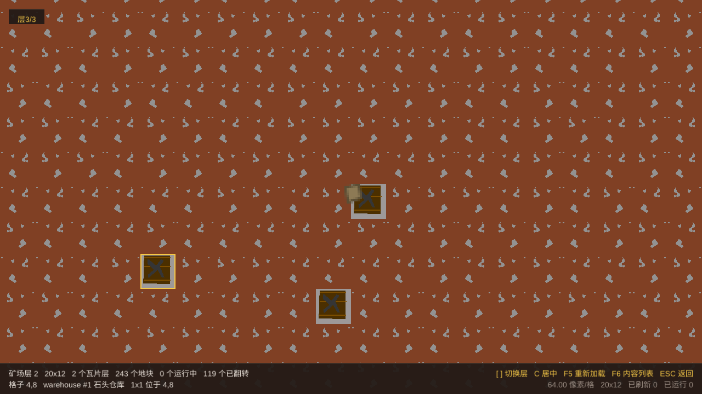

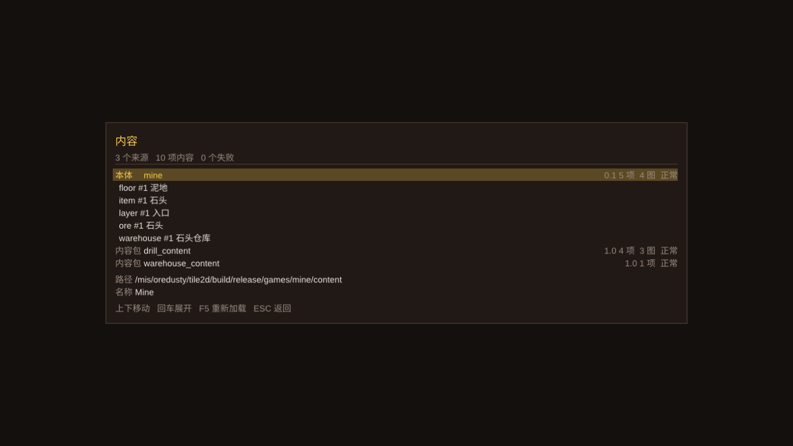

### M2 交付状态（十四）：双击选中带容器的地块，内容显示在界面最上方居中（已落地）

设计者的要求（§1.31 的原话）："使得包含container子对象的地块可以被鼠标双击选中，选中后会在游戏界面最上方居中
显示物品信息"。

* **"带容器的地块"是一个问法，不是一个类型**：`SceneTile` 多了 `container()`（默认 `nullptr`，仓库覆盖它
  返回自己的容器，`types/scene_tile.h`）——双击不认"仓库"这个名字，它问地块"你有没有容器"。将来的机器
  输入侧、需求提交箱只要有容器就自动能被选中，这里一行都不用改。
* **双击是游戏自己的判断**（`mine/double_click.h`）：**同一个格子、两次按下、0.4 秒之内**。指针在两次之间
  晃一点不算（手抖不该把一次双击变成两次），按到别的格子就重新计数。窗口是代码常量、不是内容数据，由帧
  时间推进——第一下按下的"忘了"是时间到了，不是被下一次按下顶掉的。单测 `test_double_click` **8 用例 /
  28 断言**钉住这几条（同格与异格、刚好在窗口内、超出窗口、一秒之后、第三次按下、reset、空转的时间不改变
  任何东西）。
* **一次手势只显示一处**（沿用 `types/click.h` 那条"一个指针、一个被选中的东西"）：双击的第一次按下仍然是
  单击（打开/关闭地块右下角的面板，§1.27），第二次按下**选中**、并把右下角的面板关掉；此后任何一次单击
  都把显示让回给右下角面板。选中的东西消失（换层、重载、地块没了）就自动清掉——选中记住的是**格子**，不是
  地块指针，因为重载会重建整层。
* **同一份内容，两处画**：`container_panel()` 一次算出标题、每行的本地化名字与面板大小；
  `place_panel_at()` 把它放在地块右下角（§1.27），`place_panel_top_centre()` 把它放在**界面最上方居中**
  （§1.31）。字在 overlay 趟、贴图在自己的图片趟，两趟问同一个排版（与 M2.15 同一个道理）。
* **实测（真机无头 1280×720，夹具层 20×12，48 像素/格）**：先把夹具的掉落物拖进一个仓库，再在同一格双击——
  日志 `world: selected warehouse #1 at 4,8`，界面上方居中出现 `STONE WAREHOUSE   1 / 100` + 一行
  `[chunk 的贴图] chunk   x1`。**量出来的位置**：面板上沿 y=16，横向 x 525..754（宽 230），**中心 639.5**，
  屏幕中心是 640；换 `--lang zh-Hans` 同一屏宽 142、中心仍是 639.5——面板宽度是文字算出来的，中心不偏。
* **验证**：新增 `test_double_click` **8 用例 / 28 断言**；`test_warehouses` 7 → **8 用例 / 114 → 119 断言**
  （新增一条：仓库被当作普通地块问 `container()` 时给出的就是它自己那个容器，而地板没有容器——双击要问的
  正是这个）、`test_sandbox` 718 → **719 断言**（仓库成了可放置内容：不然试玩里没有仓库可选）；套件
  **31 个测试**全绿（release / debug / asan / tsan / server-only 31/31、no-renderer 11/11、Ore 13/13）。
* **设计者的三条补充**（M2.17）：① **沙盒的试玩**也要这个功能（编辑状态不要）——试玩里双击选中的地块是
  按那一格的内容**现建**出来的（沙盒存的是内容引用、不是地块对象，`types/tile_definition.h` 的 `make_tile`），
  所以面板说的是"这个容器现在是空的"；沙盒里没有存储，它说的是实话。为此**仓库成了可放置内容**
  （`is_placeable_kind` 多一行：它和地板、矿一样占一格），否则试玩里根本没有仓库可选。② 面板只说**装了什么**，
  不说来源（§7.10 的数据还没给）。③ **地图上的方框高亮**：选中的地块在它自己的位置上画一个占地大小的方框
  （3 像素强调色）加一层 27% 的强调色（`kPalette.highlight`），世界视图与试玩都画。
* **顺带修掉试玩里的一处遮挡**：试玩画格子是**满格、没有内缩**的，而内容贴图在**字之后**的另一趟里画——
  所以指针框、选中框与面板要是还和字一起画在贴图之前，就会被贴图盖住（重出截图时看得见：面板的字上压着
  石头）。它们现在都在贴图之后画（`draw_playtest_over_art`）。
* **表与公开面**：本体表 822 → **857 节 / 2602 → 2673 符号 / 9928 → 10132 重定位**（release，
  1 326 770 → 1 351 045 B = 1.29 MiB），指纹不变（`bdcb9b070ab30e78`，头文件 90 → **91**——新的
  `mine/double_click.h`），align 分布 `{1:139, 2:66, 4:7, 8:90, 16:477, 32:46, 64:32}`，向宿主索取的符号
  仍是 **162** 个（这一轮没有新的平台符号）。
* **还没有的东西**：① 双击**只在世界视图里**——沙盒是调试工具，而且它存的是内容引用而不是地块对象，
  那里没有容器可问；② 面板说的是容器**装了什么**，不是"这条物品从哪来"——那仍是 §7.10 的数据；
  ③ 选中没有在地图上画高亮（标题里写着是哪个地块）。

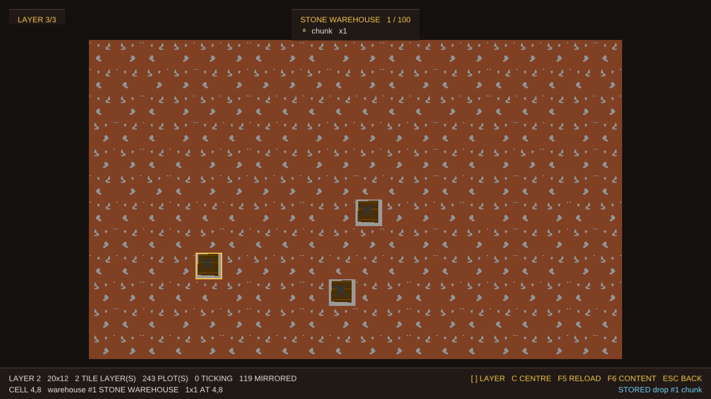

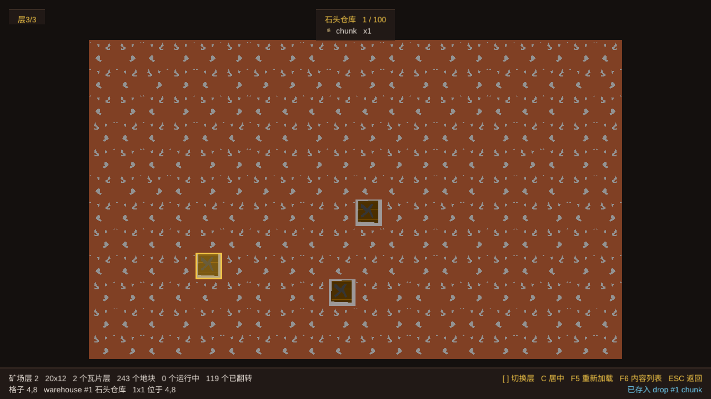

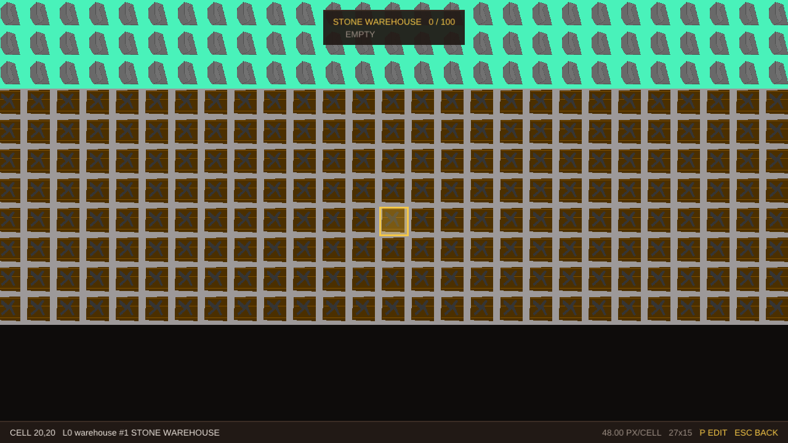

### M2 交付状态（十五）：`.ecfg` 的 `__include`（已落地）

设计者的要求（§1.32 的原话）："为ecfg添加__include: #file 功能，加载时可以加载其他ecfg文件的内容放入
include所在的位置解析"。

* **它是"位置"，不是"字符串"**：展开在**解析之前**做——一行 `__include: #<路径>` 被那个文件的行**替换**掉，
  再交给原来的解析器。所以 include 出来的内容与直接写在那儿**完全一样**：同样的键唯一、同样的缩进规则、
  同样的报错。内容包里的每个内容文件、`ui.ecfg`、`mod.ecfg`、沙盒读的那几份，走的都是这条路
  （`EcfgDocument::load` 现在会解析 include）。
* **缩进就是位置**：被包含的文件**顶格**写，落进来时缩进到 `__include` 那一行的缩进。于是同一份片段既能放
  在顶层、也能放进 `item::` 表里——这正是"把一个文件拆成几份"的用法（`docs/MODS.md` §0 有例子）。
  `<< ... >>` 文本块的内容**原样**搬过去：那是值，缩进它会把值改掉。
* **每一处失败都指得出来**：读不到（`__include 'x.ecfg' cannot be read (from …)`）、成环（a 引 b、b 引 a
  → `is already being read … (a loop)`）、嵌套超过 **16** 层、`#` 后面没写路径——四种都报**文件 + 行号**；
  被包含文件里的**语法错误**也指回它自己（解析器数的是展开后的行，报告时换回原来的文件与行）。
* **纯文本的 `parse(text)` 会拒绝 include**，并说清原因（那段文本没有可以相对的文件）：内存里的文本没有
  目录，替它猜一个是不对的。知道自己在读文件的调用方用 `load`（相对文件自己）或新的重载
  `parse(text, base_directory, error)`。
* **被包含的文件自己也能 include**（递归展开，链上查环），所以"包 → 章节 → 条目"这种三层拆分是自然的。
* **片段可以自己声明**（设计者 M2.18 的第三条，值三选一）：`__not_main` 是 `"skip"` 时 `load` **跳过**这个
  文件——没有文档、**也没有错误**（`ecfg_skipped(error)` 就是问这个；重载照样跳过）；是 `"true"` 时**拒绝**，
  错误直说"include 它，不要单独加载它"；是 `"false"`（或不写）时是普通文件。两个布尔字面量 `true`/`false`
  等价。**别的值一律报错**，不会被猜成 `false`。include 这条路不经过 `load`（展开器自己读文本），所以片段
  照常能被 include。它是文件自己的属性——**不跟着内容走**：被 include 的文件即使写着 `"skip"`，包住它的
  主文件仍然是一个可以加载的主文件（有单测钉住，否则每个带片段的包都会拒绝加载）。
  引擎自带的三条加载路径（内容包扫描、模组宿主、沙盒重载）都按这个字段跳过文件；`EcfgDocument::main()`
  让别的调用方也能问出文件自己说了什么。与 `_` 前缀分工：名字让**包扫描**不去读它，字段让**直接加载**失败
  或跳过，两道保险。
* **片段的名字以 `_` 开头**（`_parts.ecfg`、`_ores/stone.ecfg`）：内容包扫描时这样的文件或目录**不是内容
  文件**，因为它们既会被自己读一遍、又会被 include 一遍，同一份内容就会注册两次（实测过：不跳过时那条
  内容会被报成"不是一个内容类别"）。片段照样能被 include——扫描看名字，展开看 `__include`，两件事分开。
* **验证**：`test_ecfg` 12 → **22 用例 / 128 → 154 断言**（十个新用例：顶层与表内、文本块原样、递归、相对
  文件、读不到、成环、写法不对、纯文本拒绝、被包含文件里的语法错误指回它自己）；`test_content_pack`
  **16 用例 / 253 断言**（两个新用例：一个包里的内容文件 include 另一个、include 不到时报出文件名）；
  套件 **31 个测试**全绿（release / debug / asan / tsan / server-only 31/31、no-renderer 11/11、Ore 13/13）。
* **表与公开面**：本体表 **857 节 / 2674 符号**里 t2d 部分 57 → **58** 个（多的是新的 `parse` 重载），
  引擎公开面 83 → **84** 个（A 层 38 → **39**，`engine.api` 里加了那一行），启动器仍然报 0 个越界符号；
  向宿主索取的符号总数 162 → **163**。
* **验证跑得更快了**（设计者 M2.18 的第四条）：`tools/verify.sh` 把七个目标（六个预设 + Ore）**并行**跑
  （每个构建树彼此独立），每个目标内部再用 `ctest -j` 并行，作业数按核数在目标间平分（`VERIFY_JOBS` 可覆盖）。
  实测同一台机器上：原来串行 **约 190 秒**，现在 **27 秒**（都建好时）到 **53 秒**（含增量构建）——约 3.5–7 倍。
  并行也暴露了两个**真的会打架**的地方并修掉了：工具的 ABI 探针目录原来按"在构建什么"命名（两个预设同时跑同一个
  测试就是同一个目录，一个把另一个正在链接的目录删掉），`/tmp/codetab-names.txt` 是固定名（两个进程互相截断）。
  现在两者的名字都带**本次运行的令牌**。日志在 `build/verify/`。
* **还没有的东西**：① include 不做"只包含一次"——同一个文件被两处 include 就是两份，和 C 的 `#include` 一样；
  ② 没有通配（`#parts/*.ecfg` 不行），要哪份写哪份；③ 路径可以写 `..`、也可以写绝对路径——内容文件是给
  设计者的工具，不是一个沙箱；④ 分层更多的是编辑器的事：展开后的行号只出现在错误信息里。

### M2 交付状态（十六）：层定义器的 `place_block`（已落地）

设计者的要求（§1.33 的原话）："在层定义器中添加place_block字段，可以在指定位置放置具有指定属性的方块，格式为
place_block:: / placement1:: / x:111... subobject:: / container:: / items:["aaa",100,"bbb",100]"。

* **一条放置就是一行数据，落在它说的那一格**：`kind` + `content`（与 `scatter` 同一对字段）、`layer`（默认 0）、`x` 与 `y`
  （**两个都要写**——一格有两个坐标，原话里的 `x:111...` 后面的省略号我读作"还有别的字段"）、`subobject:: container::
  items:[名字,数量,…]`。位置是**固定**的（这正是它与 `scatter` 的分工：一个说"哪里"，一个说"多少"）。
* **它是第三个创建器**：地板 → **放置** → 散点。放在散点之前，占住的那一格散点就不会再落上去（与"一个格子一个
  瓦片层只放一个东西"同一条规则）；地板在它之前，所以放置的东西站在已经铺好的地板上。
* **`subobject::` 是引擎的词**：今天只有 `container::`（将来机器输入侧、需求提交箱是同一层里的别的子对象），
  别的名字**直接报错**，不会被忽略——与 `size::`、`floor::` 一样，引擎定义的表里不认识的键是错误。`items` 是"名字、
  数量"成对的扁平数组：奇数个、名字不是字符串、数量不是正整数，都在读文件时报错。
* **物品名字在这里不解析**：放在层里的数据只说名字，**世界建这一层时**才拿注册表去查（模组能改名、能加物品，
  一个内容文件不该假定另一个文件里有什么）。查不到、容器装不下、那一格在地图外、瓦片层不存在——四种都在
  **构建报告**里成句地说出来，而不是让地图悄悄少一块或者少装几件。
* **实测**（真机无头 1280×720，48 像素/格）：写一个内容包，层 `demo` 是 20×12、两层瓦片层，地板铺 `dirt`，
  再 `place_block` 一块 `warehouse:"stone"` 在 `x:4 y:8 layer:1`，装着 `items:["stone",100]`——日志
  `world: layer 1 is 20x12 with 2 tile layer(s): 241 plot(s)`（240 块地板 + **1 块放上去的仓库**），0 个错误；
  进世界视图双击那一格，上方居中的面板写着 **`STONE WAREHOUSE   100 / 100`** 与一行 **`[石头贴图] STONE   x100`**——
  装进去的东西是真的在那儿（同一屏也是 §1.31 的选中方框）。
* **验证**：`test_layer_rules` 23 → **25 用例 / 807 → 828 断言**（一条完整放置读成什么、五种写法错误各自的措辞）；
  `test_world` 13 → **15 用例 / 146 → 153 断言**（放上去的方块在那、容器里是数据说的那 7 件；装着没有的物品时
  方块照旧在、报告里点名）。套件 **31 个测试**全绿。

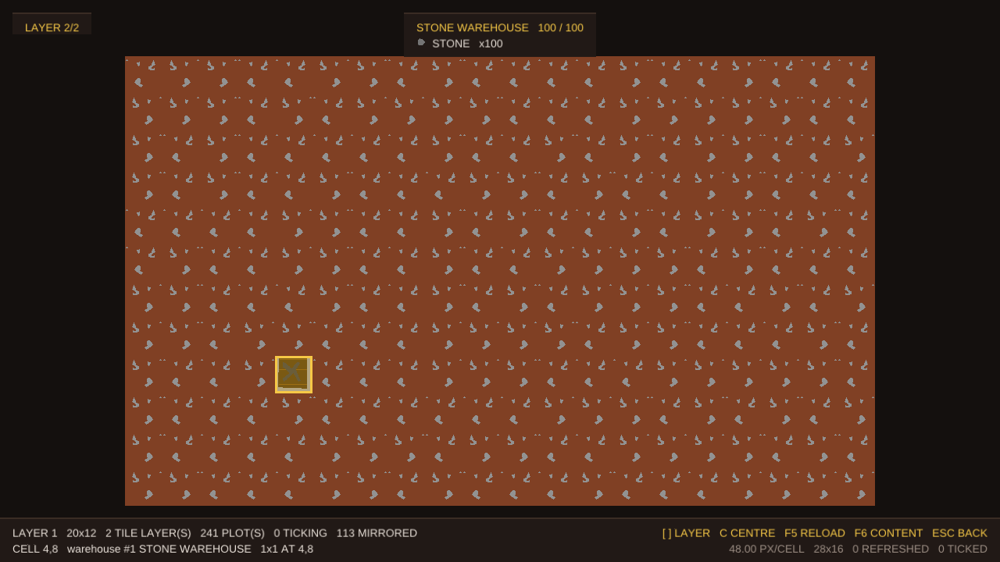

* **设计者随后给了第一层的内容**："设置故事模式第一层在地图中间放置包含10石头的石头仓库"——`games/mine/content/layers.ecfg`
  的 `entrance` 里因此多了一段 `place_block`：`kind:"warehouse" content:"stone" layer:2 x:50 y:50`，
  `subobject:: container:: items:["stone",10]`。**中间**取的是 100×100 的第 50 列第 50 行（0..99 的中点在 49 与 50
  之间，取右边那一格），放在**瓦片层 2**——设计者随后纠正："仓库作为一个建筑应该在地板层之上"，所以这一层从
  也不会落在它身上。实测：日志 `world: layer 0 is 100x100 with 2 tile layer(s): 10021 plot(s)`（10000 块地板 +
  20 块矿石 + **1 座仓库**，`3 TILE LAYER(S)`），HUD 同步；双击地图正中那一格，面板写着 `STONE WAREHOUSE   10 / 100` 与
  `[石头贴图] STONE   x10`。

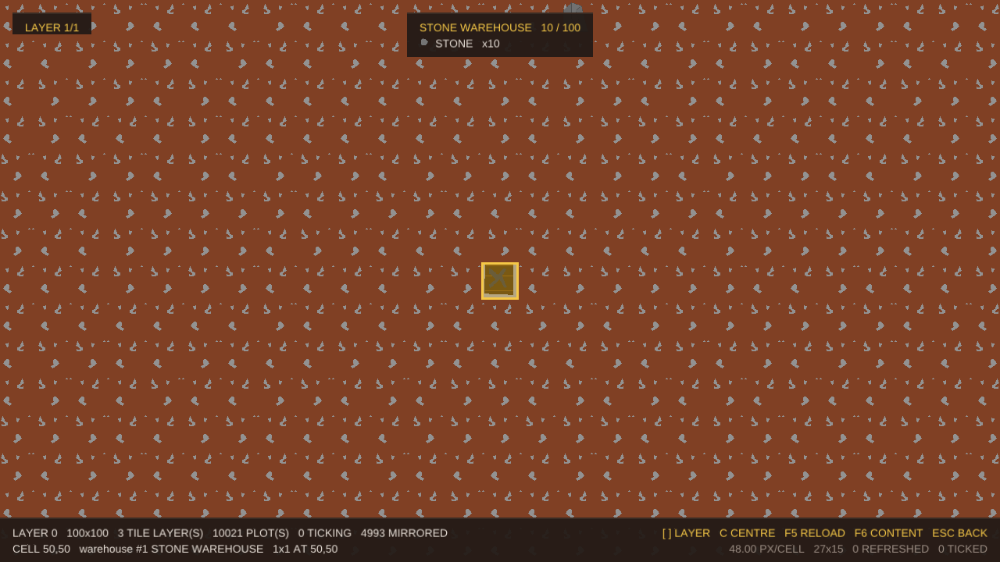

### M2 交付状态（十七）：`building` 子对象、放置前的判断、定义属性与存档属性（已落地）

设计者的两段要求（§1.34、§1.35 的原话）："创建building子对象，包含对应地块的所需材料，建造时间，建筑分类（存储，
加工，开采等，后续需要），提供建造相关的接口，包含can_place等方法在放置前判断对应的位置是否符合放着的条件，例如
钻头必须放置在矿物上等"；"我们需要让地块和子对象的属性分为定义属性(例如1个仓库容量是100这一类固定属性)和存档属性
（例如一个仓库里面有什么）并让他们区分起来，其中定义属性不可以在层设置中覆盖，地图上的所有同种地块读取同一份定义
属性，参考享元设计"。

* **`building` 是一个子对象，和容器并列**：内容条目下 `building:: materials:[…] time:5 category:"extraction"`；
  地块用 `SceneTile::building()` 回答。分类是引擎的词（storage / processing / extraction），不认识的名字在读文件时
  报错——与 `subobject::` 的其它名字同一条规矩。
* **`can_place` 是放置前的询问**，在 `MineLayer` 上（它才知道地图）：格子在不在图上、瓦片层有没有、那一格是不是空的、
  以及内容自己的条件。今天唯一的内容条件是设计者给的例子：**钻头必须站在矿上**（同一格更低瓦片层里有矿），层构建时
  对钻头强制，不合就进构建报告并跳过这一块。
* **定义属性 / 存档属性按享元分开**：`TileDefinition` 是**一份共享记录**（容量、掉头、图片、挖掘力、硬度、掉落、
  `building`），活过所有层；地块实例只存自己的状态。地块通过新的 `SceneTile::definition()` 拿到那一份——固定属性
  从它读，不拷贝。**层设置写不进定义属性**：`place_block` 的 `container::` 只认 `items`，写 `capacity:` 报错。
* **设计者的四条答复**（M2.20 收尾）：① "一次完善"——**容量改成定义属性**：`Warehouse::capacity()` 现在读它那一份
  定义（`definition()->capacity`），**没有 setter 了**，容器只是按定义建出来，运行时改不动；② "等后续加入"——
  `can_place` 的更多规则等设计者给；③ "等后续开发"——建造本身（扣材料、走时间、完工）等后续；④ "完善"——
  **单测补上了**（见下）。
* **验证**：`test_mine_types` 15 → **17 用例 / 191 → 224 断言**（`building` 从数据读出来是什么；同一内容的两块地块
  `definition()` 与 `building()` 是**同一个指针**——享元；不是建筑的内容 `building()` 是空）；`test_world` 15 →
  **16 用例 / 153 → 168 断言**（`can_place` 的四类回答各自的措辞：空位、已占、出图、瓦片层不存在；**钻头要矿**
  的两条分支；层构建时对钻头强制、报告里点名）；套件 **31 个测试**全绿（release / debug / asan / tsan / server-only
  31/31、no-renderer 11/11、Ore 13/13）。

### M1 验收标准（已满足）

1. 本文档存在，且代码中**没有任何预设的游戏内容**（资源/结构/配方/建筑清单均无硬编码）。
2. `mine_game` 启动后显示开始界面，可 ↑/↓ 选择、←/→ 修改、Enter 确认、Esc 退出。
3. 开始界面提供：世界类型（故事 / 无尽）、种子（无尽时可改、可随机）、以及单机 / 主持 / 加入 / 退出。
4. 选择后进入会话界面，显示本次会话的**世界类型、角色、种子**，并明确标注"层内容尚未提供"。
   （M2.8 之后：故事有层数据时这一行改成 `STORY DATA: N LAYER(S)`，只有一层都没有时才说"尚未提供"——见（五）。）
5. 菜单逻辑有纯 CPU 单测（无 GPU、无线程、毫秒级）。
6. 开始界面与会话界面各有 1 张离屏截图作为视觉证据。

---

## 9. 技术映射

**复用 Tile2D（不重复造）**：确定性 tilemap（多层 + 层掩码碰撞 + 序列化）、`Tileset`、`Rng`、
`ByteWriter/Reader`、日志、CLI、`.ecfg` 读取器；传输层 `ILink`（共享内存 SPSC 环 / KCP over UDP）、
消息分帧与握手、地图分块传输；渲染（`SpriteBatch`、字形图集、`TextRenderer`、`TilemapRenderer`）；
测试基建（`t2d_add_test`、离屏回读测试）。

**随横版演示一起删除的**（不是本项目的目标，留着会把设计往横版形状上带）：平台跳跃的 `World`、
它的快照格式与命令位、客户端预测/和解/插值、`ServerHost`/`LocalClient`、三个演示程序
（`tile2d_game`/`tile2d_server`/`tile2d_bot`）、内置平台 tileset 与程序化 tileset 图集、演示关卡与
其截图。传输层本身是内容无关的，全部保留并被 `test_kcp` / `test_protocol` 覆盖；
游戏的模拟、快照与预测在 M2/M3 按那时的内容重建（见 §8）。

**游戏新增**：

* `[已实现]` `mine_core`：会话配置（世界类型 / 角色 / 种子）、开始界面模型、内容注册表与
  每存档 id 表——纯逻辑，无 Ore 依赖。
* `[已实现]` `mine_app`：Ore 应用外壳 + 界面状态机（开始界面 ⇄ 会话界面）+ 绘制。
* `[已实现]` `mine_game`：可执行程序（`--world`、`--seed`、`--host`、`--connect`、`--start`、
  `--headless`、`--frames`、`--screenshot`）。
* `[已实现]` 配置读取器 `t2d/core/ecfg.h`（`.ecfg` 格式，严格报错带行列号）与内容加载器
  `mine_core/content_loader.h`；单测 `test_ecfg`、`test_content_loader`。
* `[已实现]` **字体引擎与多语言**：自研 TrueType/CFF 解析 + 解析式抗锯齿栅格化 + 字形图集 +
  排版（`t2d/text/*`、`t2d/render/{glyph_atlas,text_renderer}`），界面字符串按 id 从
  `assets/text/ui.ecfg` 取，支持 `en / zh-Hans / zh-Hant` 并可运行时切换；中文界面截图见
  `docs/TEXT.md`。单测 `test_font`、`test_cff`、`test_text`。
* `[已实现]` **单层沙盒**：`mine_core/sandbox.h`（网格、内容面板、光标、相机、按名字重载、
  布局序列化、文字导出）+ `mine_app` 的沙盒界面；单测 `test_sandbox`；说明 `docs/SANDBOX.md`。
* `[已实现]` **多层瓦片地图**：`TileMap` 支持 1..32 个瓦片层（构造参数，默认 1，因此所有既有调用
  行为不变）、按层掩码的碰撞/危险/单向/射线查询、`topmost()`、逐层填充与计数、逐层 ASCII 读写与
  盖章（`stamp_ascii`）；序列化格式升到 v2（逐层 RLE，运行不跨层），校验和与层数一起哈希。
  渲染器按层自下而上绘制。单测 `test_tilemap`（17 用例 / 359 断言）
  与离屏像素测试 `test_render_offscreen`（高层覆盖低层、掩码选层）。
* `[已实现]` 沙盒支持瓦片层：`--tile-layers / --layer / --fill-layer`，`[ ]` 切换当前层，非当前层压暗，
  光标处的"格子"报告整叠内容；布局文件（magic `MSB2` + 一个版本字节，当前 3）逐层存取。
* `[已实现]` **相机（框架）**：`t2d/core/camera2d.h`——世界↔屏幕映射、以锚点缩放、`fit`、`clamp_to`、
  `visible_cells`（剔除范围）。纯数学、无 GPU；沙盒的相机就是它，单测 `test_camera2d`。
* `[已实现]` **大图存储（游戏）**：`mine/content_grid.h`——每格 32 位的内容引用（id/kind/缺失标志）、
  按层惰性分配、O(1) 已放置计数；沙盒改用它，世界地图将来用它。单测 `test_content_grid`。
* `[已实现]` **大图绘制**：只走 `visible_cells()`，超过四边形预算时按块采样（`draw_step_for`），
  低缩放自动关掉网格线与标签；沙盒状态栏新增 `VIEW`（像素/格、可见格数、丢帧警告）与 `STORAGE` 行。
* `[已实现]` **框架修复**：`Application::run()` 退出顺序改为 `wait_idle()` → `on_shutdown()`（此前无头运行
  必然 `VK_ERROR_DEVICE_LOST`）；`AppConfig::upload_segment_size`（每帧动态数据段大小，默认 1 MiB，mine 用 4 MiB）。
* `[已实现]` **沙盒试玩（playtest）**：`P` 在同一层上切换“编辑 / 试玩”，`--playtest 1` 直接进入。
  试玩按**游戏的方式**画这一层（所有瓦片层自下而上、不压暗、贴图按格子铺满，没有网格线、标签、面板与
  状态栏），按**游戏的方式**操作（只有相机与指针：方向键/WASD 连续平移、滚轮或 `+`/`-` 缩放、中键拖动、
  `C` 复位；指针指着哪一格就在哪一格画框，底部一行 HUD 说出那一格是什么）。切换只换视口、不重置相机，
  所以“看的就是刚才在改的那块”。它**不是玩法**：没有模拟、需求、推进与动作（动作表属 §7.14），也没有
  角色——它验的是引擎这一半，并且是 M2 世界视图的第一个使用者。纯逻辑侧：`SandboxModel::point_at()` /
  `hovered()` / `point_at_cell()` / `set_viewport()`，单测 `test_sandbox`（28 用例 / 716 断言）。
  说明与截图：`docs/SANDBOX.md` §9。
* `[已实现]` **框架修复（文字行盒）**：`t2d::line_box()` + `layout_text()`（`t2d/text/text_layout.cpp`，
  `t2d::text`，**无 GPU 也能排版**）——pen 是第一行行盒的左上角，基线在它下方一个 ascent，
  `measure()` 的盒子就是 `draw()` 填充的盒子；行距是下限（盒子不短于字体自己的行高）。界面行高统一
  走 `line_for(size)`，开始/会话面板按内容定高，高亮条就是行盒本身（见 `docs/TEXT.md`）。
* `[已实现]` **框架修复（指针坐标）**：`ore::PixelScale` + `InputState::add_pointer_event()`——平台层把指针
  从窗口系统的 screen coordinates 换算成帧缓冲像素（逐轴；窗口尺寸为 0 时退化为 1.0），窗口尺寸或帧缓冲
  尺寸变化时重算，因子进启动日志；`Window::pixel_scale()` 供应用自己换算。单测 `test_input_map`（含 2 倍
  与 1.6667 倍缩放、退化尺寸、进入窗口后的首个事件不带增量）。
* `[已实现]` **内容包与模组包**：`mine/content_pack.h`（**一个目录 = 一个内容包**：若干内容文件 + 资源，
  可选 `pack.ecfg`；目录发现——它本身是包就用它，否则里面的每个包目录都是包；依赖排序）与
  `ContentPipeline`（本体内容包 → 内容包 → 模组包，同一个注册表、同一份报告）；
  `t2d/core/module.h`（动态库加载：`dlopen`/`LoadLibrary`、符号解析、
  错误报告、移动语义）与 `mine/mod_package.h`（清单解析、目录扫描、依赖拓扑排序、冲突报告、
  原生模块宿主与 C ABI 实现）；模组 SDK 头 `mine/mod_api.h`（版本化、只追加的 C ABI）；示例包
  `games/mine/tests/mods/*`（一个纯数据、一个原生）；沙盒 `--mods`、F5 连模组一起重载、状态栏 MODS 行。
  单测 `test_module`（5 用例 / 33 断言）、`test_mod_package`（9 用例 / 104 断言）。
* `[已实现]` **第一份本体内容：泥地**（§1.17）：`games/mine/content/floors.ecfg` 用 `floor:: dirt::`
  声明它，贴图 `content/art/floor_dirt.png` 与它放在一起。**本体内容是加载顺序的第一段**，
  不需要任何参数就会加载（`--content` 是在它之后追加）：沙盒打开就列出 `floor #1 DIRT`（M2.16 起名字
  来自字符串表），
  空格键铺到格子上画的就是这张贴图。为此补上的工程：**引擎会读的字段现在有两个**（`image`、
  `random_reverse`，后者读不懂会报告而不是当成假）；**图片对所有来源一视同仁**——本体内容、内容包、
  模组内容文件都按"相对声明它的那个文件"解析、校验、加载（此前只有内容包有这一步）。
* `[已实现]` **内容逻辑层（游戏）**：`mine::types`（`docs/TYPES.md`）——定义是数据、逻辑是 C++，
  这个命名空间是两半之间的契约，里面不出现任何内容名字。第一个类型是**地块基类**
  `types/tile.h`：kind + id（与地图格/存档同一套身份，名字永远问注册表）、**占地矩形**
  （锚点 = 左上角，`covers`/`cell_count`/`within`/`overlaps`，2×2/3×3/2×3 是同一个矩形而不是特例）、
  "内容是否还在"（消失时保留 id 与位置，回来按名字修好）、以及**渲染朝向**（`random_reverse` 开关 +
  `mirrored()` 结果 + `randomise_mirror(rng)`：地图初始化时用层自己的随机数掷一次，50% 左右翻转，
  开关为假的地块不消耗随机数，且它只关于渲染——做什么从不被镜像）。地块是一棵继承树：
  `SceneTile`（场景/矿物/地板：**没有每帧路径**，脏标记 + `refresh()`，调用方只为改过的东西付钱）→
  `EntityTile`（**继承场景地块**，所以世界变化时的按需刷新它一样有；在此之上**自己带节奏**，
  `Floor`（继承场景地块，只多一个 `is_floor()` 标记）、`SingleOre`（同上，只多一个 `is_ore()`
  标记：一格一块、可以挖出来的东西，散点生成器一格放一个），
  `period_seconds()` 0 = 每 tick、`advance(dt)` 到点才跑，余数留下、长帧只跑一次并把整段时间交给
  `on_update(elapsed)`）。因为实体地块**是**场景地块，"要不要 tick"由**层在创建时**分列表决定，
  不靠运行时判类型。纯逻辑、无 Ore 依赖，
  另有**定义器**（`types/tile_definition.h`）：把一条内容读成 `TileDefinition`（`image`、
  `random_reverse`），再由 `make_tile` 按类别造出地块（floor → `Floor`、machine → `EntityTile`、
  structure → `SceneTile`），加载时也读一遍这两个字段所以写错当场报告。
  单测 `test_mine_types`（14 用例 / 187 断言：身份与命名、占地的每一格、同层重叠、地图边界、
  内容消失后保留 id、场景地块"没人叫就不跑"、节奏与余数、长帧只跑一次、**机器既是场景地块又有节奏
  且两条路径互不代替**、**翻转掷骰的 50% 与同种子可复现**、通过基类指针的多态与析构）。
  还没有用户：**M2 的模拟是它的第一个使用者**，而"一个机器具体做什么"是设计者的内容（§7.3/§7.4/§7.7）。
* `[已实现]` **内容列表（游戏）**：`mine/content_list.h`——把一次加载摊成一张表：一行一个来源
  （本体文件 / 内容包 / 模组包），按加载顺序，**失败的那些也在表里**（一个解析不了的包同样是一行），
  每行给出它注册的每一条内容与 id、贴图数、`NATIVE` 标记与状态 `OK` / `PARTIAL` / `FAILED`；
  展开一行看它注册了什么，`MESSAGES` 区放这次加载自己、不属于任何一行的问题（某一行的错误不在那里重复）。
  入口：开始界面 `CONTENT` 行、沙盒 `F6`、`--content-list 1`；列表里 `F5` 即重载。
  数据侧由 `ContentPipelineReport::sources` 提供（`ContentPipeline` 逐来源记录，`ModHost` 现在把
  **被拒绝的清单**也记进报告，所以"这个包在这儿、它没加载"看得见）。单测 `test_content_list`
  （9 用例 / 238 断言）。说明与截图：`docs/MODS.md` §5、`docs/SANDBOX.md` §10。
* `[已实现]` **调试输入服务器（框架）**：`ore/debug/input_server.h` + `--input-server <port>`——
  在 127.0.0.1 上开一个 TCP 端口，一行一条命令（`key` / `mouse` / `scroll` / `text` / `shot` / `quit`），
  喂给**窗口层填的同一个 `InputState`**，因此应用分不出真人按键与脚本按键。回复 `ok` 表示**帧循环已经应用**，
  所以"读到 ok 再截图"截到的就是这条命令之后的那一帧；`shot` 让一次运行能截多张；`timeout` 表示这条命令作废。
  窗口不一定敲得进去（Wayland 会话自己决定谁拥有键盘、嵌套合成器先截走事件、无头运行没有窗口），
  而这个服务器绕开的正是这些：脚本化验证不再依赖合成器、焦点与指针位置。配套的两处框架修正：
  无窗口运行时帧循环同样调用 `begin_frame()`（否则一次按下会被读成永远按下），mine 的输入处理器改用
  `Application::input()` 而不是 `window()->input()`（无头运行因此可被驱动）。另外 `--platform wayland|x11|null`
  可以指定窗口系统（GLFW 默认自己挑）。单测 `test_debug_input`（6 用例 / 103 断言，含真实 socket 往返）。
* `[已实现]` **世界（游戏）**：`mine/world.h`——`MineLayer`（地图格 + 地块 + 块索引 + 层自己的骰子）
  与 `MineWorld`（种子、层形状、生成器、**只有被进入的那一层在内存里**）。`place()` 把一条内容变成地块：
  按类别造类（`make_tile`）、掷一次翻转骰子、把占地写进每一格、进块索引，**占地放不下、同层重叠、
  注册表里没有这条内容都当场拒绝并说明**（不半途放下）。两条推进路径 `refresh()`（只为脏的付钱）与
  `tick(dt)`（只走"会跑的"）各一帧一次。查询：`ref_at`（格子）、`plot_at`/`top_plot_at`（占地感知、
  走块索引）、`blocks(掩码, 格)`（掩码挡路由，图外算挡路）、`for_each_plot_in(矩形, 访问者)`
  （跨块的地块只访问一次）。单测 `test_world`（12 用例 / 130 断言）。
* `[已实现]` **定义留下来给建层用**：`ContentDefinitions`（`content_loader.h`）——管线本来就逐文件读
  `tile_definitions` 好把写错的字段当场报出来，现在把它**留下**并合进 `ContentPipelineReport`，
  于是"这块内容能不能掉头"由数据决定，建层不再猜。
* `[已实现]` **世界视图（游戏）**：会话界面 `Enter` 或 `--world-view 1` 进入矿场的一层；
  `--layer-fill bands|scatter` 是调试填充；`[ ]` 换层、`C` 复位、`F5` 重载并重建、
  `F6` 内容列表、`Esc` 回会话界面。绘制走 `draw_layer_images()`：**按不同图片分批**（`docs/MODS.md` §0）、
  每个地块画满自己的占地、`mirrored` 把 uv 的 u 轴反过来。
* `[已实现]` **游戏自己找内容（框架 + 游戏）**：`t2d/core/executable.h`——`executable_path()`（Linux 走
  `/proc/self/exe`、Windows 走模块句柄、macOS 走 `_NSGetExecutablePath`，拿不到就回空串）与
  `parent_directory_of()`（纯字符串规则，可无文件系统测试）；`mine/content_search.h`——
  `packs_beside()` 与 `default_content_directories()`：可执行文件旁边的 `packs/` 第一顺位、
  工作目录下的第二顺位、同一目录只算一次、只有存在的才进列表。单测 `test_executable`（2 用例 / 18 断言）
  与 `test_content_search`（5 用例 / 41 断言，含"一个目录里同时放包和模组、两者都加载且无冲突"）。
  顺带定下一条规则：**带 `mod.ecfg` 的目录不是内容包项目**，`ContentPack::scan_directory` 不再往里递归。
* `[已实现]` **框架修复（重载会丢设备）**：重载内容时替换纹理前先 `renderer().wait_idle()`——
  上一帧可能还在 GPU 上读那张纹理，销毁在用的纹理会 `VK_ERROR_DEVICE_LOST`（`sync.cpp:72`，
  退出码 134）。复现步骤与修后数字见 §8 的 M2 交付状态。
* `[已实现]` **代码表（框架）**：`t2d/core/object_file.h` + `t2d/core/code_table.h` + `tools/codetab`——把系统
  编译器编出来的目标文件打成一张表（`.codetab`），运行时在内存里合并多张表、建一张符号表、**在合并之后**填
  所有重定位。于是"模组覆盖本体函数"与"模组覆盖虚函数、本体的虚调用改道"都成立（实测 11 → 101、25 → 97）。
  设计、边界与实测数字：`docs/TABLES.md`；公开面与版本规则：`docs/ENGINE_API.md`。
* `[已实现]` **整块本体进表，可执行文件变启动器（游戏）**：`mine.codetab` 里是**整个游戏**，由工具链编
  （release 818 节 / 2585 符号 / 9891 重定位 / 1.26 MiB；debug 6011 / 20457 / 27140 / 3.80 MiB），
  `mine_game` 只做启动：收集表
  （本体表 + `--table` + `packs/*.codetab`）、合并、校验公开面与版本、调用入口符号 `mine_game_main`。演示模组
  `mods/demo_mod/mod.codetab` 顶掉本体一个函数：输出从 `Mine, unmodified` 变成 `Mine, modded`。
* `[已实现]` **发布包与开发包（工程）**：`mine_package` 出 `mine-0.1.0-Release.zip`（启动器 + 表 + `engine.api` +
  界面文本 + 本体内容包 + 着色器 + `packs/` 模板，strip 后约 0.9 MiB），`builddev` 出 `mine-dev-0.1.0-Debug.zip`
  （头文件含生成的 `config.h` + `engine.api` + 本体表 + `codetab` + 模板 + 文档）。两个包都在"只有解压目录"的
  环境里实跑过：`0 error(s)`。
* `[已实现]` **框架修复（同一份定义两个函数体）**：GCC 在 `-O3` 下会把同一个 vague linkage 函数吐成两份不同的
  机器码（实测 253 与 744 字节），旧的合并按"组内位置"去重，留下小的那份却把大的那份的重定位写了进去——
  Release 包一启动就报 "a relocation runs past the section"。现在按**组签名 + 节名 + 字节**认同一份定义，字节
  不同就各留各的；被丢掉的拷贝连同它的重定位一起丢；`from_objects` 还会拒绝任何越界的重定位，于是这类问题
  变成**构建失败**而不是坏包（回归测试在 `test_code_table`）。
* `[已实现]` **界面文本跟着包走（工程）**：`assets/text/ui.ecfg` 现在优先从**可执行文件旁边**读
  （`mine/content_search.h` 的 `ui_text_beside()`），源码树只是构建目录里跑游戏时的回退——包拷到别的机器上
  也还有文字，而不是一串 id。
* M2 还差：**层规则的内容**——格式已落地（`layer::` 的 `size::` 与 `floor::`，见下面的"（二）"），
  还在等设计者的 §7.3、§7.4、§7.8、§7.9：每层生成哪些资源/结构、一张图的每个瓦片层放什么、
  故事有多少层；**层间通道与解锁**（§7，当前唯一确认的解锁条件是"本层需求全部完成"）、
  以及模组的 tick/行为钩子（等模拟的形状定了再往 ABI 末尾追加）。
* M3：需求与提交渠道、物流与加工（按设计者清单）。
* M4：内容数据、存档、联机回归。

---

## 10. 非目标（工程边界）

* 不做 3D、体素、复杂光照、大规模粒子。（"多边形风格"指的是 2D 贴图的美术风格，不是 3D 建模。）
* 不做玩家角色/化身：没有角色贴图、角色移动、角色碰撞，也没有"出生点"（§1.11）。
* 不做矢量多边形渲染：贴图是图片资源（PNG），"多边形"是美术风格，不是渲染方式（§1.10）。
* 不预设任何玩法内容（战斗、敌人、经济、成就……）——需要就由设计者提出。
* M1 界面只支持 ASCII 大写（框架内置 5×7 位图字体）；中文界面需换字体，等设计者确认（§7.12）。
* 不做横版动作（重力 / 跳跃 / 单向平台）：框架里曾经的横版演示已删除，游戏是平面俯视无重力。
* 不引入第二套网络栈，联机一律走 Tile2D 的 `ILink`（共享内存 / KCP）与同一套分帧握手。
* 沙盒是开发工具，**不是第三种玩法模式**：它不含内容、不做地形生成、不对布局文件承诺存档兼容
  （见 `docs/SANDBOX.md`）。

---

## 11. 术语

| 术语 | 含义 |
|---|---|
| 层（Layer） | 矿场的一层，一张独立地图实例，带资源/结构/需求描述 |
| 地块（Tile） | 地图中占据格子的**固定物体**（地板、矿物、机器…），可以占 1 格或 2×2、3×3、2×3 等；基类 `mine::types::Tile`（§1.12） |
| 场景地块（SceneTile） | 构成矿场的地块（场景、矿物、地板）：**仅在需要时更新**，没有每帧成本（§1.13） |
| 实体地块（EntityTile） | 功能地块（机器…）：**继承场景地块**，在此之上**每 tick 或每 xx 秒更新**，节奏由地块自己持有（§1.13、§1.14） |
| 渲染翻转（random_reverse） | 地块基类上的开关：为真时地图初始化随机决定是否**左右翻转渲染**（50%），只影响渲染（§1.14）；**由内容作者在数据里写**，`mirrored` 不进存档（§1.15） |
| 地板（Floor） | 其他东西站上去的那一层：`SceneTile` 的子类，只多一个 `is_floor()` 标记；`floor::` 表声明（§1.16） |
| 矿物（SingleOre） | 一格一块、可以挖出来的东西：`SceneTile` 的子类，只多一个 `is_ore()` 标记；`ore::` 表声明，散点生成器撒的就是它（§1.19） |
| 散点生成器（ScatterRule） | 层创建器的一种（`layer::` 的 `scatter::`）：在指定瓦片层上按**平均密度**撒指定内容，**最小/最大数量**夹住结果，**地板限制**决定哪些格子可用（`mine/layer_rules.h`） |
| 本体内容 | 游戏自己带的内容，`games/mine/content/`，加载顺序的第一段，无需参数（§1.17） |
| 层描述（LayerSpec） | 层的数据表示：地图形状 + 要放的内容（kind、名字、瓦片层、锚点、占地）；故事模式来自设计者数据，无尽模式由种子生成 |
| 层规则（LayerRule） | 故事模式里一层的描述：`size::`（多大、几个瓦片层）与 `floor::`（地板创建器，规则 `full_flash`）；**`layer::` 的书写顺序就是矿场顺序**（`mine/layer_rules.h`） |
| 世界（MineWorld） | 一座矿场：种子、层形状、生成器，以及**当前被进入的那一层**（`mine/world.h`）；层数可以很多，内存里只有一层 |
| 层实例（MineLayer） | 一层矿场：地图格（`ContentGrid`）+ 地块（`mine::types`）+ 块索引 + 这一层自己的骰子；两条推进路径都在它身上 |
| 需求（Demand） | 层目标：通过某种提交方式提交指定原料或产物；完成即推进 |
| 提交渠道（Submit channel） | 接收提交的机制（规则由设计者定义，实现提供抽象） |
| 会话（Session） | 一次游戏运行：世界类型 + 角色 + 种子（+ 连接信息） |
| 上帝视角（God view） | 没有化身的操作方式：输入驱动相机与指针，作用在地图上（§1.11） |
| 多边形风格（Polygon style） | 贴图的**美术风格**：低多边形、平色块、硬边；贴图本身仍是图片资源（§1.10） |

---

## 12. 变更记录

| 版本 | 变更 |
|---|---|
| M2.20 | **`building` 子对象 + 放置前的 `can_place` + 定义属性/存档属性（享元）**（设计者新要求，§1.34、§1.35）：
  ① 内容条目可以写 `building:: materials:["stone",10] time:5 category:"extraction"`，分类是引擎的词（storage /
  processing / extraction，别的名字报错），地块用 `SceneTile::building()` 回答。② `MineLayer::can_place(placed,
  &why)` 是放置前的询问：在不在图上、瓦片层有没有、格子空不空、内容自己的条件——今天唯一一条是设计者给的例子
  **钻头必须站在矿上**，层构建时对钻头强制。③ **一份内容条目 = 一份定义**（`TileDefinition`，含 `building`），
  活过所有层；地块实例只存自己的状态，固定属性通过新的 `SceneTile::definition()` 从那一份读——享元。层设置写不进
  定义属性（`container::` 只认 `items`，`capacity:` 报错）。④ 设计者的四条答复："一次完善"——容量也改成定义属性
  （`Warehouse::capacity()` 读定义，没有 setter 了）；"等后续加入"——更多 `can_place` 规则等设计者给；"等后续开发"
  ——建造本身等后续；"完善"——单测补上（`test_mine_types` 17/224、`test_world` 16/168）。套件 **31 个测试**全绿 |
| M2.19 | **层定义器的 `place_block`**（设计者新要求，§1.33）：一层可以在它说的位置放一块指定的东西，并且一开始就装着
  指定的物品——`place_block:: <名>:: kind:"warehouse" content:"stone" layer:1 x:4 y:8 subobject:: container::
  items:["stone",100]`。`kind`/`content`/`layer` 与 `scatter` 同一套字段，`x` 与 `y` 两个都要写（一格有两个坐标）；
  `subobject::` 是引擎的词，今天只有 `container::`（别的名字直接报错），`items` 是"名字, 数量"成对的正整数数组
  （奇数个、数量 ≤ 0 都在读文件时报错）。它是第三个创建器：**地板 → 放置 → 散点**，占住的那一格散点不会再落上去。
  物品名字在世界建层时才对注册表解析：查不到、容器装不下、格子在地图外、瓦片层不存在，都在构建报告里成句说明
  （`LayerBuildReport::refuse`），而不是让地图悄悄少一块。实测：一个 20×12 的层 240 块地板 + 1 块放上去的仓库
  （`241 plot(s)`，0 错误），双击它显示 `STONE WAREHOUSE   100 / 100` + `STONE   x100`。`test_layer_rules` 23 →
  **25 用例 / 807 → 828 断言**、`test_world` 13 → **15 用例 / 146 → 153 断言**；套件 **31 个测试**全绿。设计者随后
  给了第一层的内容：地图正中（`x:50 y:50`）一座装着 10 块石头的石头仓库，落在 `content/layers.ecfg` 里；设计者
  随后纠正"仓库作为一个建筑应该在地板层之上"，于是这一层改成三层瓦片层（0 地板、1 矿、2 建筑），仓库在 2 上 |
| M2.18 | **`.ecfg` 的 `__include: #<路径>`**（设计者新要求，§1.32）：一行 `__include` 被那个文件的内容**替换**
  掉，然后才解析——展开在解析之前，所以 include 出来的内容与写在那儿完全一样。路径相对**写它的那个文件**
  （与美术资源同一条规则），被包含的文件顶格写、落进来时缩进到 `__include` 那一行的缩进，于是同一份片段
  能放进顶层或任何表里；`<< ... >>` 文本块的内容原样搬。读不到 / 成环 / 嵌套超过 16 层 / `#` 后没路径都是
  错误，报**文件 + 行号**；被包含文件里的语法错误也指回它自己。`EcfgDocument::load` 与新的重载
  `parse(text, base_directory, error)` 会展开，纯文本 `parse(text)` 拒绝 include 并说清原因。公开面 83 →
  **84**（A 层 38 → 39）。片段的名字以 `_` 开头（包扫描跳过它，见 `docs/MODS.md` §0），否则同一份内容会被
  注册两次。片段也可以写 `__not_main` 声明自己：`"skip"` 跳过（不报错）、`"true"` 拒绝（报错）、`"false"`
  普通；别的值是错误。
  `test_ecfg` 12 → **29 用例 / 128 → 180 断言**、`test_content_pack` **18 用例 /
  261 断言**；套件 **31 个测试**全绿 |
| M2.17 | **双击选中带容器的地块，内容显示在界面最上方居中**（设计者新要求，§1.31）：① `SceneTile` 多了
  `container()`（默认 nullptr，仓库覆盖它）——"带容器的地块"是可问的属性，不是"仓库"这个名字，将来的
  机器输入侧与需求提交箱只要有容器就自动能被选中。② `mine/double_click.h`：同格、两次按下、0.4 秒之内
  算双击（窗口是常量，由帧时间推进；按到别的格子重新计数），单测 **8 用例 / 28 断言**。③ 一次手势只显示
  一处（`types/click.h` 的规则）：双击的第一次按下仍是单击（右下角面板），第二次按下**选中**并关掉右下角的
  面板，之后任何一次单击都把显示让回给右下角；选中记住的是**格子**，换层 / 重载 / 地块没了就自动清掉。
  ④ `container_panel()` 一次算出标题、每行的本地化名字与面板大小，`place_panel_at()` 与
  `place_panel_top_centre()` 只决定它放在哪里——字在 overlay 趟、贴图在自己的图片趟，两趟同源。
  ⑤ 设计者的三条补充：**沙盒的试玩**也要（编辑状态不要；试玩按那一格的内容用 `make_tile` 现建地块，面板
  因此说"现在是空的"——沙盒没有存储；为此仓库成了**可放置内容**）、面板只说**装了什么**、**地图上的方框
  高亮**（占地大小的 3 像素强调色方框 + 27% 的强调色填充，世界视图与试玩都画）。⑥ 顺带把试玩的指针框、
  选中框与面板移到**内容贴图之后**画（`draw_playtest_over_art`）：试玩的格子满格不内缩，之前它们会被贴图盖住。
  实测（真机无头 1280×720，48 像素/格）：拖一件进仓库再双击，界面上方出现 `STONE WAREHOUSE   1 / 100` +
  一行 `[chunk 的贴图] chunk   x1`，面板上沿 y=16、x 525..754、**中心 639.5**（屏幕中心 640），简体宽 142、
  中心同样 639.5；试玩里同一套面板写着 `STONE WAREHOUSE   0 / 100` + `EMPTY`，方框落在那一格上。
  `test_warehouses` 7 → **8 用例 / 114 → 119 断言**（仓库与地板对 `container()` 的两种回答）、
  `test_sandbox` 718 → **719 断言**（仓库可放置）；套件 **31 个测试**全绿；本体表 822 → **857 节 /
  2602 → 2673 符号 / 9928 → 10132 重定位 / 1.29 MiB**（指纹不变，头文件 90 → 91）|
| M2.16 | **本地化名称（界面各处）+ 相机缩放 40–100 像素/格**（设计者新要求，§1.29、§1.30）：① 界面上显示内容
  名字的地方全部改走 `content_label()`——世界视图 HUD 的格子那一行、内容列表、沙盒调色板、入库消息、
  沙盒状态栏的格子读数与格子标签（仓库面板 M2.15 已经是），游戏里的入口只有 `MineApp::content_name(种类, id)`
  一个；没写名字的内容照旧显示 id，**种类自己的词**（`ore`、`warehouse`…）是引擎词汇、不跟语言走。② `mine/view_limits.h` 的
  `kMinViewZoom = 40` / `kMaxViewZoom = 100` 在 `MineApp` 构造时交给世界相机，于是启动取景、进层取景、
  `+`/`-`、滚轮全部落在这一对数字里。实测（真机无头 1280×720）：连按 12 次 `-` 停在
  **`40.00 PX/CELL   32x18`**（木箱上的灰叉 31 → 19 像素），连按 12 次 `+` 停在 **`100.00 PX/CELL   14x8`**
  （48 像素），`--view 10,6,5` 开机就是 40；100×100 的故事层"整图入框"要约 12 像素/格，取景只能到 40——
  **装不下时限制赢**。沙盒相机是调试工具，仍是 0.05–512 像素/格（同一屏写着 `VIEW 20.00 PX/CELL`）。
  `test_world` 12 → **13 用例 / 130 → 146 断言**、`test_text` 363 → **367 断言**（三语言两条新名字）；
  套件 30 个测试全绿；本体表 818 → **822 节 / 2585 → 2602 符号 / 9891 → 9928 重定位 / 1.27 MiB**
  （指纹不变，头文件 89 → 90）。另外按设计者的两条答复收尾：种类词不跟语言走、40/100 就是代码里的常量
  （都不做成数据）；`ore::InputState::mouse_pressed` 进公开面 `engine.api`（引擎那 83 个符号从此全部在清单里，
  启动器报告 0 个越界，B 层自此 45 个）。这一轮同时把（五）–（十二）八轮的记录补进本表（下面八行）|
| M2.15 | **石头仓库，与"[贴图][名称][数量]"**（设计者新要求，§1.28）：① 本体内容多了 `content/warehouses.ecfg`
  的 `warehouse:: stone::`——贴图是设计者自己放进本体包的那张 `art/capacity_stone_warehouse.png`（128×128
  的木箱），**容量 100**；`.kra` 源文件留在内容目录里，引擎只读 `.ecfg` 与它点名的图，既不影响加载也不影响打包。
  ② 面板每一行变成 **[贴图][本地化名称][数量]**：名称走新的 `mine/content_name.h` 的 `content_label()`——
  `content.name.<种类>.<名字>`，其次 `content.name.<名字>`，都没有就用注册表里的 id（内容没了就是 `#<id>`），
  面板标题也是仓库自己的名字（没写才退回种类词）。③ 字在 overlay、图在自己的图片趟，两趟问同一个
  `warehouse_panel_layout()`。实测（真机无头 1280×720，夹具层 20×12）：拖一件进去，英文
  `STONE WAREHOUSE   1 / 100` + `[chunk 的贴图] chunk   x1`、简体 `石头仓库   1 / 100`，HUD 同时写着
  `STORED drop #1 chunk`。`test_warehouses` 6 → **7 用例 / 106 → 114 断言**、`test_content_pack` 239 →
  **245 断言**、`test_text` 357 → **363 断言**；套件 30 个测试全绿 |
| M2.14 | **仓库——容器、拖入、点击**（设计者新要求，§1.27）：① `mine::types::Warehouse`（`types/warehouse.h`）
  是**场景地块**——不跑、不自动更新（单测钉住 `ticking_count() == 0`，跑一百秒仍是 0），有人对它做什么才发生
  什么。② 三个子对象各管一件事、都能单独用：`container`（容量、里面有什么、按**到达顺序**列出、`add`/`take`）、
  `draginto`（接收掉落物，装不下就拒绝、拒绝时什么都不变）、`click`（接收点击信息）。③ 定义器给 `capacity`：
  必须是**大于零的整数**，否则在文件处被拒绝；不写就是装不下任何东西的仓库。④ 面板画在**地块右下角**。
  新增 `test_warehouses` **6 用例 / 106 断言**、`test_text` 347 → **357 断言**；套件 **30 个测试**全绿 |
| M2.13 | **钻头——实体地块，按"硬度 ÷ 能力"出料**（设计者新要求，§1.26）：① `mine::types::Drill`
  （`types/drill.h`）继承 `EntityTile`（会跑的功能地块），它站在矿**上面**那一层（一个格子每层只放一个地块）；
  一个出料周期 = 矿的 `hardness` ÷ 钻头的 `dig_power`，到点往外丢一个那条矿对应的 `drop::`。② 追加
  `ContentKind::Drill`（追加在类别表末尾，旧存档表照旧读得出），地块定义器加了三个按类别读的字段——不写、
  写 0、写负数、写了没注册的名字都被**拒绝**。③ 建层时 `configure_drill` 把"名字 → id"与设计者的数字一次
  定下来。④ 顺带把 `drop::` 的定义器接进真正的加载路径。新增 `test_drills` **4 用例 / 58 断言**；套件
  **29 个测试**全绿 |
| M2.12 | **掉落物与指针拖动**（设计者新要求，§1.25）：① `mine::types::Drop`（`types/drop.h`）是实体的一种：
  位置自由、进四叉树、能被查到，`auto_update()` **天生为假**（"它是什么"，不是条目里的字段）、`draggable()`
  为真（普通实体为假）。② `drop::` 定义器只读 `image`；为此追加 `ContentKind::Drop`。③ `mine/pointer_drag.h`：
  按下左键取**最近**的一个可拖物（`kGrabRadius` 0.75 格）、保留抓取偏移、夹在地图内、松手不动、并列取小 serial、
  被销毁时松手。实测：脚本隔着调试输入服务器把 32 像素/格一屏里的掉落物从 `(635.1, 352.1)` 拖到
  `(923.2, 448.8)` = **9.00 / 3.02 格**（指针走多少，它走多少）；新增 `test_drops` **4 用例 / 72 断言**、
  `test_text` 345 → **347 断言**；套件 **28 个测试**全绿 |
| M2.11 | **实体与它的四叉树**（设计者新要求，§1.24）：① `mine::types::Entity`（`types/entity.h`）——**一个点**，
  **不**与瓦片地图对齐（3.5、2.25 就是一个位置）、会动、能交互，不继承 `Tile`；身份仍是"类别 + 注册表发出去
  的 id + 名字"。② `UpdateCadence`：默认每 tick 更新，可以声明更新间隔或**不自动更新**。③ 为保证性能，一个层
  运行时**所有实体编入一张四叉树**（`mine/quadtree.h`）：`entities_within(点, 半径)` / `for_each_entity_within`
  按出生顺序回答"这附近有什么"；`spawn` / `adopt` / `destroy` 是它们的一生。新增 `test_entities`
  **8 用例 / 129 断言**；套件 **27 个测试**全绿 |
| M2.10 | **第一件物品——石头**（设计者新要求，§1.23）：本体内容第一次有物品——`content/items.ecfg` 声明
  `item:: stone::`，贴图 `content/art/item_stone.png`（64×64，**逐字节**拷进本体包）。本体包按路径排序加载
  （floors → items → layers → ores），所以它注册成 `item #1 stone`。**同名不是冲突**：注册表**按种类发号**，
  地图上那一格（`ore #1 stone`）与能被搬走的那个（`item #1 stone`）是两条互不干扰的内容——这就是
  `ContentDefinitions` 把查找拆成 `find_tile()` / `find_item()` 的原因。实测 `4 registered, 2 plot
  definition(s), 1 item definition(s), 1 story layer(s)`；物品**进不了地图**（一格放得下地块、放不下物品）
  但**画得出来**（贴图与地块走同一条路）。`test_content_pack` 231 → **239 断言**、`test_layer_rules`
  797 → **807 断言** |
| M2.9 | **物品类与 `item::` 定义器**（设计者新要求，§1.22）：① `mine::types::Item`（`types/item.h`）——
  **不在图上**的内容（机器产出、配方进出、需求点名、玩家携带的都是它）：没有地块、没有占地、没有层，所以
  **不继承 `Tile`**（共用基类等于说两者是同一种东西）。身份与地块同一套：类别 + 注册表发出去的 id，名字永远在
  注册表里；`Item::valid(registry)` 回答"它背后的内容还在不在"——重载把内容拿走后，物品保留自己的 id 并
  **说出来**，而不是悄悄变成占了这个数字的另一条内容；默认构造的是**空槽**。② `item::` 定义器
  （`types/item_definition.h`）：引擎为它读的字段只有 `image`。`test_mine_types` 14 用例 / 187 →
  **15 用例 / 211 断言**、`test_content_pack` 198 → **231 断言**；套件 26 个测试全绿 |
| M2.8 | **故事模式的第一层与石头**（设计者新要求，§1.21）：① 本体内容第一次有层与矿物——`content/layers.ecfg`
  写 `size::` 100×100、2 个瓦片层、`floor:: full_flash:"dirt"`（把每个格子铺成本体自己的泥地），
  `content/ores.ecfg` 声明 `ore:: stone::`（设计者给的 `art/ore_stone.png`，128×128，一格一张图、不进图集），
  `scatter:: stone::` 撒 **20–35** 块（`density:0.003`、`floor:"dirt"`、撒在瓦片层 1）。② `layer::` 的
  书写顺序**就是挖下去的顺序**，`entrance` 因此正是玩家看到的第 1 层。③ 仓库里那份故事夹具的层名改成
  `fixture_shallow` / `fixture_deep`，让位给本体内容。实测（无头 1280×720）：`4 registered, 2 plot
  definition(s), 1 story layer(s), 0 error(s)`、`layer 0 is 100x100 with 2 tile layer(s): 10020 plot(s)`。
  `test_layer_rules` 23 用例 / 725 → **797 断言**、`test_content_pack` 198 → **215 断言**、`test_text`
  343 → **345 断言**；套件 26 个测试全绿 |
| M2.7 | **左上角的层数**（设计者新要求，§1.20）：世界视图左上角显示 `层1/2`——**从 1 开始数**
  （玩家数的第一层是第 1 层），斜杠后面是**故事描述的层数**；故事没有描述这一层（走到故事之外）或
  无尽模式时只写当前层——**没有总数可说时不编一个**（一条"HUD 说 6/3"的规则比不显示总数更难解释）。
  判断是纯逻辑：`layer_depth(规则, 层号)` 返回 `LayerDepth{number, total}`（`mine/layer_rules.h`），
  文案是三语言的 `world.depth` / `world.depth.endless`（`层{}/{}` / `层{}`，英文 `LAYER`、
  繁体 `層`）。它画在**图层之上**（与底部状态栏同一条规则——M2.6 修的那条），自带小面板，
  压在贴图上也能读；底部那行仍是**引擎的**编号（从 0 开始，与 `--mine-layer` 一致）——两个读者，
  两套编号。`test_layer_rules` 22 → **23 用例 / 725 断言**（从 1 开始、故事内给总数、故事外不给、
  无尽不给、负数层号读成第一层）、`test_text` 339 → **343 断言**（三语言字符串表）；套件仍是 26 个测试；
  真机无头 1280×720 实测第一层 `层1/2`、第二层 `层2/2`，世界视图截图全部重出 |
| M2.6 | **单矿物与散点生成器**（设计者新要求，§1.19）：① **`ContentKind::Ore`**——**追加**在类别表
  末尾（不动旧值），`content_kind_name` 给 "ore"；`ContentTable::deserialize` 现在接受**更少的类别段**
  （追加类别之前的存档表读出来就是"这一类一条内容都没有"），多于本版本知道的类别仍然拒绝。
  ② **`mine::types::SingleOre`**（`types/single_ore.h`）：`SceneTile` 的子类，只多一个 `is_ore()`
  标记（"这里有没有东西可以挖"）；一格一块——散点一格放一个，所以"哪一格有矿"与"哪块地块是那个矿"是
  同一个问题。定义器：`ore` → `SingleOre`，`kind_is_a_tile(Ore)` 为真。③ **散点生成器**：
  `layer::` 的 `scatter::`，一个条目一个（`read_scatter_rule` / `ScatterRule`），属性
  `kind` / `content`（撒什么）、`layer`（撒在哪个瓦片层）、`min` / `max`（最小/最大生成数量）、
  `density`（平均密度：每个可用格子以它为概率被选中，期望 `density × 可用格子数`）、`floor`（地板限制：
  只落在**地板创建器那一层**上地板是这个名字的格子里）。创建器**地板先铺、散点后撒**，可用格子 = 在图内 +
  这一层还没有东西 + 满足地板限制，数量夹到 `[min, max]` 再夹到可用格子数——**可用格子不够时地图赢**，
  差多少**说出来**。④ **新的报告通道**：`LayerSpec::problems`——生成器说得出它做不到什么（地板/散点
  落在这一层没有的瓦片层上、限制让可用格子少于 min），`MineWorld::enter` 把它并进建层报告，
  日志与画面都看得见；`LayerBuildReport::refuse()` 现在**同样的原因只留一条**、最多 16 条并计数
  （实测：地板名写错时 `192 placement(s) refused in all, 1 reason(s) listed above`）。
  ⑤ **修掉一个只有真机截图才看得见的渲染 bug**：世界视图把"没有贴图的内容"画在所有贴图之前，于是上一层
  没有图的矿被下一层地板的贴图盖住（撒了 13 块，一块也看不见）；现在**一层一层画**（每层先颜色后贴图），
  并且把 HUD 与指针移到图层**之后**——放大到 48 像素/格时贴图曾经盖住状态栏（旧截图里就有）。
  三趟：`draw_world_screen`（底）/ `draw_world_layer`（层）/ `draw_world_overlay`（界面）。
  **世界视图的五张截图都按新顺序重出了**（`world_empty` / `world_scatter` / `world_mirror` /
  `world_layer1` / `world_zh_hans`）——它们此前拍的正是那个被盖住的状态栏。
  ⑥ **验证**：`test_mine_types` 13 → **14 用例 / 187 断言**、`test_layer_rules` 14 → **22 用例 /
  712 断言**（每一条拒绝、数量公式、地板限制、两层不互相压、同种子同布局、超出瓦片层数说出来）；
  套件仍是 **26 个测试**（debug / release / asan / tsan / server-only 26/26、no-renderer 11/11、
  Ore 13/13）；真机无头 1280×720 得到 `world: layer 0 is 48x32 with 2 tile layer(s): 1549 plot(s)`
  = 1536 个地板 + 13 块矿；本体表 18 个对象 / 843 节 / 2627 符号。**没有往本体内容里加任何东西**：
  矿物与散点只在测试替身 `games/mine/tests/data/story_content/` 里。（**后来变了**：本体有了第一层与石头，见（五）。）文档：`docs/MODS.md` §0
  （散点生成器的属性表 + 两张新截图）、`docs/TYPES.md` §4/§11/§13、`packs/template/content.ecfg`
  （`ore::` 与 `scatter::` 示例）、本文档 §1/§2/§4/§6/§7/§8/§11 |
| M2.5 | **故事模式的层规则：层从数据里来**（设计者新要求）：① **`mine/layer_rules.h`**——`layer::` 下一个
  条目一层，**书写顺序 = 矿场顺序**（与注册表发号同序，第 n 层的内容 id 是 n+1，存档按名字对得上）；
  `read_layer_rule()` / `layer_rules()` / `LayerRules`（同名先声明者保留）与
  `story_layer_generator(rules, 世界形状)`（**不看种子**：预设就是每个世界一样）。② **两张引擎读的表**：
  `size::`（`width` / `height` 1..4096、`tile_layers` 1..32，缺省用会话/命令行的尺寸）与 `floor::`
  （地板创建器：`layer` 选瓦片层 + 规则 `full_flash:"<地板名>"` 把**每个格子**设成那个地板——一格一个
  地块，所以每格能单独换、`random_reverse` 才有意义）。条目下其余字段仍是设计者的；`size::` / `floor::`
  里的字段是引擎的，写错名字**指名报告**（`size has no field 'widht'`），`size:[40,24]`、`full_flash:3`、
  `floor.layer` 超出瓦片层数等一律**带文件名报告**且该层不进故事（包照常加载，列表显示 PARTIAL）。
  ③ **规则跟着包走**：管线从本体、内容包、模组包三处一起读（`ContentPipelineReport::layers`），
  模组加一层与本体加一层没有区别。④ **拒绝要有节制**：地板名不存在时层照建，每个格子被拒一次，但报告
  **只留一条原因**并计数（`LayerBuildReport::refuse()`：同样的原因去重、最多 16 条，
  `192 placement(s) refused in all, 1 reason(s) listed above`），画面中央写明原因（空层三种解释：
  构建拒绝 → 故事没描述这一层 → 调试填充提示；三语言新增 `world.story.none`）。
  ⑤ **实测**：`full_flash` 铺 48×32 = 1536 个地块 / 769 个翻转 / **0.7 ms**，200×200 = 40000 个 / 23.6 ms，
  512×512 = 262144 个 / **154.6 ms**（解析 → 规则 → 生成器 → 建层）；真机无头 1280×720 得到
  `world: layer 0 is 48x32 with 2 tile layer(s): 1536 plot(s), 0 ticking, 769 mirrored, 1536 cell(s)`。
  单测 `test_layer_rules` **14 用例 / 330 断言**；Tile2D 套件 25 → **26 个测试**全绿
  （debug / release / asan / tsan 26/26、no-renderer 11/11、server-only 26/26）；本体表 18 个对象 /
  824 节 / 2596 符号。**没有往本体内容里加任何东西**——层是设计者的数据（§7.3 / §7.8 / §7.10 仍在等），
  仓库里只有一份测试替身 `games/mine/tests/data/story_content/`。（**后来设计者给了第一层**，见（五）。）文档：`docs/MODS.md` §0（新小节
  "故事模式的层"）、`packs/template/content.ecfg`（`size::` / `floor::` 示例）、本文档 §4 / §7 / §8 / §11 |
| M2.4 | **代码表：让 C++ 模组能改本体**（`docs/TABLES.md`、`docs/ENGINE_API.md`）：① **表与工具**——
  `t2d/core/object_file.h` 读 ELF64 目标文件（含 COMDAT 组），`t2d/core/code_table.h` 是表格式 + `CodeImage`
  （放置、合并、重定位、跑 `.init_array`），`tools/codetab` 提供 `build` / `pack` / `dump` / `api` / `dumphead`。
  ② **整块本体进表**：`mine.codetab`（release 818 节 / 2585 符号 / 9891 重定位 / 1.26 MiB；debug 6011 / 20457 /
  27140 / 3.80 MiB），由 `codetab build` 编、带构建记录；`mine_game` 变成**启动器**——收集本体表 + `--table` + `packs/*.codetab`、合并、调用入口
  符号 `mine_game_main`；引擎留在可执行文件里，`--whole-archive` 链接并导出自己的符号。③ **公开面与版本规则**：
  `engine.api`（82 个符号：A 层 38 / B 层 44）是"模组能碰什么"，`api_verdict` 是"差多远还能用"——清单内跨整个
  major、清单外同版本静默 / ±1 minor 警告后加载 / 再远拒绝、major 不同一律拒绝；三处执行：构建期 `--api`、
  `codetab api`、启动器加载期。④ **打包**：`mine_package` 出发布包（strip 后约 0.9 MiB），`builddev` 出开发包
  （头文件含生成的 `config.h` + `engine.api` + 本体表 + `codetab` + 模板 + 文档），两个包都在只有解压目录的环境里
  实跑过（`0 error(s)`）。⑤ **修 bug**：同一份 vague linkage 定义被 GCC 吐成两份不同机器码（253 / 744 字节）时，
  旧的按"组内位置"去重会把一份的重定位写进另一份——Release 包启动即报 "a relocation runs past the section"；
  现在按**组签名 + 节名 + 字节**认同一份定义，被丢掉的拷贝连同重定位一起丢，越界重定位直接让**构建失败**。
  ⑦ **一个程序只有一份（本轮的修复）**：`codetab build` 在打包前先做一次部分链接（`<compiler> -r`）——一次构建
  是**一个程序**，链接器留下先到的那份。本体表里 9 个函数的 **55 份死拷贝**不再进表（845 → 686 节，
  2634 → 2190 符号，1.13 → 1.07 MiB），启动日志不再刷一页 "both define … and the two bodies differ"；
  同一场景新旧两张表渲染**逐像素相同**（`compare -metric AE` = 0）。部分链接留下的 `R_X86_64_NONE`（76 条）
  是"没有重定位"，运行时跳过它，而不是去解析它指的 0 号空符号。
  ⑥ **界面文本跟着包走**：`assets/text/ui.ecfg` 优先从可执行文件旁边读。单测 `test_code_table` 10 → **13 → 31 → 33 用例 /
  333 断言**、`test_mine_table`（3 用例 / 17 断言）；Tile2D 套件 23 → **25 个测试**全绿（debug/release/asan/tsan
  25/25、no-renderer 11/11、Ore 13/13）；演示模组 `mods/demo_mod/mod.codetab` 顶掉本体一个函数，输出从
  `Mine, unmodified` 变成 `Mine, modded` |
| M2.3 | **内容包是一个目录**（设计者新要求）+ **本体内容按同一条规则加载**：① **一个内容包 = 一个目录**
  （若干 `.ecfg` 内容文件 + 资源），`pack.ecfg`（可选）用**顶层键** id / name / version / requires
  说明这个包是谁——与模组的 `mod.ecfg` 同一套；没有它时目录名就是 id。旧写法（一个 `.ecfg` 文件就是一个包）
  被**报告**而不是静默忽略，内容文件里残留的 `pack::` 表也被指名（"header 现在在 `pack.ecfg` 里"）。
  ② **发现规则**：给一个目录，它本身是包就用它，否则它里面的每个包目录都是包（工作区）；工作区顶层散落的
  `.ecfg` 文件报告为"loose file"；带 `mod.ecfg` 的目录仍然归模组宿主，**不会**被当成内容包扫描。
  ③ **本体内容包**（`games/mine/content/`）走同一条规则：可执行文件旁边的 `content/`（`content_beside()`）
  优先，源码树兜底（开发时跑构建目录里的游戏）；它是加载顺序第一段，`--content <目录>` 在它之后追加
  （同一段，所以本体 id 仍然不会变）。④ `--pack <file>` 取消（`--packs <dir>` 覆盖两种用法：
  指一个包或指一个工作区）。⑤ **PARTIAL 与 FAILED 的界线**：包读到了但丢了东西（重名、贴图缺失、
  字段读不懂）是 PARTIAL，只有读不出来的包才是 FAILED。单测 `test_content_pack` 11 → **13 用例 /
  196 断言**、`test_content_search` 4 → **5 用例 / 41 断言**（含"一个 `packs/` 里同时放内容包与模组包、
  两者都加载且无冲突"、"本体内容包就在游戏旁边被找到"、"多文件包 + 相对各文件的贴图路径"）；
  截图全部按新形态重生成（内容列表里的来源现在是一行一个**包目录**，本体内容显示为 `FILE mine`）|
| M2.2 | **游戏自己找内容**（设计者新要求）：① `t2d/core/executable.h`——`executable_path()` /
  `executable_directory()` / `parent_directory_of()`，纯字符串的目录规则可脱离文件系统测试；
  ② `mine/content_search.h`——默认内容目录：**可执行文件旁边的 `packs/`** 第一顺位，
  工作目录下的 `packs/` 第二顺位，同一目录只算一次，只有存在的才进列表（缺省不是承诺：不存在不报错）；
  ③ **一个 `packs/` 放两种东西**：`*.ecfg` 是内容包，带 `mod.ecfg` 的子目录是模组包；
  `ContentPack::scan_directory` 不再递归进模组包目录（否则模组的内容文件会被当成包再注册一次，
  报成"已注册、未替换"）；④ `main.cpp` 里包与模组**各自独立**套用默认目录（只写 `--packs` 时模组仍自动找），
  并在启动日志里说明这次看了哪些目录。真机验证：把包与模组放进 `build/debug/games/mine/packs/`，
  **从 `/tmp` 启动**仍然加载（1 包 + 1 模组 + 本体 = 3 项内容，0 错误；内容列表 3 个来源全 OK）。
  单测 `test_executable`（2 用例 / 18 断言）、`test_content_search`（5 用例 / 41 断言）；
  Tile2D 套件 21 → **23 个测试**（no-renderer 9 → 10）全绿；文档 `docs/MODS.md` §0、
  `packs/README.md`、`docs/SANDBOX.md` §2、`tile2d/README.md` 同步 |
| M2.1 | **世界（M2 第一段）**：① **`mine/world.h`**——`MineLayer`（地图格 + 地块 + 32×32 块索引 + 层自己的 `Rng`）与
  `MineWorld`（种子 + 层形状 + `LayerGenerator`，**只有被进入的那一层在内存里**，`enter(层号)` 现建现用，
  同一 `(seed, 层号)` 再进来是同一个矿场）。② **建层**：`place()` 走定义器造地块、**掷一次翻转骰子**、
  把占地写进每一格、进块索引；放不下 / 同层重叠 / 注册表没有这条内容 → **拒绝并说明**，不半途放下。
  ③ **两条推进路径**：`refresh()` 走过全部地块只为脏的付钱、`tick(dt)` 只走"会跑的"（创建时分会列表，
  不在运行时判类型）。④ **查询**：`ref_at` / `plot_at` / `top_plot_at` / `blocks(掩码, 格)` /
  `for_each_plot_in(矩形)`（跨块只访问一次）。⑤ **定义留下来**：`ContentDefinitions` 把管线本来就会读的
  `image`/`random_reverse` 留下并合进报告，建层不再猜。⑥ **世界视图**（会话 `Enter` / `--world-view 1`）：
  按游戏的方式画一层（瓦片层自下而上、地块画满占地、`mirrored` 翻 u 轴、无网格线标签），输入只有相机与指针，
  HUD 报层、地块、占地、翻转与两条路径这一帧做了什么；`[ ]` 换层、`F5` 重载并重建、`F6` 内容列表；
  `--layer-fill bands|scatter` 是调试填充（不点名内容，只铺注册表）。⑦ **修 bug**：重载内容替换纹理前先
  `wait_idle()`——销毁在用的纹理会 `VK_ERROR_DEVICE_LOST`（两版都复现，修后干净退出）。
  单测 `test_world`（12 用例 / 130 断言）；Tile2D 套件 20 → **21 个测试**全绿；文档补 §2/§3/§4/§8/§9/§11
  与 `docs/TYPES.md`、`tile2d/README.md` |
| M1 | 初版。仅记录设计者已确认的九条需求与工程约束；删除此前草稿中自行预设的资源、结构、配方、建筑、剧情与数值内容 |
| M1.18 | **美术资源规则落地**（设计者新增 §1.18，即 §7.13 的答案）：① **一块内容一张图、不进大图集**——
  沙盒的图片通道从"所有贴图打进一张 1024×1024 图集（统一格子、超出即拒绝）"改成**每份内容一张纹理**
  （`context().create_texture`），绘制时**按内容分组**：一个批次绑定一张纹理，所以屏幕上出现几种图就是
  几个批次（实测：只有泥地 2 个 draw call，加上仓库里 4 张内容贴图 5 个；此前恒为 2）。
  顺带修掉一个统计错误：帧计数器原来读的是"最后一个批次"的数字，多批次后必须累加（`ImagePassCost`）。
  ② **尺寸随意**（一格通常 128/256 像素，其它值也行）：不再有"图片大于格子就拒绝"这条路，也不缩放。
  ③ **命名不限，官方内容用蛇形命名**；泥地的 `random_reverse` 置为 **true**（§1.18）。
  `docs/MODS.md` §0 新增"美术资源的规则"，§7.13 标记为已确认 |
| M1.17 | **地板与第一份本体内容**（设计者新增 §1.15–§1.17）：① **`Floor`**（`types/floor.h`）继承
  `SceneTile`，**只多一个 `is_floor()` 标记**（基类默认假）——"是不是地板"是东西的**种类**而不是数据里的
  开关，所以机器问脚下、寻路问前面时不需要知道任何一块地板的名字。② **`ContentKind::Floor`** 追加在类别表
  末尾（类别值进地图格与存档，插中间等于重编号），`floor::` 表就是它的 **`.ecfg` 定义器**；
  沙盒把 `floor` 也算作占格子的类别，所以泥地可以直接铺出来看。③ **引擎会读的字段变成两个**：
  `image` 与 **`random_reverse`**（§1.15：由内容作者定义；`mirrored` 不进存档）；读不懂的字段**报告**
  （`random_reverse:1` 不当成假），本体内容/内容包/模组三处都在加载时读一遍。④ **定义器**
  （`types/tile_definition.h`）：`read_tile_definition`（读引擎字段）→ `tile_definitions`（走一份
  `.ecfg`，只收占格子的类别）→ `make_tile`（按类别造对象：floor→`Floor`、machine→`EntityTile`、
  structure→`SceneTile`），纯逻辑、可测。⑤ **第一份本体内容：泥地**
  （`games/mine/content/floors.ecfg` + `art/floor_dirt.png`）——**本体内容是第一段加载顺序，无需参数**
  （`--content` 在其后追加）。为此补的工程：**图片对所有来源一视同仁**（此前只有内容包解析图片，
  现在本体内容与模组内容文件也按"相对声明它的那个文件"解析、校验、进图集），
  **图集格子按实际贴图尺寸决定**（256×256 不会被拒绝也不会被缩放）。单测：`test_mine_types` 11 → **13 用例
  / 167 断言**（地板标记、定义器读字段与拒绝坏值、`make_tile` 的类别映射），`test_content_pack` 10 → **11
  用例 / 155 断言**（本体内容自带贴图、坏字段被报告），三语言界面与文档同步 |
| M1.16 | **地块继承树 + 渲染翻转**（设计者新增 §1.14）：① `EntityTile` 改为**继承 `SceneTile`**——
  实体地块**是**场景地块（世界变化时的按需刷新、脏标记它一样有），在此之上才加自己的节奏；因此
  "要不要 tick"不能靠运行时判类型，**层在创建时就把要 tick 的地块放进自己的列表**（刷新那一遍走过
  全部地块、只为脏的付钱；tick 那一遍只走机器），这正是省下来的东西。② 地块基类新增 **`random_reverse`**
  开关与 **`mirrored()`** 结果，`randomise_mirror(rng)` 在**地图初始化**时掷一次：为真则 50% 左右翻转渲染，
  掷的是**层自己的 `t2d::Rng`**（种子来自世界 seed，同种子同结果），**开关为假的地块不消耗随机数**
  （改一块内容不会把后面地块的骰子整体挪位），并且**它只关于渲染**——地块做什么从不被镜像；
  手工指定走 `set_mirrored()`。`test_mine_types` 9 → **11 用例 / 126 断言**（新增"机器既是场景地块
  又有节奏、两条路径互不代替"与"翻转掷骰的 50%、同种子可复现、开关为假不动随机数"）。`docs/TYPES.md`
  §3/§4 同步 |
| M1.15 | **内容逻辑层：`mine::types` + 地块基类**（设计者新增 §1.12、§1.13）：① 定义是数据、**逻辑是 C++**，
  后者住进 `mine::types`（`docs/TYPES.md`），这个命名空间是两半之间的契约，**里面不出现任何内容名字**。
  ② **地块基类** `types/tile.h`：占据格子的固定物体（地板、矿物、机器），身份是 kind + id（名字永远问
  注册表，地块不存名字；内容消失时保留 id 与位置、回来按名字修好），**占地是一个格子矩形**——锚点 = 左上角，
  `covers`/`cell_count`/`within`/`overlaps`，于是 **2×2、3×3、2×3 是同一个矩形而不是特例**；
  基类不可直接构造：地块只可能是下面两类之一。③ **两类地块是两个类**：`SceneTile`（场景/矿物/地板，
  **没有每帧路径**：脏标记 + `refresh()`，调用方只为"改过的东西"付钱）与 `EntityTile`（机器等功能地块，
  **自己带节奏**：`period_seconds()` 0 = 每 tick、`advance(dt)` 到点才跑；**按时间不按 tick 计数**，
  余数留下所以一秒的周期不漂移，**长于一个周期的一帧只跑一次**并把整段时间交给 `on_update(elapsed)`——
  地块不能补跑错过的 tick，否则产出会取决于帧是怎么掉的）。纯逻辑、无 Ore 依赖，单测 `test_mine_types`
  9 用例 / 103 断言。还没有用户：M2 的模拟是第一个使用者，"机器具体做什么"是设计者的内容（§7.3/§7.4/§7.7）；
  地块与地图的桥（把 3×3 写进 `ContentGrid`、锚点如何随存档往返）与模拟一起做 |
| M1.14 | **内容列表 + 调试输入服务器**：① **内容列表**（开始界面 `CONTENT` 行 / 沙盒 `F6` / `--content-list 1`）——
一次加载摊成一张表：一行一个来源（本体文件 → 内容包 → 模组包，按加载顺序），**没加载成功的也在表里**，
每行给出 id、版本、注册的内容数与贴图数、`NATIVE` 与状态 `OK`/`PARTIAL`/`FAILED`（`PARTIAL` = 加载了但丢了东西，
例如名字被先注册者占用）；`回车` 展开看它注册的每一条内容与 id，`F5` 当场重载，下方 `MESSAGES` 放这次加载
自己、不属于任何一行的问题（某行自己的错误不重复）。数据侧：`ContentPipelineReport::sources`（`ContentPipeline`
逐来源记录），`ModHost` 把**被拒绝的清单/重复 id** 也记进报告，"这个包在这儿、它没加载"因此看得见；
`mine/content_list.h` 是纯逻辑模型（选择、展开、滚动、消息去重），单测 `test_content_list` 9 用例 / 238 断言。
② **调试输入服务器**（`ore/debug/input_server.h`、`--input-server <port>`）：loopback TCP，一行一条命令
（`key`/`mouse`/`scroll`/`text`/`shot`/`quit`），喂给窗口层填的**同一个 `InputState`**；`ok` = 帧循环已应用
（读到 ok 再截图就是那条命令之后的那一帧），`timeout` = 该命令作废。它解决的是"窗口敲不进去"：Wayland 会话
自己决定键盘归属、嵌套合成器先截走事件、无头运行没有窗口——脚本化验证因此不再依赖合成器、焦点与指针位置，
**无头运行第一次可以被按键驱动**（配套：无窗口时帧循环也 `begin_frame()`，mine 的输入处理器改用
`Application::input()`）。框架另加 `--platform wayland|x11|null` 指定窗口系统。单测 `test_debug_input`
6 用例 / 103 断言（命令解析、错误信息、真实 socket 往返、按住 vs 点一下、双服务器）。三语言界面新增
`content.*` 与 `row.content` 字符串；`docs/MODS.md` §5、`docs/SANDBOX.md` §10、Ore README 同步；
本文档所有截图重出（内容列表三张 + 展开一张 + 真实窗口两张）。③ 顺带修掉：脚本化运行的 `--pointer`
在第一帧就被"没有鼠标"覆盖（无鼠标时指针位置是 (0,0)，居中后的地图那里在图外，于是试玩截图里
指针消失）——现在"指针跟随鼠标"从**真的出现过指针**开始（`mouse_seen_`：指针进入过窗口，或有位移）；
另修掉文档里 18 个指向不存在路径的截图链接（`docs/images/` → `../games/mine/docs/images/`） |
| M1.13 | **沙盒试玩（引擎）**：沙盒新增**试玩**状态——按 `P` 在“编辑 / 试玩”之间切换（`--playtest 1` 直接进入），
同一层、同一份内容、**同一个相机**（切换只换视口，不重置视角）。试玩按**游戏的方式画**：所有瓦片层自下而上、
不压暗、贴图按格子铺满，没有网格线、标签、内容面板与状态栏；按**游戏的方式操作**（§1.11、§3）：输入只有
**相机**与**指针**——方向键/WASD 连续平移（按住，不是一格一跳）、滚轮或 `+`/`-` 缩放、中键拖动、`C` 复位；
指针指着哪一格就在哪一格画框，底部一行 HUD 说出那一格是什么（层号/kind/id/名字，整叠自上而下，与状态栏
共用同一个 `cell_text()`）。**它不是玩法**：没有模拟、没有需求、没有推进、点击不做任何事（动作表属 §7.14），
也没有玩家角色——它验的是引擎这一半，并且是 M2 世界视图的第一个使用者。纯逻辑侧新增 `point_at()`/
`hovered()`/`point_at_cell()`/`set_viewport()`，`test_sandbox` 26 → **28 用例 / 716 断言**（指针在格内/格外/
图外、相机移动后同一屏幕点指向的格子随之改变、指针不是光标、视口变化不移动视角中心）；命令行新增
`--playtest` 与 `--pointer x,y`（脚本化运行没有鼠标，而试玩的截图少了指针就不算试玩）；顺带把“窗口尺寸/帧缓冲
尺寸变化”与“启动时缩放的 framebuffer 还没到”这件事说清楚：`Window` 在缩放因子真的变化时补一条日志
（缩放显示器上启动时那一行是未缩放的），`on_resize` 一律重新入框（首次 resize 正是缩放到达的那一次）。
截图与说明：`docs/SANDBOX.md` §9 |
| M1.12 | **修掉界面高亮与文字不重合（框架）**：排版实现把 pen 当**基线**用（`TextRenderer::draw()` 的文档却写着“pen 是左上角”），
于是每一行都被画在调用者为它预留的盒子**上方一个 ascent**：开始界面选中行的高亮条落在文字下面并压住下一行，
标题跑到面板外，沙盒格子的标签挂在格子顶端之上。修法是让实现与文档一致——**pen 是第一行行盒的左上角**：
新增 `t2d::line_box(fonts, style)`（`ascent` = 最高字面的 hhea ascent，`descent` = 其 descent，
`height` = `max(字号 × line_spacing, ascent + descent)`），`layout_text()` 把基线放在 pen 下方一个 ascent，
`measure()` 返回的盒子就是 `draw()` 填充的盒子。排版整段从 `render/text_renderer.cpp` 拆进 `t2d::text` 的
`text/text_layout.cpp`（无 GPU 也能排版，服务器可用），渲染器只剩“字形 → 图集 → 四边形”。`test_text` 新增
28 断言（同尺寸栅格化后的 ink 必须落在 `[0, height]` 内、换行、行距下限、空字体集），离屏像素测试新增
`text_is_drawn_inside_the_box_its_pen_describes`（旧行为下报 “the ink starts 8 px above the pen”）。界面侧行高
统一由 `line_for(size)` 给出（字体行盒与 1.45×字号取大），开始/会话面板改为**按内容定高**（原固定高度是照着错的
基线调的），高亮条就是行盒本身；沙盒色块改成两遍共用的正方形。三语言截图全部重出（`docs/TEXT.md` 新增 “Where a line sits”） |
| M1.1 | 新增 §6：内容注册与存档 id 策略（注册按名字、存档存数字 id、每存档自带 name→id 表、缺失内容报告而非重映射）；里程碑与术语顺延 |
| M1.2 | 新增 `.ecfg` 配置读取器（格式由仓库根 `example.ecfg` 定义）与内容加载器（配置文件 → 注册表）；§6 与 §9 相应更新 |
| M1.3 | 新增字体引擎（TrueType + CFF 轮廓、解析式抗锯齿、字形图集、UTF-8 排版）与多语言界面（`en / zh-Hans / zh-Hant`，运行时切换，语言决定 CJK 字面）；界面文案全部走字符串表，代码中无硬编码文案 |
| M1.11 | **修掉缩放显示器上的指针偏移（框架）**：窗口系统报告的指针位置是 *screen coordinates*（窗口内容区大小），而绘制与命中测试用的是 *framebuffer pixels*——1.6667 倍缩放的 GNOME/Wayland 会话里是 2133×1200 对 3555×2000，于是指针被当成帧缓冲像素用，界面越往右下偏得越多。修法是在平台边界换算一次：新增 `ore::PixelScale`（逐轴 `帧缓冲尺寸 / 窗口内容尺寸`，窗口尺寸为 0 时退化为 1.0）与 `InputState::add_pointer_event()`（位置与增量都存帧缓冲像素，指针进入窗口后的第一个事件不带增量），`Window` 在窗口尺寸/帧缓冲尺寸变化时重算，并把因子打进启动日志；`Window::pixel_scale()` 供自己读 GLFW 指针的应用使用。单测 `test_input_map` 7 用例 / 66 断言（含 2 倍、1.6667 倍与退化尺寸）。真机验证：scale 2 的嵌套合成器里合成器把指针放在逻辑 (400,300)，引擎报告 (800,600)，沙盒选中并高亮的那一格正好包含该像素 |
| M1.10 | **大图与相机（引擎）**：框架新增 `t2d::Camera2D`（世界↔屏幕、锚点缩放、`fit`/`clamp_to`/`visible_cells`，纯数学，`test_camera2d` 7 用例 / 1986 断言）；游戏新增 `mine::ContentGrid`（每格 4 字节、按层惰性分配、O(1) 计数，`test_content_grid` 5 用例 / 105 断言），沙盒整体改用它，**存储从 37 字节/格降到 4 字节/格**（1024×1024×8 层：414.6 MB → 116.6 MB，5.30 s → 1.23 s）；绘制只走可见格子，超过四边形预算时按块采样（`draw_step_for`），低缩放自动关网格线与标签，状态栏新增 `VIEW`/`STORAGE` 行（含丢帧警告）；沙盒新增 `--view x,y[,zoom]`；修掉两个框架缺陷：退出顺序（`wait_idle()` 必须在 `on_shutdown()` 之前，否则无头运行 100% `VK_ERROR_DEVICE_LOST`）与 `AppConfig::upload_segment_size`（ring 段不足时 sprite batch 整批丢弃、整帧空白）；布局格式 `MSB3`。§2/§3/§8/§9 同步更新，`docs/SANDBOX.md` §7 记录大图与相机的真机数字 |
| M1.9 | **内容包项目 + 两条新需求**：新增 `tile2d/packs/` 内容包工作区（游戏运行时自动加载 `./packs`）与 `packs/template/` 模板包项目；包目录改为**递归**扫描（一个工作区可放多个包项目，跳过 `.` 开头的项），并有测试保证模板永远可加载且**注册 0 项内容**。需求侧记录设计者新确认的两条：**贴图采用多边形风格**（§1.10；经设计者澄清：多边形是**美术风格**，仍然使用**图片资源**——§2 据此定下"内容包带图片文件 + 内容用相对路径引用 + 引擎解析校验"的约束，§7.13 改为问图片规则）与**没有玩家角色、所有玩家上帝视角操作**（§1.11 → §2/§3 改为相机 + 指针，无角色碰撞，玩家位置不进快照）。内容包加载现在会解析并校验 `image` 字段 |
| M1.8 | **纯 ecfg 内容包**：一个 `.ecfg` 文件即一个包（可选 `pack::` 头：id/name/version/requires），`--pack` 与 `--packs`（目录扫描 + 依赖排序），缺省自动加载工作目录下的 `packs/`；新增 `ContentPipeline` 把**本体内容 → 内容包 → 模组包**三个来源装进同一个注册表、同一份报告，游戏本体（会话界面）与沙盒都用它，F5 全部重载；单测 `test_content_pack`（7 用例 / 85 断言） |
| M1.7 | **模组包**：内容（定义与逻辑）从外部包加载——`mod.ecfg` 清单、依赖排序与校验、同名冲突报告而非合并、可选的 C++ 模块（`dlopen` + 版本化 C ABI `mine/mod_api.h`，`on_load`/`on_unload`、按 `struct_size` 只追加地演进）；框架侧 `t2d/core/module.h`；沙盒 `--mods` 与 F5 重载、状态栏 MODS 行；文档 `docs/MODS.md` |
| M1.6 | **删除横版演示**（设计者确认它不是项目内容）：平台跳跃 `World`、快照/命令、客户端预测/和解/插值、`ServerHost`/`LocalClient`、三个演示程序、内置平台 tileset 与程序化 tileset 图集、演示关卡与截图。保留内容无关的传输层（`ILink`/共享内存/KCP/分帧/握手/地图分块）并继续由 `test_kcp`、`test_protocol` 覆盖；`TilemapRenderer` 去掉玩家/拾取物绘制与内置图集依赖（图集网格改由 `Tileset::set_atlas_grid` 声明），`Tileset` 去掉内置 tileset，`TileMap` 去掉内置 ASCII 图例。测试套件 17 → 13（删掉 `test_snapshot`/`test_atlas`/`test_integration_*`），预设 `server-only` 改名 `no-renderer` |
| M1.5 | **多层瓦片地图**：`TileMap` 支持 1..32 层（默认 1，既有调用不变）、层掩码查询、逐层填充/计数/ASCII、序列化 v2、校验和含层数；渲染器按层自下而上；沙盒可分层绘制与编辑（`--tile-layers / --layer / --fill-layer`，`[ ]` 切层，布局 magic `MSB2`）。三层布局的真机往返：699 格 / 438 个 id 位移后仍逐格对上，删掉内容后 140 格在三层上被标为缺失 |
| M1.4 | 新增**单层沙盒**（内容调试工具）：`--world sandbox` 与 `--content / --grid / --fill / --layout / --save-layout / --dump-layer`；F5 按名字重载、F2/F3 布局往返、F4 文字导出；界面三语言。修掉 `SpriteBatch::draw_rect` 的 uv 区间采样 bug（矩形变渐变）并加离屏回归测试。文档 `docs/SANDBOX.md` |
