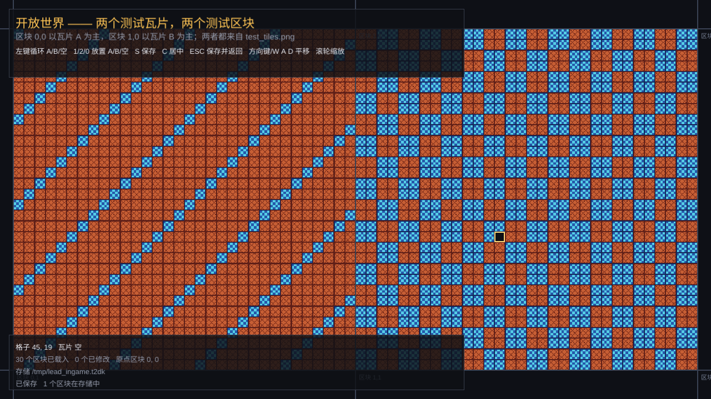
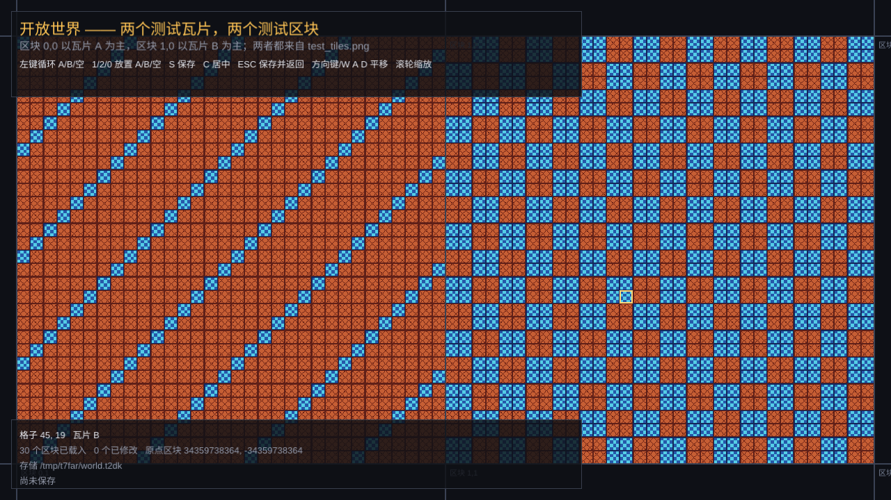

# 开放世界：相对坐标、浮动原点与 `t2d::OpenWorld`

固定地图是有边的。`TileMap`（`t2d/sim/tilemap.h`）回答的是"作者写好的宽 × 高里这一格是什么"，
矩形之外它按 `out_of_bounds_solid` 答——默认是墙，这正是固定关卡想要的，也正是开放世界负担不起的：
世界没有作者写好的边界，玩家往一个方向一直走，同一格必须永远给出同一个答案，而"远处"不能有代价。

`t2d::OpenWorld`（`t2d/sim/open_world.h`）是**面向 Mefemma 的可选引擎设施**，不是 mine 的地图模型，
也不是普通地图的替代品：**TileMap、mine 的固定层和所有普通地图继续使用绝对的作者格坐标，完全不受
这里影响**。它的目标不同：可见的格坐标必须一直很小，f32 绘制才能在任何距离保持精确。

## 1. 两个坐标空间

这是整个设计的核心，其它一切都是它的结果：

| 空间 | 类型 | 谁用 | 为什么 |
|---|---|---|---|
| **绝对区块身份** | `ChunkKey`（i64 x/y） | 生成器、`chunk_seed()`/`chunk_rng()`、loader、saver、驻留 map 的键、`resident_chunks()` | 存档和生成必须可复现：原点怎么移动，同一个绝对区块都是同一块内容、同一个存储键 |
| **相对区块** | `ChunkCoord`（i32 x/y） | `chunks_in()`、`update()`、`find_chunk()`、`ensure_chunk()`、`unload_chunk()`、`flush(coord)`、渲染与 chunk 统计 | 流送和绘制只关心"原点附近"，i32 足够，且不会把大坐标带进 f32 |
| **相对格** | `i32 x, y` | 所有 `at()`/`set()`/`topmost()`/碰撞查询/重叠盒/`cell_bounds()` | 帧内的世界坐标都在原点附近，f32 精度与距离无关 |

绝对与相对之间只差一个原点：`absolute_of(relative) = origin() + relative`，
`relative_of(absolute) = absolute - origin()`（放不进 i32 时返回 `std::nullopt`，**绝不截断**）。
`absolute_cell_x(relative_x) = origin().x * 32 + relative_x`，y 同理。

## 2. 原点、重定基与浮动摄像机

`origin()` 是相对 (0, 0) 当前对应的**绝对区块**，默认 `{0, 0}`。移动它只改变"名字"：

* `set_origin(new_origin)` 把原点移到 `new_origin`（钳制在 ±2^35 绝对区块内），返回
  `OriginShift`：`x/y` 是 `new_origin - old_origin` 的**绝对格数**。
* `OriginShift::position_delta(tile_size)` 返回要加到**所有相对位置**上的世界偏移，即
  `-shift * tile_size`：原点右移，同一个绝对地点在相对坐标里就左移。
* 驻留区块按 **绝对键**保存，所以重定基只是重新寻址：不加载、不保存、不丢内容，脏标记也不变。
* `recenter(camera)` 是常用封装的糖：把原点移到相机中心所在的绝对区块并返回 shift。
  相机和实体自己加 `position_delta`，就仍然看着同一个绝对地点：

```cpp
const OpenWorld::OriginShift shift = world.recenter(camera);
const Vec2 delta = shift.position_delta(world.tile_size());
camera.move(delta);                    // 相对坐标里回到原点附近
for (Entity& entity : entities) entity.position += delta;
```

**实用范围**：绝对格 ±2^40、绝对区块 ±2^35（`set_origin` 就钳在这个范围）；
相对格 ±`kMaxRelativeCell`（2^30）、相对区块 ±`kMaxRelativeChunk`（2^25）。视野超出相对范围
（或会碰到超过 2^20 个区块）时 `chunks_in()` 返回空、`update()` 无操作——这就是"相对空间必须保持
可绘制"的边界。直接传 i32 的格调用不额外钳制，调用方自己负责把世界留在实用范围内。

> 普通地图（TileMap、mine 的固定层）**没有**这个原点概念：它们的格坐标就是作者写下的绝对坐标，
> 不会因为开放世界移动原点而改变。`Camera2D` 也没有变化，它只是被当作"相对世界"里的相机使用。

## 3. 区块与内存

* `WorldChunk` 是 32 × 32 格 × 1..32 层（`WorldChunk::kSize` = `TileMap::kChunkSize`），
  每层固定 1024 格、行主序；一个区块 blob 不带尺寸，读的一方被告知该有几层。
* 没有"图外即实心"：某一格是什么完全由生成器决定。
* 一个 `TileId` 是 `u16`（2 字节），一层 = **1024 格 = 2 KiB**：

| 情形 | 常驻内存 |
|---|---|
| 1 层 × 1 区块 | 2 KiB（加 `WorldChunk` 的头部，约几十字节） |
| 1 层 × 默认上限 2048 区块 | 约 4 MiB |
| 4 层 × 2048 区块 | 约 16 MiB |
| 32 层 × 1 区块（上限） | 64 KiB |

## 4. 生命周期：`update()` 与两个 margin

游戏每帧做一件事：`world.update(camera)`（相机在相对空间里）或 `world.update(相对视野矩形)`：

1. **卸载**：把相对视野 + `unload_margin_chunks` 翻译成**绝对键集合**；驻留区块中绝对键不在集合里的，
   干净的直接丢；脏的先按绝对键保存，成功才丢，失败（或没有 saver）留在原地。
2. **加载**：`chunks_in(view, load_margin_chunks)` 里还缺的相对区块，按到视野中心的曼哈顿距离
   **由近到远**（距离相同按 y、再按 x）加载；`max_loaded_chunks` 是软上限：到达上限时先丢掉
   "这批加载不需要的、干净的"远处区块腾地方，腾不出才跳过并记一次 `budget_refusals`。

两个 margin 是**滞回**：加载比卸载近一环，相机停在区块边界抖动时不会每帧同一块反复加载卸载。
无效视野（非有限值、负尺寸、超出相对范围、超过 2^20 区块）是 **no-op**。

`Stats` 计数器（`reset_stats()` 清零）：

| 计数器 | 何时增加 |
|---|---|
| `chunks_generated` | 新驻留区块不是从存储读回来的（生成器生成，或没有生成器时的空区块） |
| `chunks_restored` | 新驻留区块从 loader 的字节成功读回 |
| `chunks_saved` | saver 成功保存一个区块（`update`、`unload_chunk`、`flush` 共用） |
| `chunks_evicted` | `update()` 让一个区块离开驻留集合（干净丢或保存后丢） |
| `restore_failures` | loader 给的字节不是这个世界的合法区块 blob |
| `save_failures` | saver 返回 false |
| `budget_refusals` | 因为软上限没放下的加载次数 |

## 5. 确定性生成（看绝对键）

生成器拿到的是**绝对 `ChunkKey`**，它的随机性应只来自：

```cpp
u64 seed = OpenWorld::chunk_seed(world_seed, key);   // splitmix64 风格混合，key 是绝对区块
Rng rng = world.chunk_rng(key);                      // 等价于 Rng(chunk_seed(world.seed(), key))
```

所以同一个绝对区块在世界任何原点下、任何加载顺序下都生成同一块内容；两个世界用同一个种子，
A 先加载 0 再加载 1、B 反过来，字节完全一样。**生成结果不进存储**：没被编辑过的区块卸载后再加载
就是重新生成。

生成器可以用 `set()` / `fill()` 写内容，也可以直接写 `tiles()` 的裸存储。前者会临时把区块标脏，
**但 `ensure_chunk()` 在生成器返回后会把脏标记清掉**：生成出来的区块一律干净，
"生成"永远不会被当成"编辑"而触发保存。`tiles()` 本身不标脏。

## 6. 编辑、脏标记与保存

* `set(relative_x, relative_y, id)` 写相对格：区块不在就**先让区块驻留**（loader → 生成器 → 空），
  写完把区块**标脏**。四参数形式 `set(layer, x, y, id)` 写指定层。
* **脏 == 有编辑**。干净区块（生成的、从存储读回的）可以随时无代价丢弃；脏区块必须先保存成功。
* `unload_chunk(relative)`：干净 → 立即移除并返回 true；脏 → 序列化交给 saver，成功清脏并移除，
  失败或没有 saver → 留在原地返回 false。
* `flush()` 按绝对 (y, x) 排序走所有脏区块，能存的都存，**只在保存成功时清脏**；返回 true 当且仅当
  结束时没有任何脏区块——"有脏区块但没有 saver"返回 false，而不是把编辑丢掉。
  `flush(relative_chunk)` 只处理一个相对区块。
* `update()` 的卸载遵守同一条规则：**save 失败绝不丢编辑**，失败保持驻留的区块继续占内存。

存储是**两个回调，字节放哪由游戏决定**，它们看到的是**绝对 `ChunkKey`**：

```cpp
using ChunkLoader = std::function<std::optional<std::vector<u8>>(const ChunkKey&)>;
using ChunkSaver  = std::function<bool(const ChunkKey&, ConstSpan<const u8>)>;
```

loader 返回 `nullopt` 或空 vector 都表示"这里没有存档"，会走生成；返回的不是合法区块时
`T2D_WARN` 报出**绝对**区块坐标、`restore_failures` 加一，然后回退到生成。loader 优先于生成器。
**存储键在重定基前后是同一个**：编辑、flush、移动原点、再读回来，同一个 `ChunkKey` 的字节恢复同一份编辑。

## 7. 存储文件：`t2d::ChunkStore`

`OpenWorld::set_store()` 的两个回调把字节放在哪里交给游戏；如果答案是「一个文件」，引擎提供
`t2d::ChunkStore`（`t2d/sim/chunk_store.h`，**格式版本 2**）作为默认实现。它按**绝对 ChunkKey**
索引一个文件：定位一个区块是「哈希 → 一个 72 字节槽 → 一条记录」，**从不扫描文件**，编辑在重新
打开后仍然存在。它和开放世界一样是可选的 Mefemma 设施；普通地图不使用它。

版本 2 的主题是**损坏隔离**：每个槽 half 都有 CRC，一个坏槽既不能让探测提前结束（从而藏掉后面的
区块），也不能冒充别的 key；一个坏记录只让**那一个** key 报 `Corrupt`，其它区块照常读取。引擎只
**报告**损坏；是丢弃、重建还是中止，由游戏通过 policy 决定。版本 1 文件被明确拒绝（没有迁移）。

### 文件布局（小端，单文件）

| 区域 | 大小 | 说明 |
|---|---|---|
| header copy A | 4096 B | 元数据 + CRC，带序列号 |
| header copy B | 4096 B | 同一份元数据的另一份；提交时轮流写 |
| index | slots × 72 B | 开放寻址哈希槽；每槽两个 36 B half（含 half CRC） |
| data records | 追加 | 自描述记录，含 payload |

header 固定偏移：magic `T2DK` u32、version u32 = 2、sequence u64、index_offset u64（= 8192）、
index_slots u32（2 的幂）、live_count u32、tombstone_count u32、reserved u32 = 0、data_start u64
（= 8192 + slots × 72）、data_end u64、header_crc32 u32（覆盖前面 56 字节），页内其余为零。
**两份 header**：每次元数据提交写「不是当前」的那一份、序列号 + 1；打开选校验通过且序列号较大的
一份（相同取 A）。所以单份 header 撕裂永远还有另一份可读。

index 槽是两个 36 字节 half：tag u32（bit 0-1 状态：0 空 / 1 live / 2 tombstone；bit 2-31 写代数）、
key_x i64、key_y i64、record_offset u64、payload_size u32、**half_crc32 u32**（覆盖前 32 字节）。
**全 36 字节为零**是唯一的「合法空」；其余 half 只有状态是 live/tombstone、字段通过检查且 CRC
匹配才算有效，否则是 **poisoned**。插入/修复会写进空、tombstone 或 poisoned 的 half；覆盖同一个 key
时替换它自己那个 live half（旧内容成为垃圾）。新 half 的代数 = 该槽最大代数 + 1（至少 1），代数溢出时
先重写。half CRC 让撕裂/损坏的 half 变成 poisoned 而不是被当成有效条目；一个槽可以合法地放两个不同
key 的 half，所以探测不能按「槽里有东西」提前终止。

探测规则是隔离的关键：**只有两个 half 都合法空的槽才终止探测**；poisoned half 不终止、不匹配、
不遮蔽，探测继续并计入 `stats.corrupt_slots`。命中一个 live half 后如果记录校验失败，记住 `Corrupt`
候选并**继续往后找**——这个坏槽可能正在冒充后面那个真条目；找到任何有效条目就以它为准，一直找不到
才报 `Corrupt`。写入可以修复 poisoned half（把新 half 写进坏 half）；erase 把「key 的槽坏了」当成
missing，write 会插入一条新的有效条目。哈希是 key.x / key.y 的 u64 位模式的 splitmix 风格混合，
槽位 = hash & (slots - 1)，线性探测，遇到 tombstone 继续、遇到合法空停。装载因子超过
`Options::max_load_factor`（默认 0.7）就扩容。

data record（40 B header + payload）：magic `T2R1` u32、state u32（1 live / 2 deleted）、
payload_size u32、key_x i64、key_y i64、payload_crc32 u32、header_crc32 u32（覆盖前 32 B）、
reserved u32 = 0。记录自描述：写 = 追加完整记录 → 更新一个槽 half → 提交另一份 header；
删 = 追加 deleted 记录 + 写 tombstone 槽；覆盖 = 追加新记录，旧 payload 成为垃圾，等 compact() 回收。

### 一次查找

`fetch(key)` 返回 `ReadResult{ status, bytes, error }`，状态是 **Ok / Missing / Corrupt / NotOpen /
IoError**：Ok 是校验过的精确字节；Missing 是找不到可达的有效条目（不是错误）——索引项整个被损坏成
poisoned 时 fetch 也只能报 Missing，因为坏槽已经不能指出它属于哪个 key，这时 `scan()` 会报 `IndexSlot`；
Corrupt 是一个能定位到该 key 的 live 条目记录/校验损坏（**绝不返回错误字节**）；IoError 是读文件失败；
移动后的 store 报 NotOpen。`read(key, error)` 是
便捷包装：Ok → 字节，Missing → nullopt 且无 error，Corrupt/IoError → nullopt + error；`contains()` 等价于
`fetch().status == Ok`。OpenWorld 的 loader 仍然把 Missing/Corrupt 都变成 nullopt（世界会重新生成它）。

一次查找的步骤：1. `hash_key(ChunkKey)` 得到起始槽；2. 线性探测，每步读一个 72 B 槽；3. 遇到 key
相同的 live half 就读且只读**一条**记录（header + payload 一次读），校验 magic / state / key / 尺寸 /
两个 CRC；4. 有效就返回；记录坏了继续探测，最后没有任何有效条目才报 Corrupt。
`stats.reads == probes + hits`（一次槽读或一次记录读都算一次 read），所以「没有扫描文件」可以用计数器证明。

### 崩溃、损坏与恢复

* **tail recovery**：写入顺序是 record → slot → header。若在 header 提交前崩溃，header 的
  `data_end` 之后可能已有一条完整记录；打开时从 `data_end` 向后扫描完整且 CRC 正确的记录并重新
  应用（更新槽、重算 live/tombstone），遇到截断/损坏的尾巴就停——**从不截断已提交数据**。
* **torn header**：另一份 header 仍有效，打开选有效副本中序列号较大的。
* **torn slot**：half CRC 让撕裂/损坏的 half 变成 poisoned，而不是被当成有效条目；同一槽里的另一个
  half（可能属于别的 key）仍可读，探测继续而不是终止。两半都坏时整槽是 poisoned。
* **poisoned slot**：坏槽不终止探测、不匹配任何 key，探测继续；其它区块不受影响。该 key 若没有
  其它有效条目，`fetch()` 报 Missing 或 Corrupt；再 `write()` 会把新 half 写进坏 half（修复）。
* **损坏记录**：只影响它自己的 key——`fetch()` 报 Corrupt，其它 key 照常读取；覆盖该 key 追加一条
  新记录即可恢复可读。

### `scan()`：只读的损坏报告

`scan()` 不修改文件。它先逐槽检查每个 half 的 CRC/状态，坏 half 报 `IndexSlot`（带 slot 下标）；
再校验每个 live 槽指向的记录，报 `RecordHeader` 或 `RecordPayload`（key 来自有效槽）；然后**独立于
索引**走一遍记录日志。坏 header 没有可信长度，于是逐字节向前找下一个 **header CRC 和 payload CRC
都成立** 的候选（payload CRC 排除误报），找到就从那里继续，`stats.resyncs` 加一。
`ScanReport{ corruptions, live_chunks, checked_slots, checked_records, error }`：fatal I/O 进 error，
损坏是数据；同一处损坏只报一次。

### 由游戏决定：policy compact

* `compact(error)` 默认**安全**：遇到第一个损坏就失败，原文件不动，error 提示先 `scan()` / 用 policy。
* `compact(policy, report, error)` 让游戏逐个决定**记录日志里的损坏**：每个坏记录/未知区域回调
  `policy(CorruptChunk)`，返回 `CorruptAction::Abort` 或 `Drop`。**Abort** = 停止、原文件不变、
  返回 false；**Drop** = 跳过该坏记录/未知区域并重同步，已知 key 进入 `CompactReport::dropped`
  （之后游戏可写 replacement，或让 OpenWorld 重新生成它）；后面的有效记录仍然 later-wins。
  注意：**索引槽损坏不会进 policy**——记录日志才是事实来源，compact 直接用记录重建索引，数据没
  丢；如果游戏决定不要这个 key，先 `erase(key)`（见下一条）。
* `CompactReport{ corruptions, dropped, kept, aborted }`。
* 丢弃一个**索引项已损坏**的区块也用 `erase(key)`：它总会追加一条 deleted 记录（即使当前找不到这个 key），
  所以随后的 compact 不会用旧记录把它复活。这就是“游戏决定丢弃”的路径。
* 自动扩容（write 内部）和默认 compact 一样在损坏时中止，**不会静默丢数据**。

### 重写路径（扩容 / compact / index 恢复共用）

扫描 `data_start..data_end` 的记录，按出现顺序保留每个 key 的最新状态（后面的 live 覆盖，deleted
删除；坏 header 用上面的重同步跳过），在 `<path>.tmp` 里写新文件：按 (y, x) 排序的幸存记录、新索引、
两份 header，flush + fsync 后原子 rename 覆盖原文件。任何一步失败都删掉临时文件、原文件保持不动。
扩容至少 2 倍旧槽位；compact 按装载因子选择新槽位并可缩小文件；两者都重置 tombstone 和写代数。

### 限制与注意

* 单线程；`write()` 每次追加后 fflush，`flush(true)` 才 fsync（Windows 用 `_commit`）。
* `index_slots` 夹在 [16, 2^24]，payload ≤ 64 MiB；哈希与文件格式（版本 2）是磁盘契约，改动会让旧
  索引失效；版本 1 文件被拒绝，没有迁移。
* 一个损坏的区块**不会**拖垮整个文件：打开仍然成功，其它区块照常读取，坏的那个由 `fetch()`/`scan()`
  报告；处置方式（丢掉、重建、中止）由游戏决定，引擎不替它选。
* 槽被外部损坏后，header 里的 live 计数与 `chunk_count()` 可能暂时偏大（它们是上次提交的槽计数）；
  `scan().live_chunks` 是这次实际能走通的有效条目数，`compact()` 会重算并提交正确计数。
* 失败后的推荐恢复：重新 `open()`（tail recovery + header 回退）；`scan()` 看清损坏；再用
  `compact(policy)` 留在游戏手里的选择。

接到 OpenWorld：

```cpp
#include <t2d/sim/chunk_store.h>

ChunkStore store = ChunkStore::open("world.t2dk").value();
world.set_store(store.loader(), store.saver());   // 回调看到的是绝对 ChunkKey
world.update(camera);
world.set(12, -3, 7);                              // 编辑让区块变脏
world.flush();                                     // saver 追加一条记录
store.flush(true);                                 // fsync

// 读取时区分「没有」和「坏了」；坏掉的处置由游戏决定。
ReadResult got = store.fetch(key);
if (got.status == ReadStatus::Corrupt) {
    ScanReport report = store.scan();              // 哪些槽/记录坏了
    CompactReport compacted;
    store.compact([](const CorruptChunk&) { return CorruptAction::Drop; }, &compacted);
    // world 的 loader 会把 dropped 的区块当 Missing，由生成器重建；
    // 游戏也可以自己 write() 一份 replacement。
}
// 下次启动：重新 open()，再 set_store(store.loader(), store.saver())，编辑从文件恢复。
```

`test_chunk_store` 覆盖（29 cases / 6200 checks）：创建/重开、精确读写与空 payload、覆盖/删除幂等、
i64 极端 key、2048 区块跨扩容后全部读回（probes 有界）、compact 回收空间且幂等、单份 header 回退、
tail 恢复、移动语义、Options 夹取、stats、一次读只碰索引和一条记录、从记录日志重建损坏 index，
以及 v2 的损坏隔离：坏槽 half 不返回错误字节且不影响其它 key、poisoned 空槽不终止探测、
Ok/Missing/Corrupt/NotOpen 四种状态、scan 的 IndexSlot/RecordHeader/RecordPayload 与重同步、
默认 compact 中止 vs 游戏 policy Drop/Abort、损坏早期 header 后重同步并重建后面的区块、真实
OpenWorld 只重新生成损坏的那个区块并保留其它编辑、索引项丢失后 `erase` 仍能真正丢弃该区块、
以及 v1 文件被拒绝且不被修改。

## 8. 区块字节格式（未变）

所有整数小端，varint 是 LEB128（和 `ByteWriter::write_varint` 一致）。T2DC v1 与此前的绝对坐标版本
逐字节相同：相对坐标模型没有改变存档格式。

| 字段 | 大小 | 说明 |
|---|---|---|
| magic | 4 字节 | `T` `2` `D` `C` |
| format version | u8 | 当前 `1`；不认识就拒绝 |
| layer count | varint | 1..32，并且**必须等于世界的层数** |
| 每层（自底向上） | | 32 × 32 行主序的连续 run |
| &nbsp;&nbsp;run length | varint | 必须 > 0，且不超过本层剩余格数 |
| &nbsp;&nbsp;tile id | u16 | 这个 run 里每一格的瓦片 id |

run **不跨层**；空区块也编码成合法的 run（每层一个 1024 的空 run）；最坏情况（相邻格都不同）
一层约 4 KiB、32 层约 128 KiB。`deserialize()` 拒绝 magic/version 不对、层数越界或不匹配、run 为 0、
run 超过剩余格数、截断、尾部多余字节。

## 9. 相对坐标查询

```cpp
world.at(x, y);                 // 第 0 层；区块不在 = kEmptyTile
world.at(layer, x, y);
world.topmost(x, y, mask);
world.is_solid(x, y, tileset, mask);
world.is_one_way(x, y, tileset, mask);
world.is_hazard(x, y, tileset, mask);
world.overlaps_solid(relative_box, tileset, mask);
world.overlaps_hazard(relative_box, tileset, mask);
```

这些查询**只读常驻区块，缺区块按空处理，绝不隐式加载**：它们全是 const 的，帧线程的碰撞查询
不该突然读盘或跑生成器。坐标是**相对格**，`LayerMask` 语义和 TileMap 完全一样（第 i 位是第 i 层）。
所以规则很简单：**每帧先 `update(camera)`，再查询/绘制**。
`chunk_bounds(relative_chunk)` / `cell_bounds(relative_cell)` 返回**相对世界**的 AABB（离原点很近的
小 f32），绝对原点不会出现在里面。

## 10. 绘制：`TilemapRenderer::draw_world()`

```cpp
void draw_world(SpriteBatch& batch, const OpenWorld& world, const Tileset& tileset, const Aabb2& view,
                TileMap::LayerMask mask = TileMap::kAllLayers, u32 tint = 0xFFFFFFFFu);
```

* `view` 是**相对世界单位**；只走 `world.chunks_in(view, 0)`：视野碰到的每个相对区块计一次
  `chunks_considered`，不驻留的不画、计 `chunks_culled`（洞），驻留的计 `chunks_drawn`。
* 驻留区块里只画与 `view` 相交的格；几何来自 `world.cell_bounds(relative_cell)`（相对格），
  uv 来自 `tile_uv_rect()`。**绝对坐标永远不会进 batch**，所以离绝对原点再远也不影响 f32 精度。
* 一个区块内按层自底向上画；区块把平面分成互不重叠的块，跨区块顺序不影响像素。
* `mask`/`tint` 与 `draw_map()` 相同；`draw_map()` 和普通 TileMap 的行为完全没变。

统计（`TilemapRenderer::stats()`）：`chunks_considered/drawn/culled` 描述上一次 `draw_world()`；
`tiles_considered/drawn/culled` 累计到 `reset_stats()`；`map_layers` 是上一次绘制访问的层数。
`draw_map()` 会把三个 chunk 计数器清成 0。

**f32 精度**：相对空间里 `view` 和 `cell_bounds()` 都很小，所以绘制在离绝对原点任意远处都精确。
唯一要注意的是别把绝对坐标（例如 `absolute_cell_x()`）拿去画：要画绝对地点，先重定基 /
`recenter()`，把它变成原点附近的相对坐标。

## 11. 边界与限制

* **面向 Mefemma 的可选设施**：Mefemma 本身仍然"没有世界模型"（`games/mefemma/docs/FRAMEWORK.md`），
  一个想要流送瓦片世界的游戏可以选择接入它；Mefemma 的 `--scene openworld` 就是这份接入的示范（见 §13），
  但 shell 仍然不拥有世界模型。mine 的固定层和普通 TileMap 不使用它。
* **engine.api**：Mefemma 的游戏逻辑运行在 code table 里，调用 `OpenWorld` 的场景必须把符号加进
  `engine.api`。`openworld` 场景已经这样做：它用到的 25 个符号（`t2d/sim` 23 个、`t2d/core` 2 个，
  其中 `OpenWorld::set_origin` 是超远内容原点用的）以 B 层写进清单，`codetab api --surface engine.api`
  对 Mefemma 和 mine 两张表都报 0 个越界。
* **单线程、无全局状态、无新依赖**：每个 `OpenWorld` 独立，线程安全由调用方保证。
* **一个文件一个 store**：`ChunkStore` 不加文件锁，同一路径同时只允许一个 writer；
  `loader()`/`saver()` 捕获 store 的 `this`，交给 world 之后不要再移动这个 store。
* **绝对范围**：原点钳在 ±2^35 区块（±2^40 格）。这比 f32 能精确绘制的范围宽得多，只是给 i64 运算兜底。
* **相对范围**：相对格 ±2^30、相对区块 ±2^25；视野超出即拒绝。直接传 i32 的调用没有再钳制。
* **软上限不是硬保证**：脏区块和已驻留的编辑不会被预算驱逐，驻留数可能暂时超过 `max_loaded_chunks`。
* **没有"图外即实心"**：要围栏就由生成器放。
* **区块 blob 格式不变**：T2DC v1 与绝对坐标版本逐字节兼容。

## 12. 用法

```cpp
#include <t2d/core/camera2d.h>
#include <t2d/render/tilemap_renderer.h>
#include <t2d/sim/open_world.h>
using namespace t2d;

OpenWorldConfig config;
config.seed = 0xC0FFEEull;
config.layers = 2;
config.load_margin_chunks = 1;
config.unload_margin_chunks = 2;
OpenWorld world(config);

// 生成：只拿到绝对 ChunkKey。同一个绝对区块在世界任何原点下都是同一块内容。
world.set_generator([](const ChunkKey& key, WorldChunk& chunk) {
    Rng rng(OpenWorld::chunk_seed(0xC0FFEEull, key));
    for (i32 layer = 0; layer < chunk.layers(); ++layer) {
        for (TileId& cell : chunk.tiles(layer)) cell = static_cast<TileId>(rng.next_bounded(4));
    }
});

// 存储：键也是绝对的，所以移动原点不会换键。
world.set_store(
    [](const ChunkKey& key) { return read_chunk_bytes(key); },   // optional<vector<u8>>
    [](const ChunkKey& key, ConstSpan<const u8> bytes) { return write_chunk_bytes(key, bytes); });

// 相机在相对空间里；每一帧 update 一次，然后查询/绘制都读驻留区块。
Camera2D camera(Vec2{1280.0f, 720.0f}, 2.0f, Vec2{0.0f, 0.0f});
world.update(camera);

// 走得足够远之后重定基：原点落到相机所在区块，相机/实体加上同一个 delta，画面不跳。
const OpenWorld::OriginShift shift = world.recenter(camera);
const Vec2 delta = shift.position_delta(world.tile_size());
camera.move(delta);

// 世界逻辑和绘制都用相对坐标。
world.set(123, -45, 7);                       // 相对格；区块自动驻留并标脏
TilemapRenderer renderer;
renderer.draw_world(batch, world, tileset, camera.visible_world());

if (!world.flush()) {
    // 还有脏区块没保存（没有 saver，或 saver 返回了 false）
}
```

`test_open_world` 覆盖这里说的每一条规则（36 cases / 736 checks）：相对/i32 极端坐标与转换往返、
origin 钳制、重定基不丢驻留区块与脏标记、生成与存储按绝对键跨原点稳定、recenter、远绝对原点下
相对几何仍然很小，以及开放世界的全部流送/编辑/查询语义。其中
`near_the_absolute_limit_the_relative_world_streams_edits_and_restores` 把原点放在
{kMaxAbsoluteChunk - 4, -(kMaxAbsoluteChunk - 4)}（约 ±1.1e12 格，离钳制只有 4 个区块）：相对几何仍是
0..1024、双世界按绝对键生成同样字节、编辑经真实 `ChunkStore` 落盘并按远绝对键读回、`set_origin`
在 ±kMaxAbsoluteChunk 处精确钳制。渲染侧由 `test_render_offscreen`
新增的用例覆盖（其中 4 个 `draw_world`、1 个 `draw_map` 计数器回归；整套 17 cases / 169 checks，
需要 Vulkan 设备）：驻留区块上屏、视野外格子/区块被剔除、视野内但未驻留的区块计 culled、层顺序/掩码、
stats 精确值，以及绝对原点在 {1'000'000, -1'000'000} 和近极限
{kMaxAbsoluteChunk - 4, -(kMaxAbsoluteChunk - 4)} 时按相对坐标照常绘制（后者的 stats 和像素与近原点完全相同）。

## 13. 在游戏里：Mefemma 的 `openworld` 场景

`games/mefemma/src/scenes/open_world_scene.cpp` 是这套设施在游戏里的完整示范（启动参数
`--scene openworld`）：

* **两个测试瓦片、两个测试区块**：`games/mefemma/assets/textures/test_tiles.png` 是 32×16 的两格图集
  （A 暖色交叉纹、B 蓝色棋盘）。场景有一个**内容原点** `content_origin`（缺省 {0,0}，命令行
  `--world-origin <x,y>`）：生成器把 `content_origin` 填 A 并在每 8 格画一条 B 斜线，把
  `content_origin + {1,0}` 填 B 并铺 2×2 的 A 方块，其余区块为空。构造时先
  `world.set_origin(content_origin)` 再流送，所以相对格始终在 0..63，而生成与存储键保持精确的绝对
  区块。场景**不用** `TilemapRenderer`：它按 `camera.visible_world()` 只遍历可见格、用
  `world.at()` 读驻留区块、用两格 uv 调 `DrawList::sprite("test_tiles", ...)`，和普通 Mefemma
  场景同一套绘制路径。
* **流送与浮动原点**：每帧 `world.update(camera)`；`load_margin=1`、`unload_margin=2`、软上限 0
  （测试场景要内容，不要预算）。C 调 `world.recenter(camera)`，再用 `OriginShift::position_delta()`
  同步相机，画面不跳；区块身份仍是绝对的，回到同一地点时从存储读回的是同一份编辑。
* **保存与读取**：场景构造时拿到 `--world-file`（缺省是 **存档目录** 下的 `mefemma_openworld.t2dk`，
  存档目录来自首次运行提示写下的 `redirect.ecfg`，或在没有配置时由 `--save-path` 指定一次），
  `on_enter` 打开 `ChunkStore` 并 `set_store(store.loader(), store.saver())`；S 和离开场景都执行
  `world.flush()` + `store.flush(true)`。打不开就 HUD/日志报错、不带存储继续跑；被驱逐的脏区块先写进
  store，没编辑过的生成区块永远不写。
* **超远位置**：`--world-origin 34359738364,-34359738364` 把内容放到离默认原点约 1.1e12 格处，离
  ±2^35 区块的钳制只有 4 个区块。画面、HUD 布局、指针和存储行为都和近原点逐像素一致（相对空间仍是
  0..1024 个世界单位），HUD 的原点行显示远绝对区块；编辑仍按绝对键存进 `ChunkStore`。这是"绝对
  f32 已经没法用、相对坐标仍然干净"在游戏里的直接证据。
* **运行**：

      ./build/mefemma/debug/games/mefemma/mefemma_game --scene openworld \
          --save-path /tmp/mefemma-saves --world-file /tmp/openworld.t2dk
      ./build/mefemma/debug/games/mefemma/mefemma_game --scene openworld \
          --save-path /tmp/mefemma-saves --world-origin 34359738364,-34359738364 \
          --world-file /tmp/far.t2dk

（--save-path 回答首次运行的存档目录问题、不写 redirect.ecfg；直接运行而不给这两个参数时，Mefemma
会先显示选择存档目录的提示，见 games/mefemma/docs/FRAMEWORK.md §7。）





`games/mefemma/tests/test_open_world_scene.cpp` 用假 `GameServices` 和临时目录里的真 store 覆盖同一条
路径（10 cases / 130 checks）：两个测试区块的生成与两格 uv、点击循环 A/B/空、保存后重开、S 与离开保存、
不可写路径的降级、远行后 recenter 再回来按绝对键恢复编辑，以及在近极限内容原点下两个远区块各编辑一格、
保存/重开恢复、recenter 后按新的相对地址仍读到同一份绝对编辑。这两条是"设施在游戏里真的能用"的实测证据。
