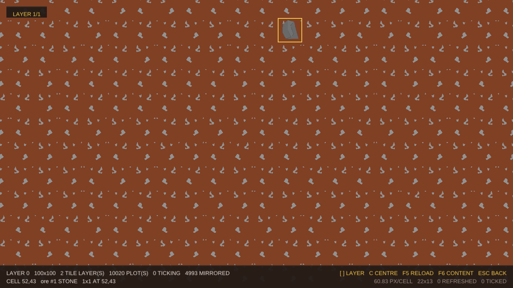
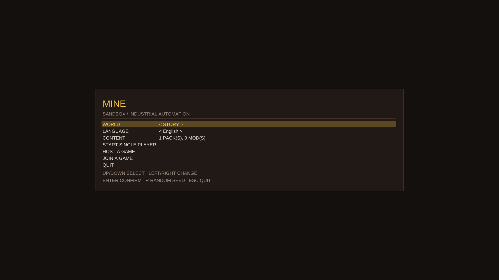
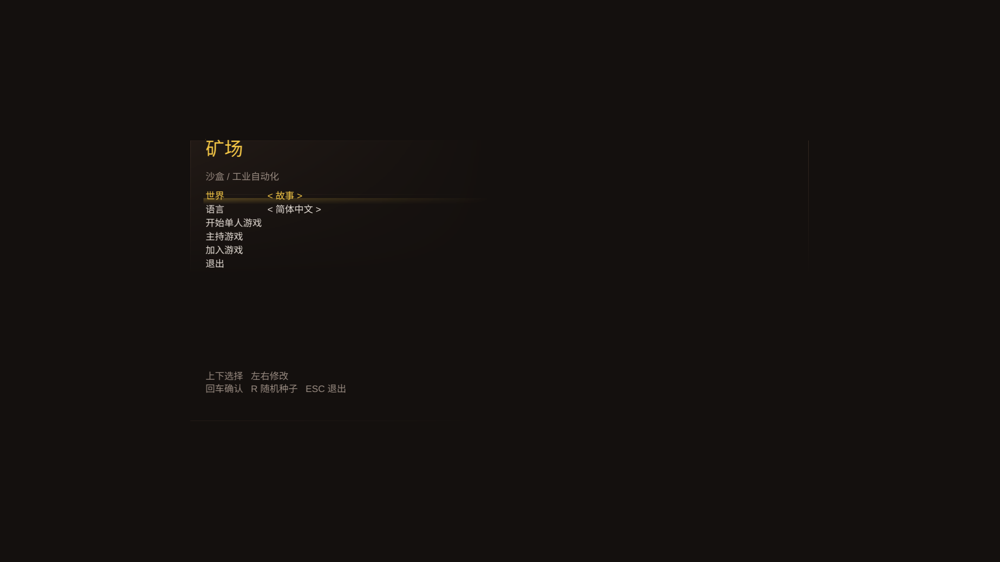
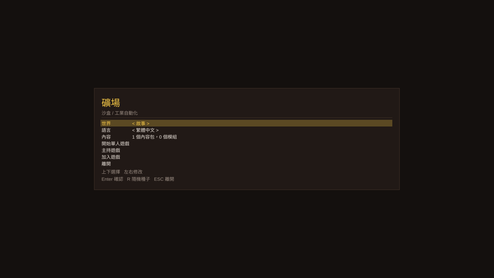

# Text: fonts, languages and the interface strings

Tile2D renders text with its own font engine — no FreeType, no stb_truetype, no new dependency — and
shows it through string tables so a language can be added without touching code.

## What the engine reads

| Layer | Files | What it does |
|---|---|---|
| Container | `t2d/text/sfnt.h`, `font.cpp` | sfnt table directory, `.ttc` collections (one file, several faces), `head`/`hhea`/`hmtx`/`maxp`/`post`/`name` |
| Character map | `font.cpp` | `cmap` formats 0, 4, 6 and 12 — format 12 is what carries CJK beyond the BMP |
| Outlines | `font.cpp` (glyf), `cff.cpp` (CFF) | TrueType quadratic contours including composites, and CFF Type 2 charstrings including CID keyed fonts, subroutines, hint masks and the flex operators |
| Rasterising | `raster.cpp` | analytic anti-aliasing: for every edge and pixel the exact covered area is integrated, so a horizontal stroke lands on its true fraction of a pixel instead of banding at a sampling grid |
| Caching | `render/glyph_atlas.cpp` | shelf packing into an RGBA8 page, keyed by (font, glyph, pixel size); one page holds thousands of glyphs |
| Layout (CPU) | `text/text_layout.cpp` | UTF-8, per character font selection, advances, wrapping, line breaking, and the line box |
| Drawing | `render/text_renderer.cpp` | placed glyphs → atlas slots → batched quads; nothing is measured here |
| Languages | `text/locale.h`, `text/utf8.h` | language tags, string tables, fallback, script classification |

**Why both outline formats**: the fonts a game actually needs are split that way. Latin text usually
ships as TrueType (`glyf`), and the CJK families — Noto Sans CJK and friends — ship as **CID keyed
CFF**. An engine that only reads `glyf` cannot draw Chinese at all on a normal Linux system.

## Where a line sits

The vertical contract is one sentence: **the pen is the top left corner of the first line box.**
`line_box(fonts, style)` is that box, and it comes from the fonts, never from the string:

| Field | Meaning |
|---|---|
| `ascent` | the tallest face's `hhea` ascent in pixels: the first baseline sits that far below the pen |
| `descent` | the same face's descent, below the baseline |
| `height` | `max(size_px * line_spacing, ascent + descent)` — the caller's line spacing is a **floor**, not a ceiling, because a box shorter than its own font would put one line's ink on top of the next line's |

Everything a line needs follows from it: `measure()` returns the box `draw()` fills, so a background
rectangle drawn as `[pen, pen + size]` always covers its text, and a label and the value beside it share
one baseline whatever scripts they are in. Before this was true the renderer put the first baseline *at*
the pen, so every line was drawn one ascent above the box its caller had reserved: a selected row's
highlight landed under its text and over the row below, and a panel's title hung over the panel's edge.

The layout is CPU work and lives in `t2d::text` (`text/text_layout.cpp`), so a dedicated server can
measure and place a string with no GPU; `TextRenderer` only turns placed glyphs into atlas lookups and
quads. `test_text` checks the box against glyphs rasterised at the same size (their ink has to land
inside `[0, height]`), and `test_render_offscreen` checks the pixels: text drawn at a pen is read back
below that pen and inside the box it measured.

## Fonts

    ./build/mine/debug/games/mine/mine_game --lang zh-Hans            # picks a CJK face automatically
    ./build/mine/debug/games/mine/mine_game --font /path/latin.ttf --cjk-font /path/cjk.ttc

The shell looks for a Latin font and a CJK font in the usual system locations, and picks the **face**
inside a collection by name: Noto Sans CJK carries ten faces, and Simplified (SC) and Traditional (TC)
Chinese really do draw some characters differently (矿/礦, 语/語, 戏/戲), so the language decides which
face is loaded. `Font::face_names()` reads only the table directories and the name tables, so
choosing a face does not cost ten outline parses.

## Languages

`assets/text/ui.ecfg` holds the shell's own strings, one table per language. The file is looked for
**beside the executable** first (`assets/text/ui.ecfg`), the way the content pack and the shaders are,
and only then in the source tree a build ran from — a release package carries it, so a package copied
to another machine still has text instead of ids:

    en::
        row.start:"START SINGLE PLAYER"
    zh-Hans::
        row.start:"开始单人游戏"
    zh-Hant::
        row.start:"開始單人遊戲"

* Lookups go through the **id**, never the text, so a string can be reworded or retranslated at any
  time. A missing translation falls back to English, and a string missing everywhere comes back as its
  own id — visible in the interface instead of blank.
* `test_text` asserts that **every language translates every id English has**: a half translated
  interface fails the suite instead of shipping.
* Simplified and Traditional Chinese are separate tables. They are separate translations, not a
  runtime conversion: converting between them properly needs a character mapping table (thousands of
  entries), which is data the designer can supply later. The engine supports both variants today,
  including their different glyph forms.
* Unknown tables in a string file are reported, so a typo like `zn-Hans::` does not silently
  become an untranslated language.

### Naming content

Content names are the designer's **ids** — `stone`, `chunk`, `entrance` — and an id is what a save
stores and what the data refers to, not a label. Where the interface shows a piece of content it shows a
**localized name** when the string table has one, and the id when it does not:

    en::
        content.name.stone:"STONE"                 # the plain one, any kind of thing called stone
        content.name.warehouse.stone:"STONE WAREHOUSE"   # the kind-specific one wins
    zh-Hans::
        content.name.stone:"石头"
        content.name.warehouse.stone:"石头仓库"

`mine/content_name.h` is the lookup (`content_label`): `content.name.<kind>.<name>` first, then
`content.name.<name>`, then the name the registry knows it by. A missing entry is told apart from an
empty one by the rule above — a table answers with the **id it was asked for** when it has no string —
so nothing has to be listed twice to say "no label here".

**Every place the interface shows a name goes through it.** One lookup, five callers, and the game's
only entry point is `MineApp::content_name(kind, id)` (`games/mine/include/mine/app.h`):

| Where | What it shows |
|---|---|
| the world view's HUD, second line | the plot the pointer is on, and the drop being dragged: `CELL 52,43   ore #1 STONE   1x1 AT 52,43` |
| the warehouse panel | the title and every row: `[picture] [name] xN` |
| the content list (`F6`) | every entry a source registered |
| the sandbox palette | the name on the left, `kind #id` on the right — the id stays, because a save and a log use it |
| the sandbox's cell readout and cell labels | `L0 floor #1 DIRT` in the status bar, and the label drawn on a cell when it is big enough to hold one (it falls back to `#id` when the name does not fit) |
| the HUD's stored message | `STORED drop #1 chunk` / `已入库 drop #1 chunk` |
| the selection panel (a double click on a plot that holds something) | the title and every row, at the top of the screen, centred — the same content the click panel shows, in the same shape |

**The kind's own word is not translated.** `ore`, `warehouse`, `floor`… are the engine's vocabulary
(`content_kind_name`): they are what the docs, the log and `engine.api` say, so `warehouse #1 石头仓库`
reads as "the engine's word, then the designer's name". A kind that should follow the language is one
line at the callers.

Content with no entry in the table keeps showing its id — that is why the fixtures (`chunk`, `scrap`,
`wall`) look the same in every language, and why a screenshot of them still matches the build.

## Adding a language

1. Add the tag to `Language` and the names to `kNames` in `text/locale.cpp` (and, if it needs a
   different script, to `is_cjk()` in `text/utf8.cpp`).
2. Add its table to `assets/text/ui.ecfg`.
3. If it needs another font, add it to `kCjkCandidates` in `games/mine/src/app.cpp`.

Nothing else: the interface reads ids, and the renderer asks the font set which font owns each
character.

## Screenshots

Same binary, three languages (`--lang`):

## Known limits

* Only horizontal layout; no vertical text, no bidi, no shaping (Arabic/Devanagari ligatures).
* Kerning is not applied yet: advances come from `hmtx` and the CFF charstrings.
* `seac` (the deprecated Type 2 accent composition) is unsupported; it appears in none of the CJK
  collections on a normal system, and the modern way to build accented glyphs is a composite.
* One glyph atlas page is used; a glyph that does not fit is counted (`dropped_glyphs()`) rather
  than silently dropped. More pages are a follow-up, not a redesign.
* `CffFont` keeps a copy of the CFF table (15–23 MB for the Noto CJK faces), so a font owns its
  bytes instead of borrowing the caller's buffer.
