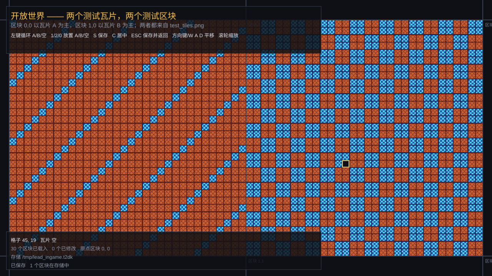
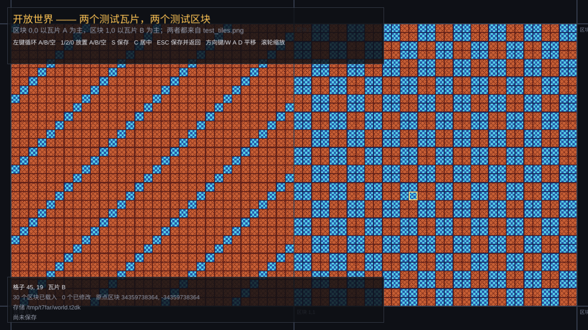
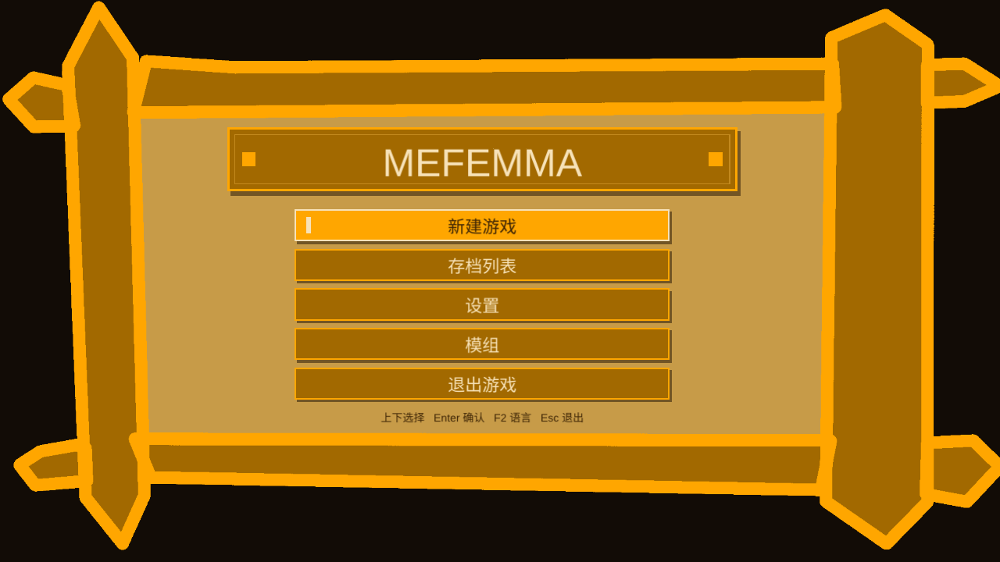
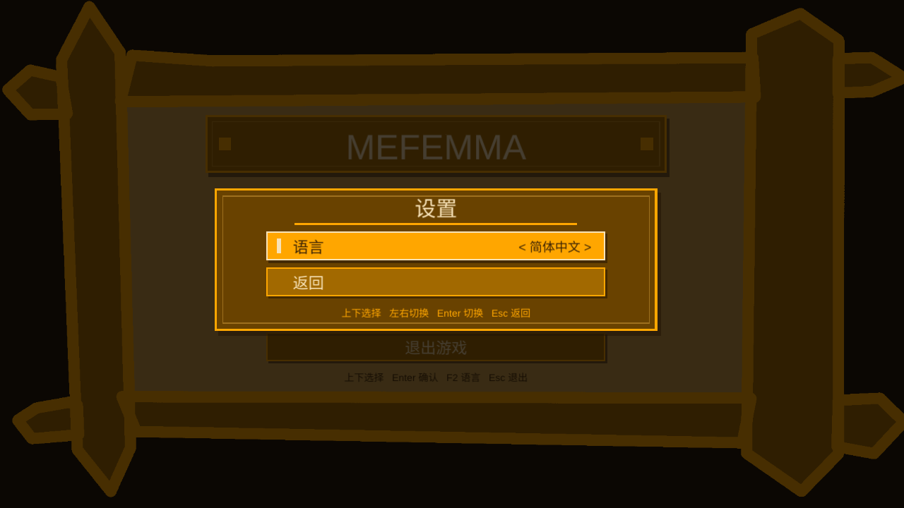
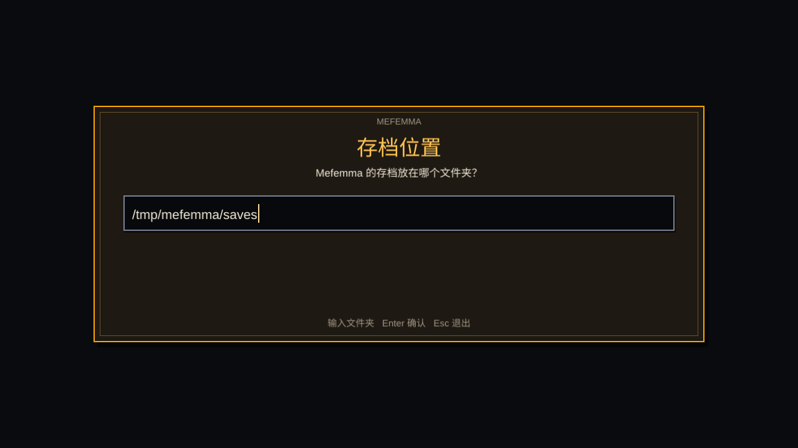
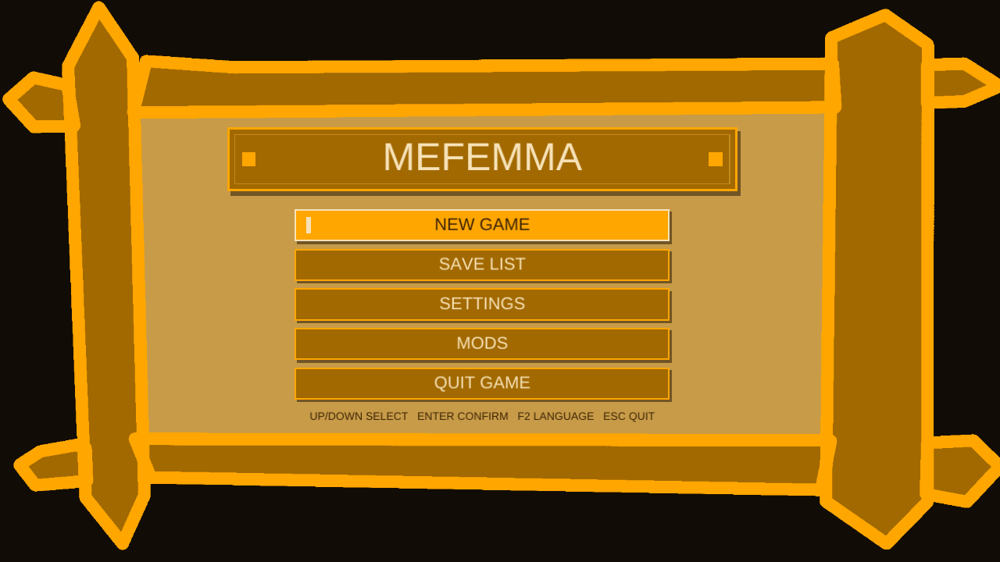
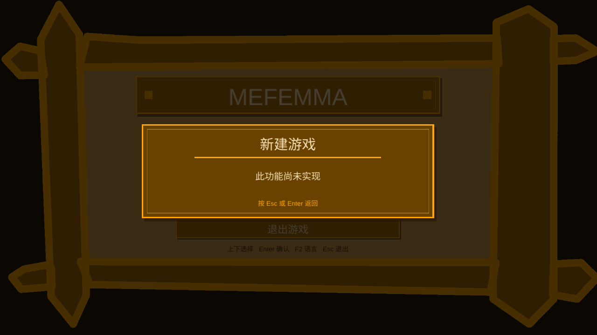
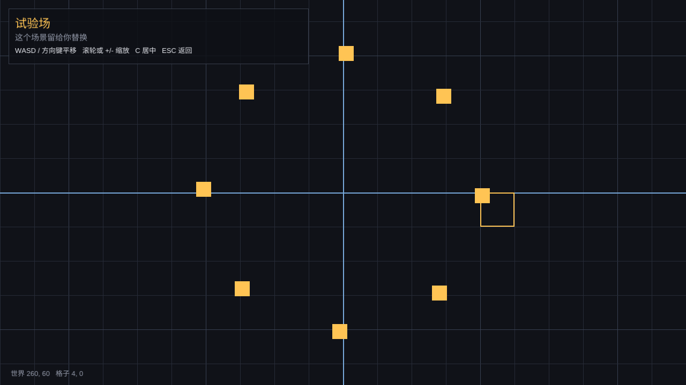

# Mefemma - a game project on Tile2D

Mefemma is the **second game project** in this repository. It is not a copy of the mine game and it shares
none of its screens, its content model or its world: it is a separate shell on the same engine, with the
pieces a game needs and nothing that a game's designer has not asked for.

What ships today is the **framework**:

* a window and a frame loop (Ore's application), with a clock and a headless path;
* a **start screen** built from the designer's sign picture: the game's name, New Game, Save List,
  Settings, Mods and Quit, driven by the keyboard or the mouse. **Settings is real**: it opens an internal
  menu over the sign with a LANGUAGE row and a BACK row, and the chosen interface language (English,
  Simplified Chinese, Traditional Chinese) applies to the running game immediately and is saved in the save
  directory's `config.ecfg` for the next run;
* a **first-run save-location prompt**: when `redirect.ecfg` beside the executable is missing or invalid,
  the game asks for a save folder before any other scene starts, records the absolute path in that file, and
  puts the open-world store under `<save folder>/mefemma_openworld.t2dk`. `--save-path` is a one-run
  override that writes nothing; deleting `redirect.ecfg` asks again;
* **scenes** - the places a game is in - and a stack that pauses, resumes, overlays and replaces them
  without a scene ever seeing the window;
* an **open-world test scene** (`--scene openworld`, `--world-file <path>`, `--world-origin <x,y>`):
  two test tiles in two test chunks streamed around the camera, edited in the game, saved into one
  `t2d::ChunkStore` file and read back on the next run. It is a worked example of the engine's optional
  open world, not a world model the shell owns; `--world-origin` can put that content at an ultra-far
  absolute chunk and nothing about the frame changes, because the scene draws in relative space.

  

  
* a **DrawList**: a scene asks for rectangles, pictures and text, and never touches the GPU;
* a 2D renderer that turns that list into batches, preserving the order it was asked in;
* **assets**: pictures by name, interface strings by id, fonts per language, all found beside the
  executable (with the source tree as a build-tree fallback);
* **input** with the distinction between a key held and a key pressed this frame, pointer deltas that
  survive a frame boundary, the wheel and typed text;
* a **settings** file and a command line, plus the code-table launcher the repository's games ship behind.

It ships **no gameplay and no game content** on purpose: what a game is, what its screens are and what
art it has are the designer's to decide. The start screen is the screen the designer drew; **New Game, Save
List and Mods only say that they are not implemented yet**, Settings now changes the interface language and
saves it for the next run, and Quit is real. The first run additionally asks where saves should live and
writes that decision to `redirect.ecfg`; the language lives in `<save directory>/config.ecfg`, so it travels
with the saves and a packaged `assets/config/game.ecfg` stays the read-only shipped default. `--lang` still
wins over the saved choice. The playground is one example of a scene, not a design.

## Build and run

    cd tile2d
    cmake --preset mefemma-debug          # also: mefemma-release, mefemma-asan, mefemma-tsan
    cmake --build build/mefemma/debug -j
    # a fresh build tree has no redirect.ecfg next to the game: --save-path answers the first-run prompt
    # (and writes no redirect file). Point --redirect at a file to keep the answer across runs instead.
    ./build/mefemma/debug/games/mefemma/mefemma_game --save-path /tmp/mefemma-saves
    ./build/mefemma/debug/games/mefemma/mefemma_game --lang en --save-path /tmp/mefemma-saves
    ./build/mefemma/debug/games/mefemma/mefemma_game --scene playground --save-path /tmp/mefemma-saves
    ./build/mefemma/debug/games/mefemma/mefemma_game --scene openworld --save-path /tmp/mefemma-saves
    ./build/mefemma/debug/games/mefemma/mefemma_game --scene openworld --save-path /tmp/mefemma-saves \
        --world-file /tmp/world.t2dk
    # the same content near the absolute limit (about 1.1e12 cells out): same picture, same code path
    ./build/mefemma/debug/games/mefemma/mefemma_game --scene openworld --save-path /tmp/mefemma-saves \
        --world-origin 34359738364,-34359738364 --world-file /tmp/far.t2dk

    # the first-run prompt itself: a missing redirect file, answered with Enter
    ./build/mefemma/debug/games/mefemma/mefemma_game --redirect /tmp/mefemma/redirect.ecfg

The game has its own presets, separate from the mine game's (`mine-*`): building this one never builds the
first. `no-renderer` builds Tile2D without any game, because there is no window and no GPU in that
configuration.

    ctest --test-dir build/mefemma/debug -R 'test_draw_list|test_scene_stack|test_settings|test_input|test_data_paths|test_first_run|test_scenes|test_open_world_scene'

A scripted run needs no keyboard, a window or a display:

    ./build/mefemma/debug/games/mefemma/mefemma_game --headless --frames 4 --size 1280x720 \
        --scene playground --save-path /tmp/mefemma-saves --pointer 900,420 --screenshot out.png

    ./build/mefemma/debug/games/mefemma/mefemma_game --headless --frames 2 --size 1280x720 \
        --scene openworld --save-path /tmp/mefemma-saves --screenshot out.png

    ./build/mefemma/debug/games/mefemma/mefemma_game --headless --frames 2 --size 1280x720 \
        --scene openworld --world-origin 34359738364,-34359738364 --pointer 900,420 \
        --save-path /tmp/mefemma-saves --world-file /tmp/far.t2dk \
        --screenshot /tmp/mefemma_openworld_far.png

`--scene playground` skips the start screen; `--pointer x,y` puts the pointer somewhere, because a headless run
has no mouse (a real pointer takes over as soon as it moves). `--save-path` answers the save-location
question for this run; the headless commands above use it so a fresh tree never waits at the prompt.

## First run: where the saves live

The first time the game runs where no valid `redirect.ecfg` is beside the executable, it starts with a single
save-location prompt instead of the title screen. It asks for a save **directory** (the field starts at
`<redirect file's dir>/saves`), creates it, and records the absolute, lexically normal answer in
`redirect.ecfg` beside the executable:

    # Mefemma's redirect file: the save directory chosen on the first run.
    # Deleting it makes the next run ask again.
    save_path:"/home/player/.local/share/mefemma/saves"

A relative answer is resolved against the redirect file's own directory, `~` expands from HOME, and an
answer that cannot be turned into a directory shows a localized error and leaves the prompt up. Escape
quits without writing anything (the next run asks again). The open-world example scene then keeps its store
at `<save directory>/mefemma_openworld.t2dk`; an explicit `--world-file` still wins.

Two command-line flags make scripted runs deterministic:

    --redirect <path>    use (and create on confirmation) this redirect.ecfg instead of the default
    --save-path <dir>    answer the question for this run only; no redirect.ecfg is written

## Saved settings: the language in the save directory

The Settings menu's LANGUAGE row (and F2) does two things: it switches the running game at once, and it
writes the choice to `<save directory>/config.ecfg`:

    # Mefemma's settings for this save directory. Written by the Settings menu.
    language:"en"

The next run with the same save directory starts in that language. The precedence is

    --lang  >  <save directory>/config.ecfg  >  assets/config/game.ecfg

so a scripted `--lang` always wins and never rewrites the file, and a run without a save-directory file
keeps the shipped settings default. A missing `config.ecfg` is silent; an invalid one (wrong type, unknown
language, parse error) is logged and ignored, and the game falls back to the shipped default. Delete the
file to get that fallback intentionally; the Settings menu replaces it on the next language change. A failed
write is logged and the live language is kept for the rest of the run.

`redirect.ecfg` stays beside the executable (it is how the game finds the save directory); `config.ecfg`
belongs to the save directory and travels with the saves. The first-run prompt applies a `config.ecfg` found
in the directory the player chose, so pointing at an existing save directory immediately picks up its
language.

## The pieces

| Module | What it does | Tested by |
|---|---|---|
| `mefemma_core` | settings, input, the draw list, the scene stack, the save-path field, `redirect.ecfg` and the save directory's `config.ecfg`, where the files are | `test_settings`, `test_input`, `test_draw_list`, `test_scene_stack`, `test_data_paths`, `test_first_run` |
| `mefemma_app` | assets, the 2D renderer, the application shell | `test_scenes` for the scenes; the rest is compiled and run through the launcher and needs a GPU |
| `src/scenes` | `SavePathScene`: the first-run save-location prompt; `TitleScene`: the start screen on `assets/textures/start_screen.png` and its internal settings menu (language, back); `PlaygroundScene`: a camera example; `OpenWorldScene`: two test tiles in two streamed chunks with a `ChunkStore` | `test_scenes`, `test_open_world_scene`, and the headless screenshots above |

`mefemma_core` has no graphics dependency at all: it links `t2d::core` and `t2d::text` and nothing else, so
a test drives a scene with a fake `GameServices` and no window.

## Layout

    include/mefemma/
        app.h            the shell: window, clock, scene stack, the services a scene asks for
        scene.h          Scene, GameServices, SceneStack
        draw_list.h      rectangles, pictures and text, in submission order
        renderer2d.h     a DrawList in, batches out
        assets.h         fonts, strings, pictures
        input.h          keys, mouse, wheel, typed text
        settings.h       the settings file and the fields the shell reads
        data_paths.h     where the files that travel with the game are
        redirect.h       the first-run save directory and redirect.ecfg
        path_input.h     the UTF-8 field model the first-run prompt types into
        scenes/          the four scenes
    src/                 the same, plus game_main.cpp (the game's entry) and main.cpp (the launcher)
    assets/              settings, strings, pictures: what the game reads at run time
    docs/                this project's framework guide
    tests/               the core's unit tests

## What is deliberately absent

Mefemma has no world model, no entities, no tile layers, no content packs, no save format, no audio and no
networking. Those are not omissions to be filled in by the framework: they are **design decisions a game
makes**, and the framework's job is to leave the room for them. `docs/FRAMEWORK.md` names the place each
one would attach, with the extension points and the reasons.

One engine facility is aimed at this shell without being part of it: `t2d::OpenWorld`
(`docs/OPEN_WORLD.md`) is an optional streamed tile world in **relative coordinates** around a movable
origin, with absolute chunk keys for generation and saving. Its edits can be persisted through the
engine's optional `t2d::ChunkStore`, a single-file store keyed by the same absolute chunks; it reports a
damaged chunk to the game and the game decides whether to drop, regenerate or abort. The shell still has
no world model of its own, but the `openworld` example scene opts into both so the facility has a
working, testable use: two test tiles, two test chunks, streaming, editing, saving and reloading.

## Where a game starts

1. Read [docs/FRAMEWORK.md](docs/FRAMEWORK.md) - the frame, the scenes, the draw list, the services.
2. `TitleScene::activate()` is where New Game, Save List and Mods go. Today each opens a note that says
   it is not implemented; replace that with the scene the row deserves. Settings already opens the internal
   settings menu - `TitleScene::settings_open()`/`settings_item_rect()` are its testable surface, and
   `GameServices::set_language()` is what a row calls to switch the string table and fonts.
3. Put your own modules next to the scenes, add them to `CMakeLists.txt` (`mefemma_core` if they need no
   GPU, `mefemma_app` if they do) and write a test in `tests/`.
4. Put the game's own fields in `assets/config/game.ecfg` and read them with `Settings::find`; put its
   strings in `assets/text/ui.ecfg` and its pictures in `assets/textures/`.

## License

The game code is under the **Reciprocal MIT** license (MIT plus a share-alike condition); its assets are
**CC BY-SA 4.0**. See [LICENSE](LICENSE), [LICENSE-ASSETS](LICENSE-ASSETS), and the repository-wide
[LICENSING.md](../../../LICENSING.md).

## Verification

Run in this checkout, on this machine (Intel Arc via Mesa when a display is available; the screenshots above
were rendered through SwiftShader's Vulkan ICD because the session has no display-attached device):

| Check | Result |
|---|---|
| `mefemma-debug` preset | 24/24 tests green (the 8 mefemma suites among them) |
| `mefemma-release` preset | 24/24 tests green |
| `test_scenes` | 22 cases / 177 checks: the first-run prompt (prefill, editing, confirm, empty/file failures, Escape, drawing and caret windows), the five title rows, the internal settings menu, placeholders, playground |
| `test_first_run` | 13 cases / 150 checks: redirect.ecfg and config.ecfg round trips and failure modes, defaults, path normalisation, directory creation, the UTF-8 path field |
| `mefemma-asan` / `mefemma-tsan` | 24/24 tests green in each (run for this change) |
| `codetab api --surface engine.api mefemma.codetab` | `accept (0 symbol(s) outside the surface)` |
| `--scene openworld` headless run | screenshot written, two test tile patterns and the HUD visible; `test_open_world_scene` 10 cases / 130 checks |
| `--scene openworld --world-origin 34359738364,-34359738364` headless run | identical picture, HUD origin line shows that far chunk; screenshot `docs/images/openworld_far_zh_hans.png` |
| malformed `--world-origin` | exit 1 with "wants chunk coordinates like ..." / "wants two whole absolute chunks inside ..." |
| first-run prompt over `--input-server` (`--redirect` at a missing path) | default shown; ENTER created `<dir>/saves` and `redirect.ecfg` with `save_path:"<dir>/saves"`, then the title started; second run read the file and did not prompt; screenshot `docs/images/first_run_zh_hans.png` |
| settings language persistence over `--input-server` | zh-Hans start, LANGUAGE changed to English wrote `config.ecfg` with `language:"en"`; restart started English from it; `--lang zh-Hans` won without rewriting; a corrupt config warned and fell back; deleting it fell back silently; F2 also wrote `zh-Hant`; an existing `config.ecfg` in a first-run directory applied after ENTER |
| open-world store under the save directory | `--save-path <dir> --scene openworld` used `<dir>/mefemma_openworld.t2dk`; no redirect.ecfg and no config.ecfg were written by that run, and `assets/config/game.ecfg` was unchanged |
| `--save-path` with a missing redirect | no prompt and no redirect.ecfg written; `--scene openworld` used `<save-path>/mefemma_openworld.t2dk` (explicit `--world-file` still wins) |
| headless start screen, English, playground and openworld runs | screenshots written, no error |
| `mefemma.codetab` loaded by the launcher | `1 module(s), 0 error(s)` |
| start screen over `--input-server` | Enter on New Game opened the not-implemented note, Escape closed it; a mouse click opened the Settings menu; a mouse click on Quit ended the run |
| settings menu over `--input-server` | DOWN, DOWN, ENTER opened the internal menu; LANGUAGE showed `< 简体中文 >`; RIGHT switched the whole screen to `< 繁體中文 >` live; screenshot `docs/images/settings_zh_hans.png` |
| `build/mefemma/release/mefemma-0.1.0-Release.zip` | runs from an empty directory, finds its assets, 1 module, 0 errors |
| playground over `--scene playground` | the camera example draws and answers the keyboard |
