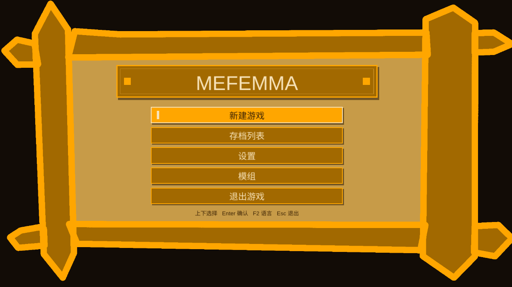
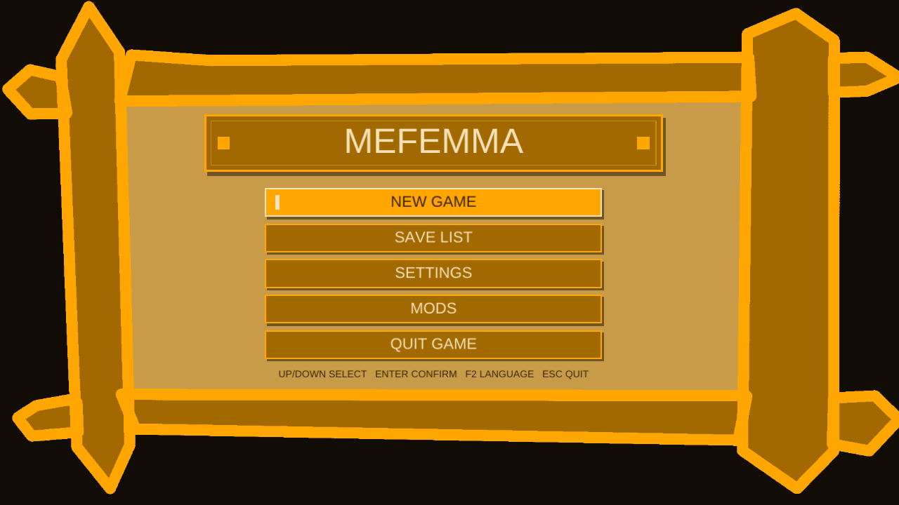
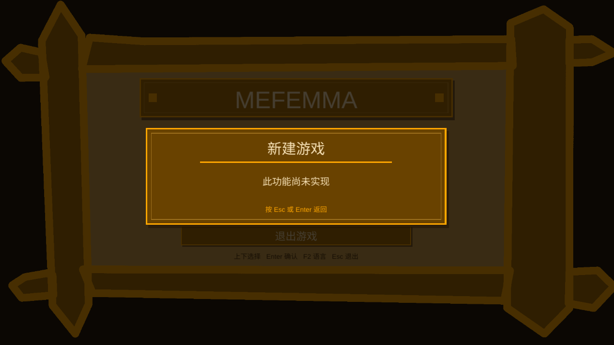
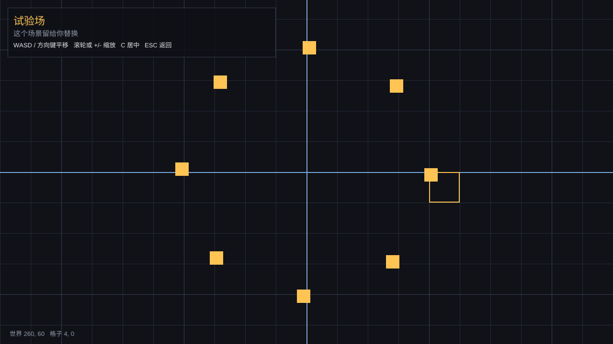

# Mefemma - a game project on Tile2D

Mefemma is the **second game project** in this repository. It is not a copy of the mine game and it shares
none of its screens, its content model or its world: it is a separate shell on the same engine, with the
pieces a game needs and nothing that a game's designer has not asked for.

What ships today is the **framework**:

* a window and a frame loop (Ore's application), with a clock and a headless path;
* a **start screen** built from the designer's sign picture: the game's name, New Game, Save List,
  Settings, Mods and Quit, driven by the keyboard or the mouse;
* **scenes** - the places a game is in - and a stack that pauses, resumes, overlays and replaces them
  without a scene ever seeing the window;
* a **DrawList**: a scene asks for rectangles, pictures and text, and never touches the GPU;
* a 2D renderer that turns that list into batches, preserving the order it was asked in;
* **assets**: pictures by name, interface strings by id, fonts per language, all found beside the
  executable (with the source tree as a build-tree fallback);
* **input** with the distinction between a key held and a key pressed this frame, pointer deltas that
  survive a frame boundary, the wheel and typed text;
* a **settings** file and a command line, plus the code-table launcher the repository's games ship behind.

It ships **no gameplay and no game content** on purpose: what a game is, what its screens are and what
art it has are the designer's to decide. The start screen is the screen the designer drew; **New Game, Save
List, Settings and Mods only say that they are not implemented yet**, and Quit is real. The playground is
one example of a scene, not a design.

## Build and run

    cd tile2d
    cmake --preset mefemma-debug          # also: mefemma-release, mefemma-asan, mefemma-tsan
    cmake --build build/mefemma/debug -j
    ./build/mefemma/debug/games/mefemma/mefemma_game                     # start screen (zh-Hans by default)
    ./build/mefemma/debug/games/mefemma/mefemma_game --lang en            # the English table
    ./build/mefemma/debug/games/mefemma/mefemma_game --scene playground   # the camera example

The game has its own presets, separate from the mine game's (`mine-*`): building this one never builds the
first. `no-renderer` builds Tile2D without any game, because there is no window and no GPU in that
configuration.

    ctest --test-dir build/mefemma/debug -R 'test_draw_list|test_scene_stack|test_settings|test_input|test_data_paths|test_scenes'

A scripted run needs no keyboard, a window or a display:

    ./build/mefemma/debug/games/mefemma/mefemma_game --headless --frames 4 --size 1280x720 \
        --scene playground --pointer 900,420 --screenshot out.png

`--scene playground` skips the start screen; `--pointer x,y` puts the pointer somewhere, because a headless run
has no mouse (a real pointer takes over as soon as it moves).

## The pieces

| Module | What it does | Tested by |
|---|---|---|
| `mefemma_core` | settings, input, the draw list, the scene stack, where the files are | `test_settings`, `test_input`, `test_draw_list`, `test_scene_stack`, `test_data_paths` |
| `mefemma_app` | assets, the 2D renderer, the application shell | `test_scenes` for the scenes; the rest is compiled and run through the launcher and needs a GPU |
| `src/scenes` | `TitleScene`: the start screen on `assets/textures/start_screen.png`; `PlaygroundScene`: a camera example | `test_scenes`, and the headless screenshots above |

`mefemma_core` has no graphics dependency at all: it links `t2d::core` and `t2d::text` and nothing else, so
a test drives a scene with a fake `GameServices` and no window.

## Layout

    include/mefemma/
        app.h            the shell: window, clock, scene stack, the services a scene asks for
        scene.h          Scene, GameServices, SceneStack
        draw_list.h      rectangles, pictures and text, in submission order
        renderer2d.h     a DrawList in, batches out
        assets.h         fonts, strings, pictures
        input.h          keys, mouse, wheel, typed text
        settings.h       the settings file and the fields the shell reads
        data_paths.h     where the files that travel with the game are
        scenes/          the two example scenes
    src/                 the same, plus game_main.cpp (the game's entry) and main.cpp (the launcher)
    assets/              settings, strings, pictures: what the game reads at run time
    docs/                this project's framework guide
    tests/               the core's unit tests

## What is deliberately absent

Mefemma has no world model, no entities, no tile layers, no content packs, no save format, no audio and no
networking. Those are not omissions to be filled in by the framework: they are **design decisions a game
makes**, and the framework's job is to leave the room for them. `docs/FRAMEWORK.md` names the place each
one would attach, with the extension points and the reasons.

## Where a game starts

1. Read [docs/FRAMEWORK.md](docs/FRAMEWORK.md) - the frame, the scenes, the draw list, the services.
2. `TitleScene::activate()` is where New Game, Save List, Settings and Mods go. Today each opens a note
   that says it is not implemented; replace that with the scene the row deserves.
3. Put your own modules next to the scenes, add them to `CMakeLists.txt` (`mefemma_core` if they need no
   GPU, `mefemma_app` if they do) and write a test in `tests/`.
4. Put the game's own fields in `assets/config/game.ecfg` and read them with `Settings::find`; put its
   strings in `assets/text/ui.ecfg` and its pictures in `assets/textures/`.

## License

The game code is under the **Reciprocal MIT** license (MIT plus a share-alike condition); its assets are
**CC BY-SA 4.0**. See [LICENSE](LICENSE), [LICENSE-ASSETS](LICENSE-ASSETS), and the repository-wide
[LICENSING.md](../../../LICENSING.md).

## Verification

Run in this checkout, on this machine (Intel Arc via Mesa when a display is available; the screenshots above
were rendered through SwiftShader's Vulkan ICD because the session has no display-attached device):

| Check | Result |
|---|---|
| `mefemma-debug` preset | 20/20 tests green (the 6 mefemma suites among them) |
| `mefemma-release` / `mefemma-asan` / `mefemma-tsan` | 20/20 tests green in each |
| `codetab api --surface engine.api mefemma.codetab` | `accept (0 symbol(s) outside the surface)` |
| headless start screen, English and playground runs | screenshots written, no error |
| `mefemma.codetab` loaded by the launcher | `1 module(s), 0 error(s)` |
| start screen over `--input-server` | Enter opened the not-implemented note, Escape closed it; a mouse click opened Settings; a mouse click on Quit ended the run |
| `build/mefemma/release/mefemma-0.1.0-Release.zip` | runs from an empty directory, finds its assets, 1 module, 0 errors |
| playground over `--scene playground` | the camera example draws and answers the keyboard |
